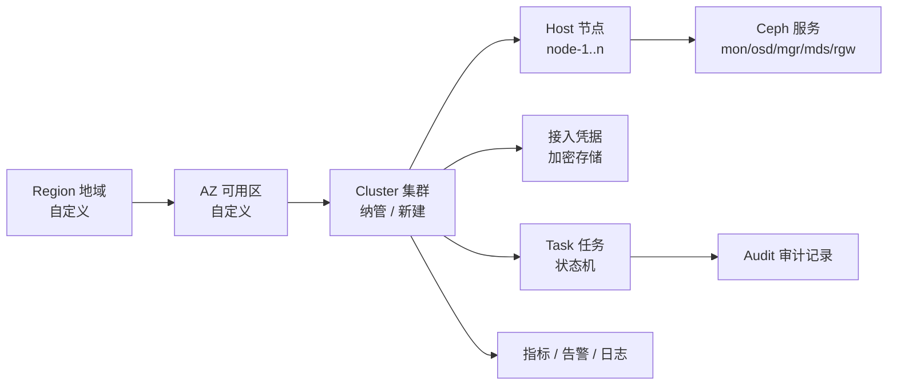
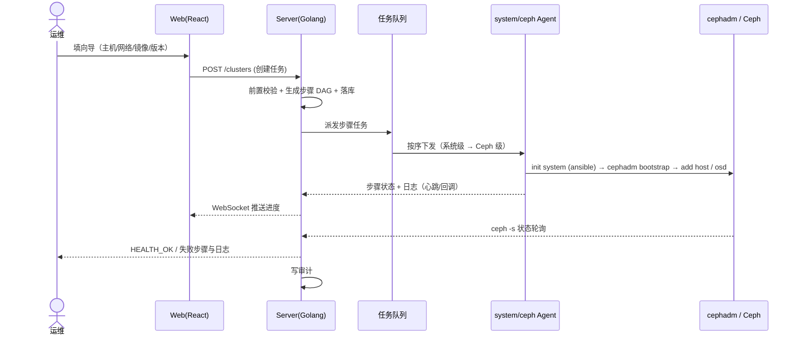
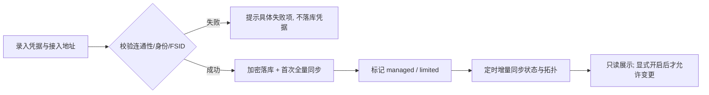

# Ceph 管理平台 PRD（v0.1 草案）

| 项目 | 内容 |
| --- | --- |
| 文档归属 | 产品经理（PM / Product Manager） |
| 状态 | **草案 · 待评审**，含待决策项，不作为开发承诺 |
| 版本 / 日期 | v0.1 / 2026-11-07 |
| 需求来源 | 初版设想图（React + Golang + PostgreSQL + cephadm + 双 Agent + VictoriaMetrics） |
| 关联文档 | [架构设计](../../02-研发/06-架构师/架构设计-Ceph管理平台.md) · [架构决策与权衡分析](../../02-研发/06-架构师/架构决策与权衡分析.md) · [项目计划与路线图](../../05-项目与流程/01-项目经理/项目计划与路线图.md) · [信息架构与页面清单](../02-UI-UX设计师/信息架构与页面清单.md) |
| 文档规范依据 | [《软件行业的岗位》](https://lnsyyj.github.io/posts/software-industry-roles/)：PRD 必须写明「解决什么问题、长什么样、哪些情况不做」 |

> 本 PRD 基于一张尚未定型的设想图撰写。**凡标注「待决策」的条目，是需要产品、架构、运维共同拍板的开放问题**，不隐藏、不替用户假定答案。

---

## 1. 背景与问题

### 1.1 现状

Ceph 集群的生命周期操作（主机初始化、bootstrap、OSD 创建、Pool 变更、扩容、故障处置）目前主要依赖命令行：

- `ansible` 做 Linux 系统初始化（内核参数、时间同步、防火墙、依赖包）；
- `cephadm` 以容器方式（podman）拉起并编排 Ceph 服务；
- 日常运维靠 SSH 到节点手工敲 `ceph -s`、`ceph osd tree` 等命令。

这套方式在**单集群、少数几名熟练运维**时可行，一旦集群数量、机房地域、操作人员增加就会失控。

### 1.2 要解决的三个问题

| # | 问题 | 现状痛点 | 产品化后的目标 |
| --- | --- | --- | --- |
| P1 | **后台操作可视化** | 状态、拓扑、容量、任务进度只能靠命令和记忆；新人上手门槛高 | Web 控制台呈现集群健康、拓扑、容量、任务与日志 |
| P2 | **方便运维部署** | 初始化 + 建集群步骤多、易漏、环境差异大；离线/内网环境尤其痛苦 | 向导式建集群 + 步骤可复制粘贴级落地手册 |
| P3 | **多集群与责任边界** | 多套集群靠人肉记录；谁在什么时间对哪套集群做了什么，无从追溯 | Region/AZ/Cluster 分层 + RBAC + 全量操作审计 |

### 1.3 产品定位（一句话）

> 面向运维团队的 **Ceph 集群控制面**：在一个 Web 控制台里，纳管已有集群、向导式新建集群、可视化日常运维，并把「谁做了什么」完整留痕；**不接管 Ceph 数据面，不替代 Ceph 自身的存储能力**。

---

## 2. 目标与非目标

### 2.1 业务目标（可度量，V1 验收口径）

| 目标 | 指标 |
| --- | --- |
| 降低建集群门槛 | 3 节点新集群从「主机纳管」到 `HEALTH_OK` ≤ 30 分钟，人工操作步骤 ≤ 5 步 |
| 降低运维门槛 | 常用运维动作（查看状态/扩容 OSD/建 Pool/查看告警）100% 可在 Web 完成，无需 SSH |
| 多集群管理 | 单管理面支持 ≥ 20 套集群、≥ 500 节点，跨自定义 Region / AZ 分组 |
| 可追溯 | 所有变更类操作 100% 留痕，审计记录可导出，保留 ≥ 180 天 |
| 部署可落地 | 管理面在离线环境按手册「复制粘贴命令」即可完成部署，无编译、无外网依赖 |

### 2.2 明确不做（Non-Goals）

按 PRD 规范，以下情况**本期明确不做**，避免范围蔓延：

1. **不改 Ceph 本身**：不 fork/modify Ceph 代码，不替换 CRUSH、PG、数据均衡逻辑。
2. **不替代 Ceph Dashboard**：Ceph 自带 Dashboard 保留作为兜底与深度排障入口；本平台做「多集群 + 流程 + 权限 + 审计」这一层。
3. **不做数据面代理**：客户端 IO（RBD/RGW/CephFS）不经过本平台，平台宕机不影响业务读写。
4. **不做计费、配额商业化、工单流程**（V2 以后再评估）。
5. **不支持非 cephadm 部署的存量集群完整托管**：非 cephadm（纯手工、Rook/K8s、老版 ceph-deploy）集群仅支持**只读纳管**，写入类操作后续按版本评估（见 §11 风险 R3）。
6. **不提供任意命令执行能力**：平台只下发白名单内的参数化任务，不提供自由 shell 输入框。
7. 不支持 Windows 作为 Ceph 节点操作系统；操作系统基线为 CentOS Stream 9。

---

## 3. 用户与场景

### 3.1 角色

| 角色 | 说明 | 典型权限 |
| --- | --- | --- |
| 平台管理员 `platform_admin` | 平台自身运维 | 用户/角色管理、系统配置、全部集群、审计查询 |
| 集群运维 `cluster_operator` | 负责特定集群 | 被授权集群内的变更操作、任务执行、告警处理 |
| 只读观察员 `viewer` | 值班、开发、业务方 | 仪表盘、拓扑、指标、日志（脱敏）只读 |
| 审计员 `auditor` | 合规/安全 | 全量审计检索与导出，无变更权限 |

权限作用域为 **Region / AZ / Cluster 三级**，支持「某用户只能操作 region-a 下的 2 套集群」。

### 3.2 核心用户故事

- **US-1 纳管已有集群**：作为运维，我手上已有 3 套跑着的 cephadm 集群，我希望填入接入凭据后平台自动同步拓扑与健康状态，而不是重新部署一遍。
- **US-2 新建集群**：作为运维，我希望在向导里勾选 3 台主机、填好网络与镜像仓库参数，点「开始」后能看到每一步进度与日志，失败能定位到具体步骤并重试。
- **US-3 日常巡检与处置**：作为值班人员，我早上打开一个页面就能看到所有集群的健康度、容量水位、告警，并对某个 OSD 异常发起预定义的处置任务。
- **US-4 事后追责**：作为审计员，我要能回答「上周三下午谁对 prod-cluster 执行了什么命令、参数是什么、结果如何」。

---

## 4. 概念模型

| 概念 | 定义 | 关键字段 |
| --- | --- | --- |
| Region | 自定义逻辑地域，如 `cn-north` | id、name、描述 |
| AZ | Region 下的可用区，如 `az1` | id、region_id、name |
| Cluster | 一个 Ceph 集群（FSID 唯一） | fsid、name、az_id、部署方式、Ceph 版本、状态 |
| Host | 被管节点 | hostname、管理 IP、角色标签、agent 状态、OS 版本 |
| Task | 一次异步变更单元 | id、类型、参数、目标、状态、步骤日志、发起人、耗时 |
| Credential | 集群接入凭据 / SSH 凭据 | 类型、密文、有效期、轮换记录 |
| Audit | 不可篡改的操作留痕 | 操作人、时间、对象、动作、参数、来源 IP、结果 |

**约束**：`Cluster.fsid` 全局唯一，纳管时做重复校验；一个 Cluster 只能归属一个 AZ。

---

## 5. 功能需求

优先级：**P0 = MVP 必须有**，P1 = V1，P2 = V2/可选。

| 编号 | 功能 | 优先级 | 一句话 |
| --- | --- | --- | --- |
| FR-01 | 纳管已有集群 | P0 | 导入已有 cephadm 集群，只读同步状态 |
| FR-02 | 新建集群向导 | P0 | 主机初始化 → cephadm bootstrap → 服务编排 |
| FR-03 | 多集群与 Region/AZ 分层 | P0 | 自定义三级分组与切换 |
| FR-04 | 集群可视化 | P0 | 健康、拓扑、容量、OSD/Pool/MON/RGW |
| FR-05 | 任务下发与执行 | P0 | 白名单参数化任务、进度、重试、取消 |
| FR-06 | 用户与 RBAC | P0 | 用户、角色、三级作用域授权 |
| FR-07 | 操作审计 | P0 | 登录与变更全留痕、可检索导出 |
| FR-08 | 监控与告警 | P1 | VictoriaMetrics + Grafana 面板 + Prometheus 告警生态 |
| FR-09 | 日志 | P1 | 任务日志、Agent 日志、平台操作日志 |
| FR-10 | 镜像仓库与离线制品 | P1 | 镜像/包管理、离线导入、复制粘贴级部署 |
| FR-11 | 主机初始化 | P0 | ansible 前置检查与初始化 |
| FR-12 | 升级与配置管理 | P2 | Ceph 版本升级、spec 配置对比与回滚 |

### FR-01 纳管已有集群（P0）

**描述**：录入集群名称、Region/AZ、`ceph-mgr` 接入地址与管理员凭据（或 `ceph.conf` + keyring），平台校验连通性后同步元数据与状态。

**验收标准**

1. 凭据加密落库，任何页面/接口/日志都**不回显明文**；
2. 连通性校验包含：可达性、身份有效性、FSID 唯一性、Ceph 版本识别；
3. 纳管成功后 ≤ 60s 展示健康状态、MON/OSD 数量、容量、版本；
4. 纳管默认**只读**：只有显式开启「允许变更」的集群才可下发任务；
5. 非 cephadm 部署集群允许纳管，但标记为 `limited`，写入类任务置灰并说明原因。

**边界**：凭据失效时集群标记 `unreachable`，保留历史数据，不删除、不自动重连风暴。

### FR-02 新建集群向导（P0）

**描述**：按步骤引导 —— ① 基本信息与网络规划 → ② 添加/发现主机并做前置检查 → ③ 选择镜像仓库与 Ceph 版本 → ④ 系统初始化（ansible）→ ⑤ `cephadm bootstrap` → ⑥ 添加主机、部署 OSD 与服务 → ⑦ 验收（`HEALTH_OK`）。

**验收标准**

1. 前置检查项至少覆盖：OS 版本（CentOS Stream 9）、时间同步、主机名解析、SSH 免密、磁盘可用、podman 可用、镜像仓库可达、防火墙/SELinux 策略、内存/CPU 下限；
2. 任一步失败：任务进入 `FAILED`，展示失败步骤、原始日志、可「从失败步骤重试」，**不静默跳过**；
3. 每一步幂等：重复执行不产生第二个集群、不重复添加 OSD；
4. 全过程有进度百分比与实时日志流；
5. 向导生成的等价命令可一键复制（对应「细到复制粘贴就能部署上」的诉求）。

### FR-03 多集群与 Region / AZ 分层（P0）

可自定义 Region、AZ、Cluster；支持批量切换、全局搜索、按标签筛选；顶部全局视图汇总所有集群健康度与告警数。

### FR-04 集群可视化（P0）

| 视图 | 内容 |
| --- | --- |
| 总览 | 健康状态、容量水位、IOPS/吞吐、PG 状态、告警数、最近任务 |
| 拓扑 | Host → 服务（mon/osd/mgr/mds/rgw）→ OSD → 磁盘，异常节点高亮 |
| 资源 | Pool 列表与配额、OSD 列表与权重、CRUSH 概览（只读） |
| 任务中心 | 进行中/历史任务、步骤日志、重试/取消 |

Ceph 原生 Dashboard 以链接方式嵌入/跳转，作为深度排障兜底。

### FR-05 任务下发与执行（P0）

**描述**：平台把运维动作抽象为**参数化任务模板**（如「新增 OSD」「创建 Pool」「调整 Pool 副本数」「服务重启」），由两类 Agent 执行：

| Agent | 职责 | 示例 |
| --- | --- | --- |
| `server-system-agent` | 系统级命令 | 磁盘准备、`podman` 检查、系统参数、时间同步 |
| `server-ceph-agent` | Ceph 级命令 | `ceph orch ...`、`ceph osd ...`、`ceph -s` |

**验收标准**

1. 只执行**白名单模板 + 校验过的参数**，拒绝任意字符串命令；参数做类型/枚举/范围校验与 shell 转义；
2. 任务状态机：`PENDING → RUNNING → (SUCCEEDED | FAILED | CANCELED | TIMEOUT)`，状态持久化到数据库；
3. 支持超时、取消、并发互斥（同一集群同一资源的变更任务加分布式锁）；
4. Agent 离线时任务排队，恢复后按策略执行，不丢任务；
5. 任务执行前后自动采集一次集群状态快照，写入审计。

### FR-06 用户与 RBAC（P0）

用户/角色/权限项管理；支持三级作用域授权；密码策略、登录失败锁定、会话超时；`待决策`：是否对接企业 LDAP/OIDC（见 §11）。

### FR-07 操作审计（P0）

记录登录/登出、所有查询之外的写操作（含任务参数、目标集群、来源 IP、User-Agent、结果码、耗时）；审计记录**只追加不修改**，支持按人/时间/集群/动作检索与 CSV 导出；审计日志与管理库分离存储。

### FR-08 监控与告警（P1）

- 指标：VictoriaMetrics（暂定）承接 Ceph mgr prometheus 模块 / node-exporter / ceph-exporter 数据；
- 展示：前台集成 Grafana 面板（集群总览、OSD、Pool、主机）；
- 告警：接入 Prometheus 生态（vmalert / Alertmanager），告警规则模板化，通知渠道支持 Webhook/邮件；告警与集群、Region 关联；
- `待决策`：Grafana 面板的鉴权与多租户隔离方式（见 §11）。

### FR-09 日志（P1）

任务步骤日志、Agent 运行日志、平台访问日志统一检索；`待决策`：日志系统选型（Loki / VictoriaLogs / ELK）。

### FR-10 镜像仓库与离线制品（P1）

管理 Ceph 容器镜像、Agent 二进制、ansible playbook 的版本；内网/离线环境支持一次导入、多集群复用；输出「复制粘贴即可部署」的命令清单。

### FR-11 主机初始化（P0）

以 ansible playbook 完成 OS 基线检查与初始化，playbook 版本受控、执行结果可回看；不修改业务数据盘以外的数据。

### FR-12 升级与配置管理（P2）

Ceph 小版本升级、cephadm spec 配置的版本对比、差异展示与回滚入口。

---

## 6. 关键流程

### 6.1 新建集群

### 6.2 纳管已有集群

### 6.3 任务下发

---

## 7. 非功能需求

| 类别 | 要求 |
| --- | --- |
| 安全 | 凭据静态加密（KMS/Vault 或至少 AES-GCM + 密钥外置）；全链路 TLS；Agent ↔ Server mTLS；命令白名单；审计防篡改；最小权限运行 Agent |
| 可靠性 | 管理面故障**不影响数据面 IO**；Server/DB/队列支持主备；任务可恢复；Agent 断连重连；状态同步具备对账机制（平台状态 vs Ceph 实际状态） |
| 性能 | 20 集群 / 500 节点规模下，总览页 P95 < 3s；状态同步周期可配（默认 30s）；任务并发可配 |
| 兼容性 | OS 基线 CentOS Stream 9；podman；Ceph 版本需在兼容矩阵中声明；支持离线/内网（无公网）部署 |
| 可观测性 | 平台自身指标、健康检查端点、任务成功率/耗时、Agent 在线率 |
| 可维护性 | 组件容器化；配置外置；数据库变更有 migration；升级可回滚 |
| 合规 | 审计留存 ≥ 180 天；日志脱敏（不落明文凭据、不落 keyring） |

---

## 8. 数据与报表

- 全局视图：集群健康分布、容量趋势、告警 Top、任务成功率；
- 集群视图：容量水位与预测、OSD 上下线历史、Pool 用量、任务耗时；
- 审计视图：按人 / 按集群 / 按动作的操作统计与明细导出。

指标数据存 VictoriaMetrics，业务数据存 PostgreSQL，**两者不做强一致**，页面需标注数据时间。

---

## 9. 验收标准与发布门槛

MVP 必须同时满足：

1. FR-01～FR-07、FR-11 全部可用，P0 用例通过率 100%（见 [测试策略与验收用例](../../03-测试与质量/01-测试工程师/测试策略与验收用例.md)）；
2. 3 节点新建集群端到端演练成功 3 次，其中 1 次为**断网/失败后从失败步骤重试**；
3. 纳管 1 套已有集群，只读同步稳定 24h 无人工干预；
4. 安全测试：命令注入用例 0 通过、凭据明文泄露 0 处（见 [安全与审计设计](../../02-研发/08-安全工程师/安全与审计设计.md)）；
5. 离线环境按 [安装部署手册](../../06-交付与实施/01-交付实施工程师/安装部署手册.md) 由**未参与开发的人员**独立完成一次部署；
6. 平台全部组件停止 10 分钟后，Ceph 集群 IO 与 `HEALTH_OK` 不受影响。

---

## 10. 里程碑

| 阶段 | 范围 | 出口 |
| --- | --- | --- |
| **M0 选型验证** | 定消息队列 / 数据库 / 镜像仓库 / 日志；验证 cephadm 在离线环境可跑通 | 4 项选型 ADR + 一次 3 节点集群手工成功 |
| **MVP** | FR-01～07、FR-11；单 Region；单机管理面 | §9 验收门槛 |
| **V1** | FR-08～10；告警闭环；离线制品；管理面 HA | 生产试运行 |
| **V2** | FR-12；多 Region 联邦、配额、LDAP/OIDC | 规模化 |

详见 [项目计划与路线图](../../05-项目与流程/01-项目经理/项目计划与路线图.md)。

---

## 11. 依赖、风险与待决策项

### 11.1 待决策项（对应设想图 TODO，需拍板）

| ID | 待决策 | 备选 | 影响 | 建议责任方 |
| --- | --- | --- | --- | --- |
| D1 | 消息队列 | RabbitMQ / NATS JetStream / Kafka / Redis Stream | 任务可靠性、部署复杂度 | 架构师 + SRE |
| D2 | 数据库 | PostgreSQL（图中已定）/ 是否引入 TimescaleDB | 指标与业务库边界 | 架构师 + DBA |
| D3 | 镜像仓库 | Harbor / registry:2 / 客户现有仓库 | 离线导入方式 | SRE + 交付 |
| D4 | 日志系统 | Loki / VictoriaLogs / ELK | 资源占用与检索能力 | SRE |
| D5 | 监控栈 | VictoriaMetrics + vmalert + Grafana + Alertmanager | 与 Prometheus 生态兼容边界 | SRE |
| D6 | 「复制粘贴就能部署」的形态 | 单条 shell 脚本 / docker-compose / podman pod / ansible playbook | 直接决定交付形态 | 交付 + SRE |
| D7 | 认证源 | 本地账号 / LDAP / OIDC | 企业客户接入成本 | 产品 + 安全 |
| D8 | 纳管范围 | 仅 cephadm / 兼容 Rook、手工部署 | 产品承诺边界 | 产品 + 架构 |

### 11.2 主要风险

| ID | 风险 | 影响 | 缓解 |
| --- | --- | --- | --- |
| R1 | Agent 具备系统级/Ceph 级执行权限，一旦管理面被攻破等于集群被接管 | 极高 | mTLS + 白名单 + 最小权限 + 审计 + 网络隔离，见安全设计 |
| R2 | 平台状态与 Ceph 真实状态漂移（控制台显示 OK，实际已降级） | 高 | 定时对账 + 页面标注采集时间 + 保留 Ceph Dashboard 兜底 |
| R3 | 「纳管已有集群」承诺过大：非 cephadm / 不同版本集群难以托管 | 高 | 明确 `limited` 只读分级，写入能力按版本矩阵开放 |
| R4 | 管理面组件多（DB/队列/监控/日志/仓库），与「方便部署」目标相矛盾 | 高 | M0 阶段就锁定最小部署单元，提供一体包 |
| R5 | cephadm / Ceph / OS 版本升级带来不兼容 | 中 | 兼容矩阵 + 每次升级前回归 |
| R6 | Grafana 嵌入带来的越权查看（绕过平台 RBAC） | 中 | 反向代理 + 统一鉴权，禁止直连 Grafana |
| R7 | 长任务失败后不可回滚（集群创建是物理不可逆动作） | 中 | 步骤幂等 + 失败步骤重试 + 明确「重置/清理」流程 |

### 11.3 需要用户确认的问题

1. 首个交付是**内部自用**还是**对外产品/私有化交付**？这决定 D6/D7 与文档、安装体验的投入。
2. 目标规模上限（集群数 / 节点数）？20 套 500 节点是暂定假设。
3. 是否必须**完全离线**？若可连内网仓库，镜像方案可大幅简化。
4. 已有集群的部署方式分布（cephadm / Rook / 手工）？决定 FR-01 的真实覆盖率。
5. 是否允许 Agent 以 root 运行？若不允许，系统级命令需改为特权接口或 sudo 白名单。
6. 监控栈是否已有存量（客户现网 Prometheus/Grafana）？决定是「集成」还是「自带」。
