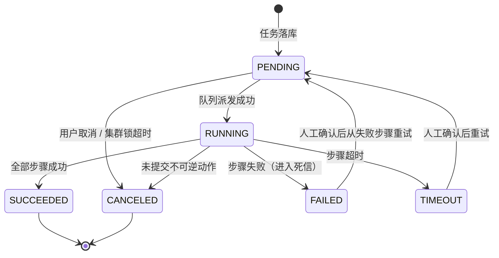

# Ceph 管理平台 · API 与数据模型设计（v0.1 草案）

| 项目 | 内容 |
| --- | --- |
| 文档归属 | 后端工程师（BE） |
| 状态 | 草案 · 与 [架构设计](../06-架构师/架构设计-Ceph管理平台.md) §7/§8 对齐 |
| 依据 | [PRD](../../01-产品与设计/01-产品经理/PRD-Ceph管理平台.md) §5 / §6 |

---

## 1. 接口约定

- 基础路径 `/api/v1`，JSON，UTF-8，时间统一 RFC3339 + UTC，ID 用 UUIDv7。
- 认证：`Authorization: Bearer <JWT>`；Agent 通道使用 mTLS 客户端证书，不复用用户 JWT。
- 幂等：所有 `POST` 变更接口要求 `Idempotency-Key` 头（或服务端按业务参数生成）。
- **变更类接口一律返回 `202 Accepted + {task_id}`，不返回同步结果**；查询类返回 `200`。
- 分页：`?page=&size=&sort=`，统一 `{items, total, page, size}`。
- 错误：`{code, message, trace_id, details}`，业务码与 HTTP 码分离；禁止把 Ceph 原始 stderr 直接返回前端（先脱敏）。
- WebSocket：`/ws/tasks?token=`，推送 `task.step.updated` / `task.status.changed` / `cluster.health.changed` / `agent.status.changed`。

---

## 2. REST 分组

| 资源 | 方法 | 说明 | 返回 |
| --- | --- | --- | --- |
| `/regions` `/azs` | CRUD | 自定义逻辑分组 | 200 |
| `/clusters` | GET / POST | 列表（可按 region/az/健康筛选）；POST = 新建集群任务 | 202 |
| `/clusters/import` | POST | 纳管已有集群（凭据 + 连通性校验） | 202 |
| `/clusters/{id}` | GET / PATCH / DELETE | 详情 / 改元数据 / 解除纳管 | 200 / 202 |
| `/clusters/{id}/sync` | POST | 触发一次状态对账 | 202 |
| `/clusters/{id}/credentials` | PUT | 凭据轮换（只写不读） | 202 |
| `/clusters/{id}/hosts` | GET | 节点与 Agent 状态 | 200 |
| `/clusters/{id}/hosts/precheck` | POST | ansible 前置检查 | 202 |
| `/clusters/{id}/topology` | GET | 拓扑（Host→服务→OSD） | 200 |
| `/clusters/{id}/pools` `/osds` | GET | 资源只读视图 | 200 |
| `/tasks` | GET | 任务列表（多维筛选） | 200 |
| `/tasks/{id}` | GET | 详情 + 步骤 + 日志引用 | 200 |
| `/tasks/{id}/retry` `/cancel` | POST | 从失败步骤重试 / 取消 | 202 |
| `/task-templates` | GET | 可用白名单任务模板（含参数 schema） | 200 |
| `/tasks` | POST | 提交参数化任务（模板 + 参数 + 目标集群） | 202 |
| `/users` `/roles` `/grants` | CRUD | RBAC + 三级作用域 | 200 / 202 |
| `/audits` | GET / 导出 | 审计检索与 CSV 导出 | 200 |
| `/alerts` `/alert-rules` | GET / CRUD | 告警事件与规则 | 200 / 202 |
| `/system/components` | GET | 管理面组件健康（区分核心/可降级） | 200 |
| `/system/registry` | GET / PUT | 镜像仓库与离线制品配置 | 200 / 202 |
| `/agent/*` | 内部 | 注册、心跳、任务领取、步骤回报（mTLS，不对外暴露） | — |

---

## 3. 任务状态机



**约束**

- 步骤状态同样有单调递增 `seq`，乱序回报丢弃；
- 步骤字段 `compensable: boolean`，不可逆步骤（`bootstrap`、`osd create`）为 `false`，失败后禁止自动重试；
- 任务与步骤都记录 `started_at / finished_at / retry_count / output_ref`；
- 审计写入失败时任务**拒绝开始**（fail-closed）。

---

## 4. 幂等与并发

| 机制 | 实现 |
| --- | --- |
| 幂等键 | `idempotency_key = sha256(fsid + task_type + canonical(params))`，`tasks` 表唯一索引 |
| 集群互斥 | `pg_advisory_xact_lock(hashtext(cluster_fsid))`，同一集群同时只跑一个变更任务 |
| 分片并发 | JetStream 按 `cluster_fsid` 分 subject，每个 consumer 有并发上限 |
| 重复投递 | Agent 本地持久化最近 N 条 `idempotency_key → 结果`，命中直接回报，不重新执行 |
| 前置守卫 | 执行前向 Ceph 查询真实状态，若目标已达期望则直接返回成功（幂等兜底） |
| 死信 | 超过重试上限 / 参数非法 → 死信 subject + 告警 + 人工处理入口 |

---

## 5. 核心表结构（摘录）

```sql
CREATE TABLE regions (
  id uuid PRIMARY KEY, name text UNIQUE NOT NULL, description text, created_at timestamptz DEFAULT now()
);

CREATE TABLE azs (
  id uuid PRIMARY KEY, region_id uuid NOT NULL REFERENCES regions(id),
  name text NOT NULL, UNIQUE (region_id, name)
);

CREATE TABLE clusters (
  id uuid PRIMARY KEY,
  fsid text UNIQUE NOT NULL,                 -- Ceph FSID，纳管去重依据
  az_id uuid REFERENCES azs(id),
  name text NOT NULL,
  deploy_mode text NOT NULL,                 -- cephadm | rook | manual | unknown
  capability text NOT NULL DEFAULT 'limited', -- managed | limited
  allow_changes boolean NOT NULL DEFAULT false,
  ceph_version text, health text,
  last_sync_at timestamptz, created_at timestamptz DEFAULT now()
);

CREATE TABLE hosts (
  id uuid PRIMARY KEY, cluster_id uuid NOT NULL REFERENCES clusters(id),
  hostname text NOT NULL, mgmt_ip inet, labels jsonb DEFAULT '{}',
  agent_status text, agent_version text, os_version text,
  UNIQUE (cluster_id, hostname)
);

CREATE TABLE credentials (
  id uuid PRIMARY KEY, cluster_id uuid NOT NULL REFERENCES clusters(id),
  type text NOT NULL,                        -- mgr_rest | ceph_conf_keyring | ssh
  cipher_text bytea NOT NULL,                -- 只存密文
  key_id text NOT NULL, rotated_at timestamptz, created_at timestamptz DEFAULT now()
);

CREATE TABLE tasks (
  id uuid PRIMARY KEY, cluster_id uuid REFERENCES clusters(id),
  type text NOT NULL, params jsonb NOT NULL,
  status text NOT NULL,
  idempotency_key text UNIQUE NOT NULL,
  created_by uuid NOT NULL, src_ip inet,
  started_at timestamptz, finished_at timestamptz,
  created_at timestamptz DEFAULT now()
);

CREATE TABLE task_steps (
  id uuid PRIMARY KEY, task_id uuid NOT NULL REFERENCES tasks(id),
  seq int NOT NULL, name text NOT NULL, status text NOT NULL,
  compensable boolean NOT NULL DEFAULT true,
  log_ref text, output jsonb, retry_count int DEFAULT 0,
  UNIQUE (task_id, seq)
);

-- 只追加：撤销 UPDATE/DELETE 权限，按月分区
CREATE TABLE audit_logs (
  id uuid NOT NULL, actor uuid, action text NOT NULL,
  target_type text, target_id uuid, params jsonb,
  src_ip inet, result text, trace_id text,
  before_snapshot jsonb, after_snapshot jsonb,
  created_at timestamptz NOT NULL DEFAULT now()
) PARTITION BY RANGE (created_at);
```

**明确不入库**：指标时序值、日志正文（只存 `log_ref`）、Ceph 完整状态历史大对象。

---

## 6. 任务模板（白名单）示例

```yaml
- type: pool.create
  capability: ceph
  risk: medium
  params:
    name: { type: string, pattern: '^[a-z0-9_-]{1,64}$' }
    pg_num: { type: int, min: 1, max: 32768 }
    size: { type: int, enum: [2, 3] }
  command: ["ceph", "osd", "pool", "create", "{{name}}", "{{pg_num}}", "{{pg_num}}"]
  precheck: "pool not exists"
  compensable: false

- type: host.precheck
  capability: system
  risk: low
  params:
    hosts: { type: array, items: uuid }
  command: ["ansible-playbook", "precheck.yml", "--limit", "{{hosts}}"]
  compensable: true
```

**执行规约**：命令以 `exec argv` 方式执行（不经过 shell），参数先按 schema 强类型校验再填入；禁止 `bash -c`、禁止模板中出现用户输入拼接的 shell 元字符。模板变更走代码评审 + 版本化发布。

---

## 7. Agent 内部协议（要点）

| 消息 | 方向 | 内容 |
| --- | --- | --- |
| `Register` | A→S | 节点 ID、证书指纹、能力集、Agent 版本、OS/podman 版本 |
| `Heartbeat` | A→S | 10s，负载、能力状态 |
| `FetchTask` / `TaskAssign` | A↔S | 按能力集与集群分片领取任务 |
| `StepReport` | A→S | `task_id, seq, status, log_chunk, output, duration` |
| `TaskSignature` | S→A | 任务签名 + nonce + 过期时间，Agent 验签后才执行 |

---

## 8. 待补 / 待确认

- OpenAPI 3.1 规范文件与自动生成的 SDK；
- 错误码字典、限流策略、审计导出字段白名单；
- `deploy_mode` 与 Ceph 版本的**能力矩阵**（决定哪些任务模板对哪些集群可用，对应 PRD FR-01）；
- D1/D2 选型确认后补充队列 subject 设计与分区策略。
