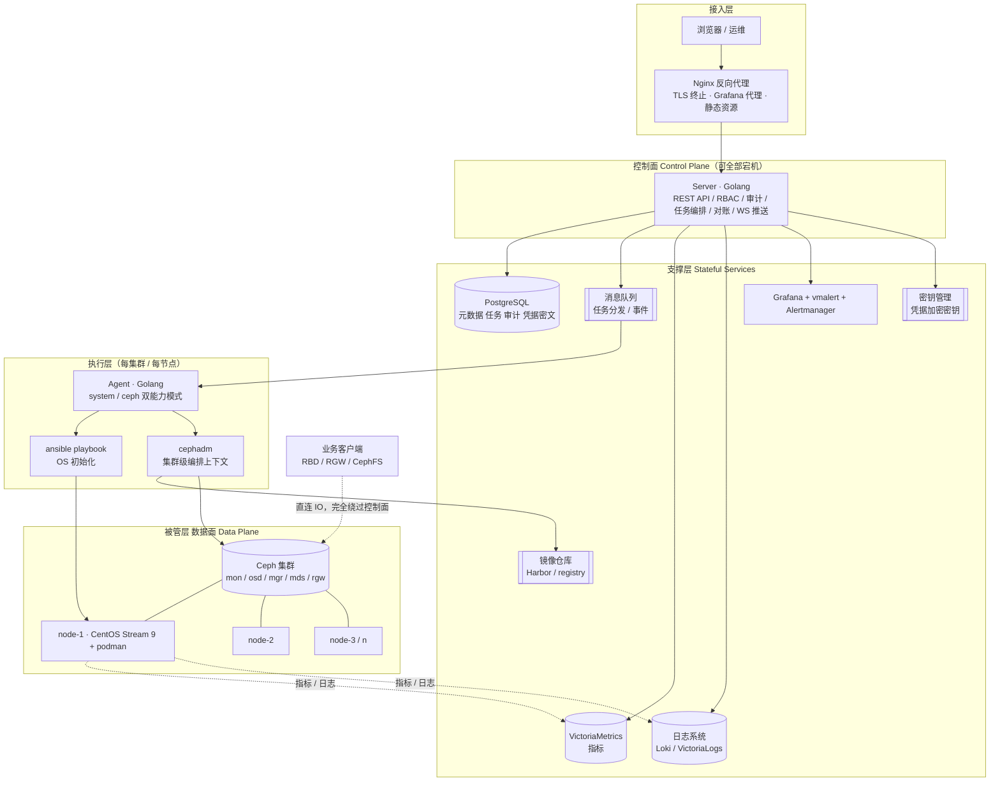
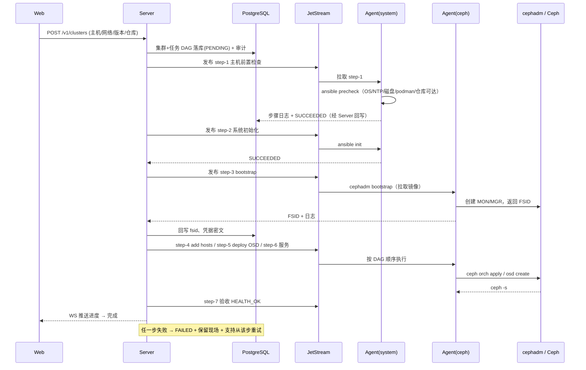
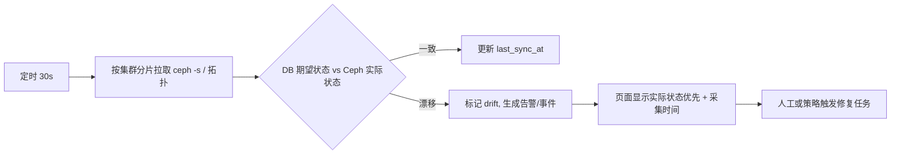

# Ceph 管理平台 · 架构设计（v0.1 草案）

| 项目 | 内容 |
| --- | --- |
| 文档归属 | 架构师（Architect） |
| 状态 | 草案 · 待技术评审 |
| 版本 / 日期 | v0.1 / 2026-11-07 |
| 输入 | 初版设想图、[PRD](../../01-产品与设计/01-产品经理/PRD-Ceph管理平台.md) |
| 配套 | [架构决策与权衡分析](./架构决策与权衡分析.md)（**必读**：设计理由、优点、缺点、弊端） |
| 文档规范依据 | [《软件行业的岗位》](https://lnsyyj.github.io/posts/software-industry-roles/)：架构师的产出为「架构设计 + 技术规范」 |

> 本文回答「系统怎么搭」；「为什么这么搭、代价是什么」全部放在权衡分析文档，避免自卖自夸。

---

## 1. 设计目标与约束

### 1.1 目标（按优先级）

| 优先级 | 目标 | 架构含义 |
| --- | --- | --- |
| G1 | **数据面零影响** | 控制面与数据面彻底解耦，平台全挂不影响 Ceph 读写 |
| G2 | **长操作可恢复、可追溯** | 一切变更走异步任务 + 状态机 + 审计，不做同步 HTTP 长调用 |
| G3 | **多集群、可扩展** | 控制面无状态，元数据模型支持 Region/AZ/Cluster 三级 |
| G4 | **内网 / 离线可交付** | 组件可容器化、镜像可离线导入、部署步骤可复制粘贴 |
| G5 | **最小权限与防误操作** | 参数化白名单任务，不提供自由 shell |
| G6 | **部署单元尽量少** | 一个「方便部署」的平台，不能先要求客户部署 6 套中间件 |

> G1/G2 与 G6 存在天然冲突，这是本架构最主要的张力，见权衡分析「弊端 B1」。

### 1.2 约束

- 操作系统基线：CentOS Stream 9；容器运行时：podman；部署编排：cephadm；主机初始化：ansible。
- 已有组件倾向：React（Web）、Golang（Server / Agent）、PostgreSQL、VictoriaMetrics、Grafana。
- 未定项：消息队列、镜像仓库、日志系统、认证源（PRD §11.1 的 D1/D3/D4/D7）。
- 假设规模：20 集群 / 500 节点（PRD §2.1）。

---

## 2. 架构总览

### 2.1 分层视图



**最重要的一条线**是右下角那条虚线：业务客户端的 IO **永远不经过控制面**。控制面只做「看、管、记」。

### 2.2 相对设想图的调整（Change Log）

| # | 设想图 | 本设计 | 理由 |
| --- | --- | --- | --- |
| C1 | `server → cephadm` 直连调用 | 改为 `server → 任务队列 → Agent → cephadm` | 建集群/扩容是分钟级长事务，同步调用会超时、丢进度、无法重试；异步任务才能做状态机、审计与断点续跑 |
| C2 | `cephadm` 画在中心，连镜像仓库与所有 node | 改为**集群级执行上下文**，由目标节点上的 Agent 驱动 | cephadm 是「一套集群一套状态」，不是全局中心服务；中心化会造成跨集群状态串扰与单点 |
| C3 | `server-system-agent-1` / `server-ceph-agent-1` 两个独立组件 | **保留能力边界，合并为一个二进制的两种运行模式**（`--capability=system\|ceph`） | 两者都运行在被管节点、都需要高权限，拆两个进程并不真正缩小权限面，却让部署、鉴权、升级翻倍；能力白名单才是真正的隔离手段 |
| C4 | 消息队列标注 `queue? rabbitmq? redis? Kafka?` | 明确为**必需组件**，建议 NATS JetStream（或 RabbitMQ） | 任务可靠性是本平台的生命线；不能靠 `goroutine + 内存队列` 糊过去 |
| C5 | 日志系统仅有方框 | 纳入统一检索，与任务日志、审计日志分层 | 排障需要「一次任务 → 步骤日志 → 节点日志」的可追踪链路 |
| C6 | VictoriaMetrics / Grafana 直接前台集成 | Grafana 经反向代理统一鉴权；告警引入 vmalert + Alertmanager | 防止绕过平台 RBAC 直接看别的集群面板；补齐 Prometheus 规则生态 |
| C7 | 无凭据与安全层 | 新增密钥管理 + Agent↔Server mTLS + 命令白名单 | Agent 具备 root 级执行能力，是最高价值攻击面 |
| C8 | 无状态对账 | 新增 Reconciler（对账器） | 平台 DB 状态与 Ceph 真实状态必然漂移，必须主动对账而非假设一致 |
| C9 | PostgreSQL 连到所有组件 | 明确**只存元数据 / 任务 / 审计**，指标与日志不入库 | 避免把时序数据塞进关系库导致膨胀 |

---

## 3. 组件职责

| 组件 | 技术 | 职责 | 不负责 |
| --- | --- | --- | --- |
| Web | React + TS | 控制台、向导、任务进度、Grafana 面板承载 | 不直连 Ceph、不直连 DB |
| Server | Golang | REST/WS、RBAC、审计、任务编排 DAG、状态对账、凭据加解密、告警关联 | 不执行任何节点命令 |
| 任务队列 | NATS JetStream / RabbitMQ | 任务派发、重试、持久化、死信 | 不承载业务状态 |
| PostgreSQL | PG 16+ | 集群/主机/用户/角色/任务/审计/凭据密文 | 不存指标、不存大段日志 |
| Agent | Golang 单二进制双模式 | 心跳注册、拉取任务、执行白名单参数化命令、回报步骤日志与状态 | 不接受任意命令、不主动连 DB |
| ansible | playbook | OS 基线检查与初始化 | 不参与运行时调度 |
| cephadm | Ceph 官方 | 集群 bootstrap、服务编排、OSD 部署、升级 | 不作为常驻中心服务 |
| 镜像仓库 | Harbor / registry | Ceph 镜像、Agent 镜像、离线制品 | 不承担业务制品 |
| VictoriaMetrics | VM + vmalert | 指标存储、PromQL 查询、告警规则求值 | 不做业务数据存储 |
| 日志系统 | Loki / VictoriaLogs | 任务日志、Agent 日志、访问日志 | 不替代审计日志 |
| Grafana | 官方镜像 | 面板展示（经反代鉴权） | 不作为权限判定点 |
| Nginx | 反代 | TLS 终止、静态资源、Grafana 代理、限流 | 不含业务逻辑 |

---

## 4. 技术选型

### 4.1 已定 / 建议

| 领域 | 选择 | 理由 | 备选 | 主要风险 |
| --- | --- | --- | --- | --- |
| 前端 | React + TypeScript | 团队既定；生态成熟；Grafana 面板嵌入方便 | Vue | 嵌入 iframe 的鉴权与样式割裂 |
| 控制面 | Golang | 单二进制、并发模型适合大量长连接/任务、静态部署简单 | Java / Python | 生态内 Ceph SDK 弱，多数靠 CLI |
| 关系库 | PostgreSQL | 图中既定；JSONB 适合存任务参数与 Ceph 原始状态；advisory lock 可做集群级互斥 | MySQL | 需自己做分区与审计表冷热分离 |
| 消息队列 | **NATS JetStream（推荐）** | 单二进制、资源占用低、持久化流 + ACK + 重试语义足够任务队列；契合 G6「少组件」 | RabbitMQ（团队熟则优先）、Kafka（过重，不选）、Redis Stream（持久化/运维语义弱，不选） | 团队不熟悉；运维工具少 |
| 镜像仓库 | Harbor（离线场景）/ 对接客户现有仓库 | 支持离线导入、复制、漏洞扫描、配额 | registry:2（轻但无管理能力） | Harbor 自身较重，与 G6 冲突 |
| 指标 | VictoriaMetrics + vmalert | 资源省、兼容 Prometheus remote_write / PromQL 主体 | Prometheus + Thanos | 与 Prometheus 规则生态存在边界差异 |
| 告警 | vmalert + Alertmanager | 复用 Prometheus 生态规则与通知渠道 | Grafana Alerting | 两套告警规则源需统一 |
| 日志 | VictoriaLogs（推荐）/ Loki | 与 VM 同栈、资源轻 | ELK（重） | 生态与查询语法差异 |
| 可视化 | Grafana（反代鉴权） | 面板生态成熟 | 自研图表 | 越权与多租户隔离 |
| 编排 | cephadm + podman | 官方路径、容器化、无 K8s 依赖 | Rook（引入 K8s，超出范围） | 版本绑定、抽象泄漏 |
| 初始化 | ansible | 图中既定，幂等、易审计 | SaltStack | playbook 版本管理 |
| OS | CentOS Stream 9 | 图中既定 | Rocky / Alma | Stream 滚动更新带来兼容风险 |

### 4.2 明确不选

- **Kafka**：为 20 集群规模引入 ZooKeeper/KRaft 级别的运维成本，收益为负。
- **Redis 当可靠队列**：AOF/持久化语义与任务「不丢」要求不匹配；可作缓存，不作任务底座。
- **Rook / Kubernetes**：会引入一整套 K8s 运维体系，与「方便部署」目标冲突；作为 V2+ 的另一个产品形态评估。
- **Server 直连 SSH 执行命令**：鉴权、审计、密钥轮换、连接风暴都难控，改用 Agent 拉模式。

---

## 5. 关键链路

### 5.1 新建集群（任务 DAG）



### 5.2 任务下发与执行语义

- **通信**：Agent 主动向 Server 发起 mTLS 长连接（或按配置轮询拉取），Server 不反向连节点 → 天然适配 NAT / 内网 / 防火墙单向放行。
- **心跳**：Agent 10s 心跳，上报在线状态、版本、能力集；离线 30s 标记 `offline`，任务留在队列不派发。
- **幂等**：每个步骤带 `idempotency_key = cluster_fsid + task_type + normalized_params`，Agent 本地记录最近执行结果，重复投递直接返回上次结果。
- **互斥**：同一集群同一资源类别的变更任务用 PostgreSQL advisory lock 加集群级互斥，避免并发改 OSD。
- **超时 / 取消**：每步有超时；取消只作用于 `PENDING/RUNNING` 中尚未提交不可逆动作的步骤，已提交步骤不回滚。
- **失败处理**：不自动无限重试；非幂等步骤最多人工确认后重试，进入死信队列并告警。

### 5.3 状态对账（Reconciler）



**原则**：`ceph -s` 的真实状态**永远优先于** DB 中的期望状态展示；DB 只用于流程与审计，不作为真相来源。

### 5.4 监控与告警链路

```
Ceph mgr prometheus 模块 / node-exporter / ceph-exporter
   → VM agent(remote_write 或 scrape) → VictoriaMetrics
   → vmalert（Prometheus 兼容规则）→ Alertmanager → Webhook/邮件
   → Server 订阅告警事件 → 关联 cluster/region → 控制台告警中心
Grafana → 经 Nginx 反代（注入统一鉴权头）→ 查询 VM
```

---

## 6. 部署拓扑

### 6.1 MVP（单机管理面，最小可交付）

```
管理节点 ×1（或 3 台小规格 VM）
  ├─ Nginx + Web 静态资源
  ├─ Server ×1（无状态，可起 2 副本）
  ├─ PostgreSQL ×1（+ 每日 pg_dump）
  ├─ NATS JetStream ×1（单节点，持久化目录）
  ├─ VictoriaMetrics 单节点 + vmalert + Alertmanager
  ├─ 日志系统单节点
  ├─ Grafana
  └─ 镜像仓库（可对接客户现有，不强制自建）
被管节点 ×N（CentOS Stream 9 + podman）
  └─ Agent 单二进制（system + ceph 能力，按标签启用）
```

所有管理面组件以 podman pod / compose 方式交付，离线镜像包一次导入（对应 PRD D6）。

### 6.2 V1（管理面 HA）

Server 多副本 + PG 主从 + JetStream 3 节点集群 + VM 双副本；**控制面仍是「一个逻辑控制面」**，不做跨地域拆分。

### 6.3 V2（多 Region 联邦，若确有必要）

每 Region 部署一套自治控制面，全局视图通过只读聚合层汇总。避免把所有地域的 Agent 长连接拉到中心（跨地域链路不稳定会导致大面积误判离线）。

### 6.4 故障域隔离

| 故障 | 数据面 | 控制面 |
| --- | --- | --- |
| Server / DB / MQ 全停 | **不受影响** | 不可管理，Agent 本地缓存待上报状态 |
| Agent 离线 | **不受影响** | 该节点任务暂停，其他节点可用 |
| 镜像仓库不可达 | 不受影响 | 新建/升级受阻，日常运维可用 |
| 监控栈全停 | 不受影响 | 无指标与告警，任务仍可执行（降级） |

---

## 7. 接口约定

| 通道 | 协议 | 用途 |
| --- | --- | --- |
| Web ↔ Server | HTTPS REST + WebSocket | 页面数据、任务进度推送 |
| Server ↔ Agent | mTLS + gRPC 双向流 / HTTPS 长轮询 | 注册、心跳、任务派发、日志与状态回报 |
| Server ↔ Ceph（只读） | ceph-mgr RESTful / Agent 转发 `ceph -s` | 状态采集（优先经 Agent，避免中心直连） |
| 监控采集 | Prometheus remote_write / scrape | 指标 |
| 告警 | Alertmanager Webhook → Server | 告警入库与关联 |

REST 资源分组（详见 [API 与数据模型设计](../02-后端工程师/API与数据模型设计.md)）：
`/v1/regions` `/v1/azs` `/v1/clusters` `/v1/clusters/{id}/hosts` `/v1/tasks` `/v1/users` `/v1/roles` `/v1/audits` `/v1/alerts` `/v1/credentials` `/v1/system/components`

**约定**：所有变更类接口返回 `202 Accepted + task_id`，不返回同步执行结果。

---

## 8. 数据模型（核心表）

| 表 | 关键字段 | 说明 |
| --- | --- | --- |
| `regions` / `azs` | id, name, parent_id | 自定义三级模型前两级 |
| `clusters` | id, fsid(uk), az_id, name, deploy_mode, ceph_version, capability(managed/limited), health, last_sync_at | 集群主表 |
| `hosts` | id, cluster_id, hostname, mgmt_ip, labels, agent_status, os_version | 节点 |
| `credentials` | id, cluster_id, type, cipher_text, key_id, rotated_at | 只存密文，明文不落任何日志 |
| `tasks` | id, cluster_id, type, params_jsonb, status, idempotency_key(uk), created_by, started_at, finished_at | 任务主表 |
| `task_steps` | id, task_id, seq, name, status, log_ref, output_jsonb, retry_count | DAG 步骤 |
| `audit_logs` | id, actor, action, target, params_jsonb, src_ip, result, created_at | 只追加，按月分区 |
| `users` / `roles` / `grants` | 标准 RBAC + scope(region/az/cluster) | 三级授权 |
| `alert_rules` / `alert_events` | 规则模板、关联集群、抑制策略 | 告警 |

**不入库**：指标时序数据、原始日志正文（只存 `log_ref`）、Ceph 完整 `ceph -s` 历史快照（只存关键字段 + 对象存储引用）。

---

## 9. 一致性、幂等与并发

| 场景 | 策略 |
| --- | --- |
| 任务重复投递 | `idempotency_key` 唯一索引 + Agent 本地结果缓存 |
| 同一集群并发变更 | PG advisory lock（`hashtext(cluster_fsid)`） |
| 长事务失败 | **补偿式 Saga**，不做分布式事务；不可逆步骤标记 `compensable=false`，只允许人工清理后重跑 |
| DB 与 Ceph 漂移 | Reconciler 定时对账，UI 以 Ceph 实际状态为准 |
| Agent 上报丢包 | 步骤状态带单调递增 `seq`，Server 按序合并，乱序丢弃 |
| 队列积压 | 按集群分片 + 并发上限 + 死信告警 |

---

## 10. 高可用与容错小结

- Server 无状态 → 水平扩展；会话放 JWT/Redis（可选），不依赖本地内存。
- PG 主从 + 定期备份 + 恢复演练（DBA 职责）。
- JetStream 持久化流，重启不丢任务。
- Agent 断线重连、本地缓存结果、任务不丢。
- 监控/日志/仓库属于**可降级组件**：全挂时控制台仍应能展示最近一次同步状态并允许执行预定义任务。
- 管理面整体不可用时，保留 Ceph Dashboard 与 SSH 作为最终兜底（PRD §2.2 第 2 条）。

---

## 11. 安全架构

详见 [安全与审计设计](../08-安全工程师/安全与审计设计.md)，此处列架构级约束：

1. **信任边界**：Server 是唯一可信调度方；Agent 只信任带签名与 nonce 的任务；被管节点不信任 Server 下发的自由文本。
2. **传输**：全链路 TLS，Agent ↔ Server 双向 mTLS，证书按节点签发、支持轮换与吊销。
3. **凭据**：静态加密（密钥外置，MVP 可用文件密钥 + 权限收紧，V1 接 KMS/Vault）；明文不出现在 API 响应、日志、审计、前端。
4. **执行**：任务模板白名单 + 参数强类型校验 + 枚举/正则/范围约束 + 参数化执行（不拼 shell 字符串）；禁止 `bash -c` 拼接。
5. **审计**：只追加、独立存储、含执行前后状态快照；审计写入失败则任务拒绝执行（fail-closed）。
6. **最小权限**：Agent 以专用账号运行 + sudo 精确白名单；若必须 root，则配合只读根文件系统、seccomp 与网络白名单。
7. **Grafana 隔离**：禁止直连，经 Nginx 反代注入身份，按 cluster 过滤数据源查询。

---

## 12. 可观测性（平台自身）

| 信号 | 内容 |
| --- | --- |
| 指标 | API QPS/延迟/错误率、任务成功率与耗时分布、Agent 在线率、对账漂移次数、队列积压 |
| 日志 | 结构化 JSON，带 `trace_id / task_id / cluster_id` 贯穿全链路 |
| 健康 | `/healthz`（进程）、`/readyz`（依赖检查，区分核心/可降级依赖） |
| 告警 | Agent 大面积离线、任务失败率突增、对账漂移持续、凭据即将过期 |

---

## 13. 演进路线与推翻条件

| 阶段 | 变化 |
| --- | --- |
| MVP | 单机管理面、单 Region、NATS 单节点、只读纳管 + 新建 |
| V1 | 管理面 HA、告警闭环、离线制品、Grafana 统一鉴权 |
| V2 | 多 Region 联邦、LDAP/OIDC、配额、升级与配置回滚 |

**何时需要重新设计**（见权衡分析 §6）：集群规模 > 100 / 需要跨地域自治 / 引入 K8s 作为统一底座 / 平台自身 SLA 要求高于 99.9% / 需要接管数据面。

---

## 14. 架构决策记录（ADR 索引）

| ADR | 决策 | 详见 |
| --- | --- | --- |
| ADR-01 | 控制面与数据面分离，平台不代理 IO | 权衡分析 §2 R1 |
| ADR-02 | 所有变更走异步任务队列，禁止同步长调用 | §2 R2 |
| ADR-03 | Agent 拉模式 + mTLS，中心不直连 SSH | §2 R3 |
| ADR-04 | 双能力合并为单二进制双模式 | §2 R4 |
| ADR-05 | cephadm 定位为集群级执行器而非中心服务 | §2 R5 |
| ADR-06 | DB 只存元数据，指标/日志分离；Ceph 实际状态为真相 | §2 R6 / §4 B3 |
| ADR-07 | 消息队列选 NATS JetStream（备选 RabbitMQ） | §2 R7 |
| ADR-08 | 引入 Reconciler 主动对账 | §2 R8 |
| ADR-09 | Grafana 经反代统一鉴权，禁止直连 | §2 R9 |
| ADR-10 | MVP 单机管理面，HA 延后到 V1 | §2 R10 |
