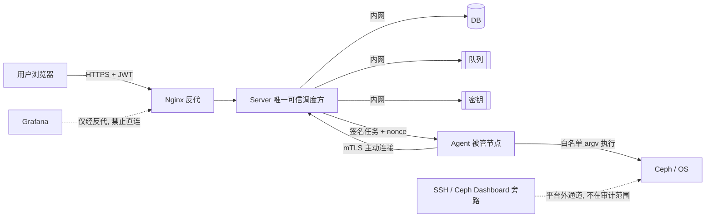

# Ceph 管理平台 · 安全与审计设计（v0.1 草案）

| 项目 | 内容 |
| --- | --- |
| 文档归属 | 安全工程师（SEC） |
| 状态 | 草案 · MVP 上线前必须完成安全评审 |
| 依据 | [架构设计](../06-架构师/架构设计-Ceph管理平台.md) §11 · [权衡分析 B2 / B9 / B11](../06-架构师/架构决策与权衡分析.md) |

> **本平台的最高风险不是数据泄露，而是「一次管理面入侵 = 全部纳管集群可被破坏」**（权衡分析 B2）。Agent 具备节点级命令执行能力，安全设计必须按「等同于堡垒机」的标准来做，而不是按普通后台管理系统。

---

## 1. 信任边界

**信任假设**：Server 是唯一可下发任务的一方；Agent 不信任任何未经签名的指令；被管节点不信任含自由文本的命令。

---

## 2. 威胁清单与对策

| 威胁 | 场景 | 对策 | 残余风险 |
| --- | --- | --- | --- |
| T1 管理面 RCE 放大 | API 漏洞/供应链投毒后批量下发破坏性任务 | mTLS + 任务签名 + 高危动作二次确认/双人复核 + 参数范围限制 + 按 Region 隔离控制面 | 白名单内的破坏性动作仍可执行，**不可根治** |
| T2 凭据泄露 | ceph keyring / SSH 私钥 / DB 密文被读 | 静态加密、密钥外置、不回显、日志脱敏、定期轮换 | 运行时内存中仍短暂存在明文 |
| T3 命令注入 | 参数里塞 `; rm -rf` 或 shell 元字符 | 强类型 schema + 正则/枚举/范围 + `exec argv` 不经 shell + 模板代码评审 | 模板本身写错仍可能引入问题 |
| T4 越权查看 | viewer 借 Grafana 面板看全部集群指标 | Grafana 禁止直连、反代注入身份、按集群过滤查询 | Grafana 原生探索页需禁用 |
| T5 任务重放 | 截获任务消息重复投递 | 签名含 nonce + 过期时间 + `idempotency_key` + Agent 本地结果缓存 | — |
| T6 审计绕过/篡改 | 改审计记录、或直接 SSH 操作 | 审计表撤销 UPDATE/DELETE、独立账号、只追加、异地备份、fail-closed | SSH 旁路无法覆盖（B11） |
| T7 Agent 冒充 | 伪造节点领取任务 | 每节点独立客户端证书 + 指纹绑定 + 吊销列表 | 证书泄露需快速吊销流程 |
| T8 镜像供应链 | 离线镜像被替换植入后门 | 镜像摘要固定 + 校验 + 仓库最小权限 + 制品签名 | 需交付流程配合 |
| T9 横向移动 | 管理面被攻破后扫描被管网络 | 网络分区：管理面只暴露必要端口；被管节点不反向开放端口 | — |

---

## 3. 凭据生命周期

| 阶段 | 规则 |
| --- | --- |
| 录入 | HTTPS 提交，服务端立即加密；**任何接口不返回明文**（包括编辑页，回显用掩码） |
| 存储 | AES-GCM，密钥由 KMS/Vault 或外置密钥文件提供；DB 只存 `cipher_text + key_id + nonce` |
| 使用 | Server 内存中解密后通过 mTLS 通道传给目标 Agent，用后即弃；不写临时文件、不进环境变量 |
| 轮换 | 支持双凭据并行期；轮换失败自动回滚到旧凭据；记录 `rotated_at` |
| 吊销 | 解除纳管时删除凭据 + 吊销对应 Agent 证书 + 写审计 |
| 禁止 | 明文出现在 API 响应、任务参数、日志、审计、前端状态、错误堆栈、崩溃转储 |

---

## 4. 命令执行安全（核心）

1. **模板白名单**：只有 `task_templates` 中注册的动作可执行，模板随代码版本化，变更需评审；新增模板不需要发版但需管理员审批 + 灰度。
2. **参数校验**：类型 → 枚举/正则 → 范围 → 业务前置检查（如目标 Pool 不存在），四层全过才生成 argv。
3. **执行方式**：`exec.Command(argv[0], argv[1:]...)`，**禁止** `sh -c` / `bash -c` / 字符串拼接。
4. **能力隔离**：`system` / `ceph` 能力集由 Server 下发，Agent 只接受自身被授予的能力任务。
5. **高危动作**：`osd.remove`、`pool.delete`、`service.stop`、`cluster.reset` 标记 `risk=high`，要求二次确认 + 输入集群名 + （V1）双人复核。
6. **最小权限**：Agent 优先以专用账号 + `sudo` 精确白名单运行；若必须 root，需安全评审并配合只读根文件系统、seccomp、网络白名单。
7. **审计联动**：审计写入失败 → 任务拒绝启动（fail-closed）；高危动作记录执行前后 `ceph -s` 快照。

---

## 5. 审计设计

| 字段 | 说明 |
| --- | --- |
| `actor` / `src_ip` / `user_agent` | 谁、从哪里 |
| `action` / `target_type` / `target_id` | 对哪个集群/主机/资源做了什么 |
| `params` | 脱敏后的完整参数（用于复盘） |
| `result` / `trace_id` / 耗时 | 结果、全链路追踪、耗时 |
| `before_snapshot` / `after_snapshot` | 变更前后关键状态（健康、OSD 数、Pool 数） |
| `created_at` | 只追加，按月分区，保留 ≥ 180 天 |

- 记录范围：登录/登出、失败登录、所有变更类操作、凭据轮换、权限变更、任务提交/重试/取消、审计导出本身。
- 存储隔离：审计库账号与应用账号分离，应用账号无 `UPDATE`/`DELETE`/`TRUNCATE` 权限。
- 导出：需 `auditor` 角色，导出行为本身写审计，导出字段经白名单过滤（防止通过导出泄露凭据密文）。
- **边界声明**：审计覆盖「平台内操作 100%」，不覆盖 SSH / Ceph Dashboard 旁路；对外承诺必须按此口径（B11）。

---

## 6. 网络与传输

| 链路 | 要求 |
| --- | --- |
| 浏览器 ↔ Nginx | TLS 1.2+，HSTS，Cookie `HttpOnly/Secure/SameSite` |
| Nginx ↔ Server / Grafana | 内网 HTTP 或 mTLS；Grafana 端口不对外暴露 |
| Agent ↔ Server | **双向 mTLS**，证书按节点签发，支持轮换/吊销 |
| Server ↔ PostgreSQL / 队列 / VM | 内网隔离 + 账号最小权限 + TLS（跨主机时） |
| 被管节点入站 | 默认不开放任何端口，Agent 主动出站长连接 |

---

## 7. 应急响应（对应「应急方案」产出）

| 事件 | 首要动作 | 后续 |
| --- | --- | --- |
| 疑似管理面失陷 | **立即全局停用任务下发**（一个开关），吊销所有 Agent 证书 | 保留审计与队列现场，离线取证，轮换全部凭据与证书，逐集群核验 Ceph 状态 |
| 凭据泄露 | 轮换该集群凭据 + 吊销相关 Agent 证书 | 检索审计中该凭据的使用记录 |
| 异常批量任务 | 熔断：暂停队列消费，冻结高危模板 | 核对已执行步骤，按不可逆清单人工处置 |
| 审计写入故障 | 任务 fail-closed 停止 | 恢复后补写，禁止跳过审计继续执行 |

> **设计要点**：必须有一个「一键停止全部任务下发」的全局熔断开关。出事时先止血，再查原因；没有这个开关，B2 的爆炸半径无法收敛。

---

## 8. MVP 安全检查清单（发布门槛）

- [ ] 命令注入用例（元字符、超长参数、Unicode、路径穿越）全部被拒
- [ ] 全链路无凭据明文：API、日志、审计、前端、错误堆栈、崩溃转储
- [ ] 任务重放 / 过期签名 / 未验签任务均被 Agent 拒绝
- [ ] viewer 无法通过任何路径查看未授权集群的 Grafana 面板
- [ ] 审计记录无法被应用账号修改或删除
- [ ] 高危动作二次确认与双人复核（V1）生效
- [ ] 全局熔断开关演练通过
- [ ] 渗透测试报告与漏洞清单闭环

---

## 9. 待决策

- D9：Agent 运行账号（专用账号 + sudo 白名单 vs root）——直接决定 B2 风险等级；
- 是否引入 KMS/Vault（MVP 可用外置密钥文件过渡，但需文档标明风险）；
- 双人复核是 V1 还是 MVP 强制；
- 证书签发与轮换方式（自签 CA / 客户 PKI）。
