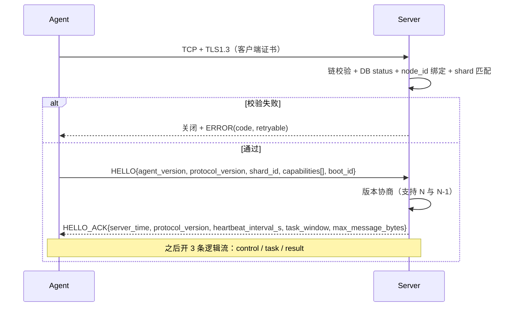
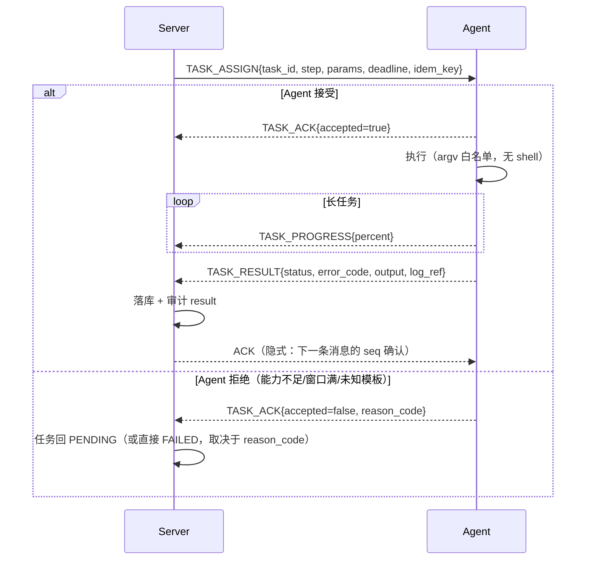
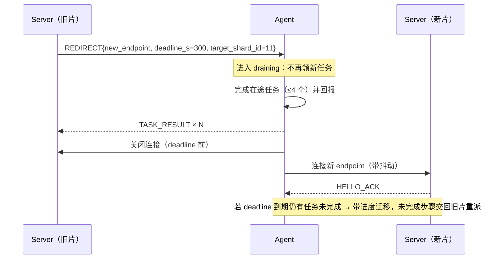

# Agent ↔ Server 通信协议（v1）

| 项目 | 内容 |
| --- | --- |
| 状态 | **草案 · 待评审** |
| 日期 | 2026-11-15 |
| 依据 | [ADR-03 拉模式](../../02-研发线/04-架构师/架构设计-Ceph管理平台.md) · [ADR-28 证书](../../02-研发线/04-架构师/ADR-28-Agent证书体系.md) · [ADR-33 日志直推](../../02-研发线/04-架构师/ADR-33-日志与告警链路.md) · [ADR-37 容量](../../02-研发线/04-架构师/ADR-37-容量模型与规模上限.md) · [ADR-38 通信分片](../../02-研发线/04-架构师/ADR-38-Agent通信分片.md) |
| 适用 | Agent 与 Server 之间的唯一通道（运行期） |

---

## 1. 范围

**定义**：Agent 如何连上 Server、如何报活、如何收任务、如何回报结果、如何被迁移到别的分片。

**不定义**：Agent 与 Ceph 的交互（本地进程调用）、日志上报（Agent 直推 VictoriaLogs，ADR-33）、证书签发（交付期 ansible，ADR-35）。

## 2. 传输栈

| 层 | 选择 | 理由 |
| --- | --- | --- |
| 传输 | **TLS 1.3** | mTLS 双向认证；session ticket 降低重连成本 |
| 承载 | **HTTP/2** | 单连接多流复用，天然支持流控 |
| RPC | **gRPC 双向流** | 长连接 + 双向消息 |
| 编码 | **Protobuf** | 体积小、向后兼容（未知字段忽略） |
| 消息上限 | **1 MiB/条** | 超限的大对象走 `log_ref` / VL，不进协议 |

**不提供 HTTPS 长轮询降级。** 10 万节点轮询 = 10 万 QPS 空转，是自伤。若客户网络阻断 HTTP/2，属于前置条件不满足，应在交付前用 prechecks 发现，而不是靠降级掩盖。

## 3. 身份与握手

### 3.1 证书即身份

| 项 | 约定 |
| --- | --- |
| 证书主体 | `CN=<node_id>`，`SAN URI = spiffe://winter/node/<node_id>` |
| 私钥 | **节点本地生成，永不出节点**（ADR-28） |
| Server 校验 | ① 证书链到 intermediate CA；② `agent_certs.status = active`；③ 证书里 `node_id` 与 HELLO 中的一致；④ 该 node 的 `shard_id` 与本 Server 所属分片一致 |
| 失败处理 | 任一条不满足 → 关闭连接 + 错误码（见 §10） |

**第 ③ 条必须有**：否则任何一台失陷节点都能用「B 的证书 + A 的 agent_id」冒充其他节点上报假状态。

### 3.2 握手时序

## 4. 逻辑流

一条连接上开 **3 条 gRPC 双向流**（ADR-38）：

| 流 | 方向 | 承载 | 特征 |
| --- | --- | --- | --- |
| `control` | 双向 | HELLO、HEARTBEAT、REDIRECT、CERT_ROTATE_HINT、ERROR | 高频小包；**拥塞时可丢/可合并** |
| `task` | 双向 | TASK_ASSIGN、TASK_ACK、TASK_PROGRESS | 中频；**不可丢** |
| `result` | Agent→Server | TASK_RESULT | 低频大包（含 output）；与 task 分离避免阻塞派发 |

**为什么分三条**：单流会让「一条 1MB 的结果」堵住「一条 200 字节的任务派发」。HTTP/2 解决的是 TCP 层队头阻塞，应用层语义仍要自己分。

## 5. 消息目录

| 消息 | 方向 | 流 | 关键字段 | 幂等 | 说明 |
| --- | --- | --- | --- | --- | --- |
| `HELLO` | A→S | control | `agent_version` `protocol_version` `shard_id` `capabilities[]` `boot_id` | — | 连接后第一帧 |
| `HELLO_ACK` | S→A | control | `server_time` `heartbeat_interval_s` `task_window` `max_message_bytes` | — | 下发运行参数，Agent 不得硬编码 |
| `HEARTBEAT` | A→S | control | `sent_at` `inflight_tasks` `load{cpu,mem}` `cert_expires_at` | 幂等 | 默认 10s |
| `HEARTBEAT_ACK` | S→A | control | `server_time` | — | 可用于估算时钟偏差 |
| `TASK_ASSIGN` | S→A | task | `task_id` `step_id` `template` `params` `deadline` `idempotency_key` `trace_id` | 按 `idempotency_key` | 窗口内最多 4 个未完成 |
| `TASK_ACK` | A→S | task | `task_id` `accepted` `reason_code` | 幂等 | 10s 内未 ACK → 服务端重派 |
| `TASK_PROGRESS` | A→S | task | `task_id` `step_id` `percent` `message` | 幂等（覆盖） | 仅用于 UI 与 `last_progress_at` |
| `TASK_RESULT` | A→S | result | `task_id` `status` `error_code` `error_message` `output` `log_ref` `started_at` `finished_at` | 按 `task_id` | **落库成功才 ack** |
| `REDIRECT` | S→A | control | `new_endpoint` `deadline_s` `reason` `target_shard_id` | — | 优雅迁移，见 §8 |
| `CERT_ROTATE_HINT` | S→A | control | `not_after` | — | 提示轮换；Agent 自己也会按时轮换 |
| `ERROR` | 双向 | control | `code` `message` `retryable` `retry_after_ms` | — | 见 §10 |

**字段原则**：所有时间戳为 Unix 毫秒（UTC）；`params` 与 `output` 为 JSON（便于模板演进），其余字段用 protobuf 标量。

## 6. 任务生命周期

| 规则 | 值 |
| --- | --- |
| 窗口 | 每连接 **4 个未完成任务**；窗口满服务端不再派发 |
| ACK 超时 | 10s；超时重派（Agent 侧按 `idempotency_key` 去重） |
| 执行超时 | 按模板声明（普通 5min / 镜像拉取 30min / 整任务 2h） |
| 结果重传 | Agent 保留最近 **100 条**结果，5 分钟内可重放 |
| 幂等 | `idempotency_key = sha256(cluster_fsid + template + canonical(params))` |

## 7. 心跳与存活

| 项 | 值 | 归属 |
| --- | --- | --- |
| 心跳间隔 | **10s**（`HELLO_ACK.heartbeat_interval_s` 下发） | Agent 发送 |
| 服务端 SUSPECT | 60s 无心跳 | Server 内存计时器 |
| 服务端 CLOSE | 90s 无心跳 → 主动断开 | Server |
| 离线标记 | SUSPECT 即标记 `offline`，任务不派发 | Server |
| 落库 | **30s 批量 flush 一次**（不是每拍写库） | Server 内部（ADR-37） |
| 时钟 | 偏差 >5s 告警；>30s 拒绝派发新任务 | Server 比对 `HEARTBEAT_ACK` |

## 8. 迁移（REDIRECT）

| 规则 | 值 |
| --- | --- |
| 宽限期 | 默认 **300s**，可随 `REDIRECT` 下发 |
| 迁移限速 | **50 次/s per shard**（服务端控制） |
| 新任务 | draining 期间**不再派发** |
| 超时 | 到期仍连不上新片 → 回退旧片重试（避免节点变砖） |

## 9. 重连与备用 endpoint

| 项 | 规则 |
| --- | --- |
| 抖动 | 重连前等待 `random(0, 300s)`；**不允许固定间隔** |
| 退避 | 1s→2s→4s→…→上限 300s，每次 ±30% 抖动 |
| 轮转 | 主 endpoint 失败 → 备用 1 → 备用 2 → 回主 |
| **禁止** | 备用不得指向同一分片（否则片级故障时全部回撞） |
| 连接上限 | 服务端 accept 限速 **200/s per 副本**，超出排队不拒绝 |

## 10. 错误码

| code | 含义 | retryable | 处理 |
| --- | --- | --- | --- |
| `CERT_REVOKED` | 证书已吊销 | ✗ | 停止重连，等待人工介入（交付期工具） |
| `CERT_EXPIRED` | 证书过期 | ✗（先轮换） | 触发轮换流程 |
| `SHARD_MISMATCH` | 连到了不属于自己的分片 | ✗ | 按配置重试主/备用 endpoint |
| `VERSION_UNSUPPORTED` | 协议版本不兼容 | ✗ | 升级 Agent |
| `RATE_LIMITED` | accept 或派发限速 | ✓ | 按 `retry_after_ms` 退避 |
| `BACKPRESSURE` | 派发窗口/队列已满 | ✓ | 稍后重试（任务仍在表里） |
| `TASK_NOT_FOUND` | 任务不存在/已过期 | ✗ | 丢弃结果并告警（可能是重放） |
| `IDEMPOTENT_REPLAY` | 重复提交 | — | 返回上次结果，不算错误 |
| `INTERNAL` | 服务端内部错误 | ✓ | 指数退避 |

## 11. 安全约束

| 约束 | 原因 |
| --- | --- |
| 证书 `node_id` 必须与 HELLO 一致 | 防「用 A 的证书冒充 B」 |
| 任务 `params` 中敏感值由 Server 脱敏后再下发 | 协议里不出现明文凭据 |
| 重放防护：`idempotency_key` + `boot_id` + 时间戳窗口（±5min） | 防止历史帧被重放触发重复执行 |
| 不支持 `insecure` / `--tls-verify=false` 类开关 | I15 |
| 断连不等于任务失败 | 任务由租约兜底，不因网络抖动判死 |

## 12. 版本与兼容

| 项 | 规则 |
| --- | --- |
| 版本字段 | `HELLO.protocol_version`（整数，当前 `1`） |
| 服务端支持 | 当前版本与上一版本（N / N-1） |
| 加字段 | 允许；消费方必须忽略未知字段 |
| 删字段 | 至少跨两个版本，且先停止写入 |
| 语义变更 | 必须升 `protocol_version` |

## 13. 可观测

| 指标 | 说明 |
| --- | --- |
| `agent_conn_total` / `agent_conn_active` | 连接数与分布（按 shard / 副本） |
| `agent_handshake_duration_ms` | 握手耗时 p99 |
| `task_assign_latency_ms` | 派发到 ACK 的延迟 |
| `task_result_ack_missing` | 落库未确认的结果数（应恒为 0） |
| `heartbeat_gap_ms` | 心跳间隔分布（发现卡顿） |
| `redirect_total` / `redirect_failed` | 迁移成功率 |
| 错误码计数 | 按 code 分标签 |

**trace_id 贯穿**：`TASK_ASSIGN.trace_id` 由 Server 生成，Agent 在 `TASK_RESULT` 与本地日志中原样带回，日志侧按此关联（ADR-33）。

## 14. 未定项

| 项 | 待定原因 |
| --- | --- |
| 是否支持 HTTPS 长轮询降级 | 会引入 10 万 QPS 空转；倾向不支持，需确认客户网络前置条件 |
| 结果消息是否压缩 | 1 MiB 上限下暂不压缩；若 `output` 常见 >100 KB 再议 |
| 批量结果上报 | 现为逐条；批量可省 RTT，但增加丢失面 |
| Agent 侧本地队列上限 | 断连期间缓冲多少条结果（建议 100 条 / 或按 24h） |
