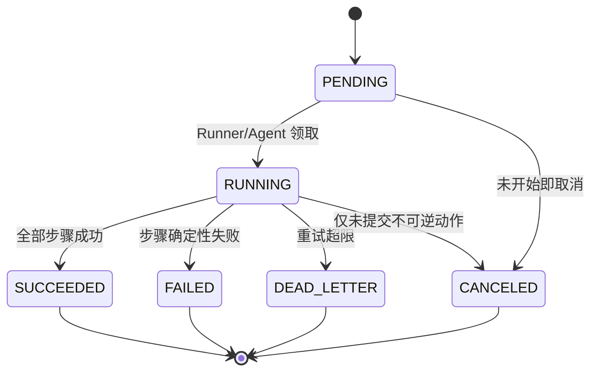
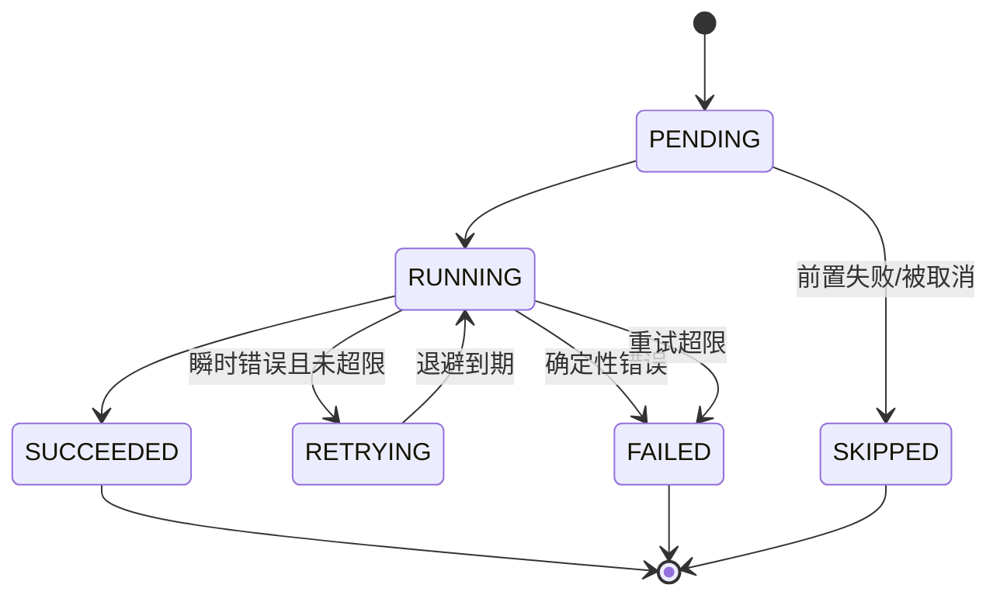

# ADR-25 · 任务状态机与重试表示

| 项目 | 内容 |
| --- | --- |
| 状态 | **Accepted（已确认）** |
| 决策日期 | 2026-11-15 |
| 决策人 | 项目负责人 |
| 影响范围 | 架构设计 §5.2 / §8 / §9、API 与数据模型、测试 TC-31、前端任务列表 |
| 关联 | [ADR-02 异步任务](架构设计-Ceph管理平台.md) · [ADR-12 RabbitMQ](ADR-12-消息队列选型.md) · [权衡分析 B6](架构决策与权衡分析.md) |

---

## 1. 决策

**自动重试不动任务号，人工重跑开新单。**

| 重试类型 | 表示 | 理由 |
| --- | --- | --- |
| 瞬时错误自动重试 | 步骤进入 `RETRYING`，`attempt_count` 递增，**任务仍为 RUNNING** | 网络抖动不该产生新任务，否则看板被刷屏 |
| 人工重跑 | 新建任务，`parent_task_id` 指向原任务；原任务保持终态不变 | 两天前的失败与今天的重跑是两件事，审计要能分开追 |
| 重试超限 | 任务进入 `DEAD_LETTER` + 告警 | 与「失败」区分：失败是确定的错，死信是「试过了不行，要人看」 |

## 2. 状态机

### 2.1 任务级

### 2.2 步骤级

## 3. 错误分类与处理

| 类型 | 例子 | 处理 |
| --- | --- | --- |
| **瞬时** | 网络超时、锁等待、SSH 重连、镜像拉取 502 | 步骤 `RETRYING`，指数退避 1s→5s→30s→2min→10min，最多 5 次 |
| **确定性** | 参数非法、目标资源不存在、版本不兼容 | 不重试，步骤立刻 `FAILED`，任务 `FAILED` |
| **不可逆步骤失败** | OSD 已创建但后续步骤失败 | 步骤 `FAILED`，任务 `FAILED`，`compensable=false`；只允许人工清理后重跑（B5） |
| **重试超限** | 5 次仍失败 | 任务 `DEAD_LETTER`，进死信队列 + 告警 + 人工处理入口 |

错误分类由任务模板声明：每个步骤标注 `retryable: true/false` 与 `error_classes`，**不允许运行时靠字符串猜**。

## 4. 约束

| 约束 | 原因 |
| --- | --- |
| 状态单向流转，仅允许 `RETRYING → RUNNING` 回流 | 防止状态机变成「什么都能改」 |
| 每次状态迁移写事件（含操作者、时间、原因） | 审计与排障都要靠迁移序列，而不是只看最终状态 |
| **不加 `PAUSED` / `BLOCKED` / `WAITING_APPROVAL`** | 高危二次确认发生在**提交前**，属于交互而非任务状态；加这些状态会让状态机与 UI 都失控 |
| 「卡住」用 `last_progress_at` + 超时告警表示，不加状态 | 避免出现「RUNNING 三天」的僵尸任务；告警阈值按任务类型配置 |
| **人工重跑必须重新走参数校验**，不得复制原参数直接下发 | 否则「重跑」就成了绕过校验的后门 |
| 重跑任务与被重跑任务共享集群级 advisory lock | 防止原任务未清理完就重跑造成双重变更 |

## 5. 数据模型变更

| 表 | 字段 | 说明 |
| --- | --- | --- |
| `tasks` | `parent_task_id` | 人工重跑时指向原任务；自动重试为 NULL |
| `tasks` | `cancel_requested_at` | 取消意图与「已取消」区分：请求已记录，等步骤到达安全点 |
| `tasks` | `last_progress_at` | 僵尸任务检测，不新增状态 |
| `task_steps` | `attempt_count`（原 `retry_count`） | 第几次尝试，从 1 开始 |
| `task_steps` | `last_error_code` / `next_retry_at` | 退避可见，便于前端显示「约 30 秒后重试」 |
| `task_steps` | `compensable` | 不可逆步骤标记，禁止自动补偿 |

## 6. 代价

| 代价 | 说明 |
| --- | --- |
| 两套重试逻辑 | 自动与人工各一套，需分别测试；好处是语义清晰 |
| 任务列表需要「重跑」标识 | UI 要显示「由 #1001 重跑」，否则用户会以为是重复提交 |
| 僵尸任务需要额外告警规则 | `last_progress_at` 阈值按任务类型配置，配错就会误报 |

## 7. 验收（TC-31）

| 场景 | 通过标准 |
| --- | --- |
| 瞬时错误 | 步骤出现 `RETRYING` 并自动恢复，任务号不变，`attempt_count` 正确 |
| 确定性错误 | 不重试，立即 FAILED，错误码写入 `last_error_code` |
| 重试超限 | 任务 DEAD_LETTER，告警触发，死信入口可见 |
| 人工重跑 | 生成新任务且 `parent_task_id` 正确；原任务状态不变；新任务重新走参数校验 |
| 取消 | PENDING 立即 CANCELED；RUNNING 仅在安全点生效，已提交步骤不被回滚 |
| 僵尸检测 | 超过阈值无进展即告警，状态仍为 RUNNING（不新增状态） |

## 8. 什么情况下推翻

- 引入审批流（高危操作需多人签批）→ 需要 `WAITING_APPROVAL` 状态，届时应重做状态机而非打补丁。
- 任务需要「暂停 / 恢复」（如长时间维护窗口）→ 需新增 `PAUSED`，同样要重做。

推翻流程同前：新开 ADR → 本 ADR 标 `Superseded` → 同步架构设计 §5.2/§8、API 数据模型、TC-31、前端任务列表。
