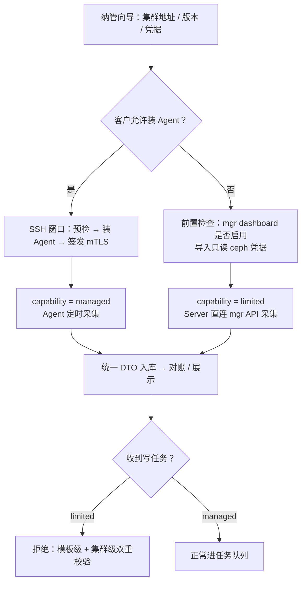

# ADR-27 · 纳管已有集群：双通道（Agent 托管 / 只读 API）

| 项目 | 内容 |
| --- | --- |
| 状态 | **Accepted（已确认）** |
| 决策日期 | 2026-11-15 |
| 决策人 | 项目负责人 |
| 影响范围 | 架构设计 §3 / §5.6 / §8、PRD FR-01、API 纳管接口、安全与审计设计、TC-33 |
| 关联 | [ADR-03 Agent 拉模式](架构设计-Ceph管理平台.md) · [ADR-23 预检执行者](ADR-23-建集群预检执行者.md) · [ADR-24 SSH 凭据](ADR-24-SSH凭据管理.md) · [权衡分析 B7](架构决策与权衡分析.md) |

---

## 1. 背景

PRD FR-01 是 P0，但架构设计只有一句「凭据导入 + 只读分级」。真实现场分两类：

- 客户允许装 Agent：能拿到写能力，与新建集群同一条路径；
- 客户**不允许在 Ceph 节点上装任何东西**（金融、政企常见）：只能只读观察。

如果只支持前者，PRD 的 `managed / limited` 分级就落空；如果只支持后者，产品就只剩「看板」。

## 2. 决策

**两条通道，由客户环境决定，不由平台偏好决定。**

| 通道 | 前置条件 | 能力 | 采集方式 |
| --- | --- | --- | --- |
| **managed**（推荐） | 可 SSH + 允许装 Agent | 全写（白名单任务） | Agent 拉模式执行 `ceph -s` / 拓扑 |
| **limited** | 集群启用 **mgr dashboard 模块** + 只读 ceph 凭据 + 网络可达 mgr | **只读**，所有写任务被拒 | Server 直连 mgr REST API 采集 |

`clusters.capability` 记录该集群属于哪种，UI 与 API 双处显式标注。

## 3. 纳管流程

## 4. 强制约束

| 约束 | 原因 |
| --- | --- |
| limited 必须用**独立只读凭据**（`mon r, osd r, mgr r, pg r`） | 禁止直接给 `client.admin`——只读通道不该持有写权限 |
| limited 集群**在 API 层拒绝所有写任务**，模板级与集群级各校验一次 | 单点校验会被新模板绕过 |
| limited 采集**只允许走 mgr REST API** | 拿不到 API 就不支持纳管，**不允许偷偷退回 SSH**（那会破坏 I3 的边界） |
| 两种 driver 产出**同一套 DTO** | 否则页面要为两种模式写两套渲染逻辑，字段漂移不可避免 |
| 记录 `ceph_version` 与 mgr API 版本，能力矩阵按版本判定 | mgr API 在不同版本字段有差异，不能假设一致 |
| limited 的采集失败只降级展示，不触发写操作 | 只读集群的故障不应引发平台「自愈」动作 |

## 5. 数据模型与接口

| 对象 | 变更 |
| --- | --- |
| `credentials.type` | 新增 `ceph_key`（只读 cephx key）、`dashboard`（mgr 用户口令），与既有 `ceph`（写权限）区分 |
| `clusters.capability` | `managed` / `limited`；变更需审计 |
| `clusters.deploy_mode` | 已有 `cephadm` / `rook` / `manual`；非 cephadm 只能走 limited |
| `clusters.collector` | 新增：`agent` / `ceph_api`，决定 Reconciler 用哪个 driver |
| `GET /clusters/{id}/capabilities` | 返回该集群支持的任务模板清单，前端据此禁用按钮 |

## 6. 代价

| 代价 | 说明 |
| --- | --- |
| 两套采集 driver | Reconciler 要抽象 driver 接口，并保证字段一致；测试要覆盖两种 |
| 客户侧前置条件 | limited 需要启用 mgr dashboard——不是所有集群都开，实施时须先确认 |
| 新增出站依赖 | Server → mgr endpoint（通常 8443）；这与「被管节点出站到管理面」是反方向的，防火墙要单独确认 |
| 只读凭据的权限设计 | cephx caps 写错（少了 `mgr r` 或多了 `osd w`）都会出问题，需给出标准命令 |

## 7. 风险

| 风险 | 缓解 |
| --- | --- |
| 客户既不让装 Agent、又没开 dashboard | **明确不支持纳管**，而不是退回 SSH；这是能力边界，写进售前清单 |
| limited 被误认为「可以改」 | UI 显示能力标签；写按钮置灰并给原因；审计记录拒绝事件 |
| 两套 driver 字段漂移 | 统一 DTO + 契约测试（同一集群两种模式对拍关键字段） |
| mgr API 性能被采集打满 | 采集频率下限（≥60s）+ 单集群串行 + 超时熔断 |

## 8. 验收（TC-33）

| 场景 | 通过标准 |
| --- | --- |
| managed 纳管 | SSH 窗口内完成预检 + 装 Agent；之后关闭 SSH 仍可采集（TC-29） |
| limited 纳管 | 不装任何组件；导入只读凭据后能展示健康/拓扑/容量 |
| limited 写操作 | 提交任何写任务被拒，且拒绝原因明确、留审计 |
| 凭据权限 | 只读 key 无法执行写命令（用该 key 实际尝试写，应失败） |
| 字段一致性 | 同一集群分别用两种 driver 采集，关键字段一致（允许采集时间差） |
| 前置不满足 | dashboard 未启用时，纳管流程明确失败并说明原因，不退回 SSH |

## 9. 什么情况下推翻

- 客户环境普遍允许装 Agent → 可取消 limited 通道，减少一条维护路径。
- Ceph 官方提供统一的只读 API 网关（替代 mgr dashboard）→ 换采集端，双通道结构不变。

推翻流程同前：新开 ADR → 本 ADR 标 `Superseded` → 同步架构设计 §3/§5.6/§8、PRD FR-01、API、TC-33。
