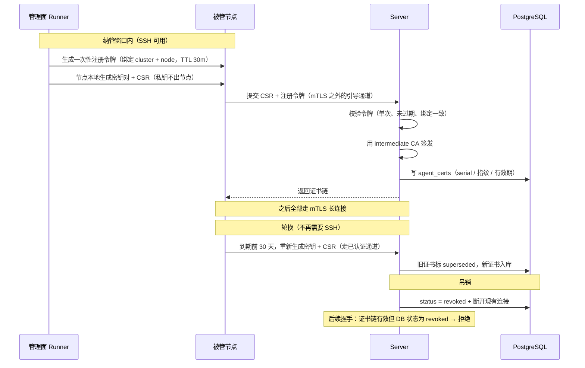

# ADR-28 · Agent 证书：内置两层 CA，私钥不出节点

| 项目 | 内容 |
| --- | --- |
| 状态 | **Accepted（已确认）** |
| 决策日期 | 2026-11-15 |
| 决策人 | 项目负责人 |
| 影响范围 | 架构设计 §3 / §5.7 / §8 / §11、安全与审计设计、纳管流程、TC-34 |
| 关联 | [ADR-03 Agent 拉模式](架构设计-Ceph管理平台.md) · [ADR-23 预检执行者](ADR-23-建集群预检执行者.md) · [ADR-24 SSH 凭据](ADR-24-SSH凭据管理.md) · [ADR-27 纳管双通道](ADR-27-纳管双通道.md) |

---

## 1. 背景

ADR-03 定了「Agent ↔ Server 双向 mTLS，证书按节点签发、可轮换可吊销」，但没回答：

- CA 是谁的？（决定离线交付可行性）
- 私钥谁生成？（决定平台被攻破后能否冒充节点）
- 离线环境怎么「即时吊销」？（CRL 分发在空气隔离环境基本不可行）

## 2. 决策

| 项 | 决策 |
| --- | --- |
| CA 归属 | **平台内置私有 CA**；外部 CA 预留配置位，**V1 实现** |
| CA 层级 | **两层**：`root`（离线保存，只签 intermediate）+ `intermediate`（在线签发节点证书） |
| 私钥生成 | **在节点本地生成**，平台只接收 CSR 并签发；**平台永不持有节点私钥** |
| 有效期 | 90 天，到期前 30 天自动轮换（带随机抖动，错峰） |
| 吊销 | **DB 状态 + 证书链双校验**：Server 校验 mTLS 时同时查 `agent_certs.status`，不依赖 CRL 分发 |
| 注册 | 一次性注册令牌（绑定 cluster + node，TTL 30 分钟，单次使用） |

### 2.1 为什么是两层

单层 CA 更简单，但 root 私钥必须常驻在线进程——一旦管理面被攻破，攻击者可以给任意节点签发「合法」证书。

两层的好处：root 私钥可离线保存（打印/保险柜），日常签发只用 intermediate；intermediate 泄露可单独轮换，不必让全部节点重新信任新 root。

> 如果团队认为两层太重，可以退化为单层，但必须明确接受「root 私钥在线」的风险，并在安全评审里记录。

## 3. 注册、轮换、吊销

**吊销为什么不走 CRL**：空气隔离环境里，CRL 的分发依赖「节点能拿到最新列表」，而这个前提经常不成立。改为「证书链 + DB 状态」双校验后，吊销只需一次写库 + 一次断连，**即时生效且不依赖任何分发**。

## 4. 强制约束

| 约束 | 原因 |
| --- | --- |
| 节点私钥**本地生成、永不外传**，平台只存 CSR 与证书 | 平台持有私钥 = 攻破后可冒充任一节点 |
| 注册令牌单次使用、绑定 cluster + node、TTL 30 分钟 | 令牌泄露也不至于被用来注册任意节点 |
| 握手校验**证书链 + DB 状态**，两者都过才放行 | 只验链无法即时吊销；只查库则不防伪造 |
| root 私钥不参与日常签发，仅用于签 intermediate | 降低在线暴露面 |
| CA 私钥按凭据级别加密存储，并**离线备份** | 丢了 CA 就得给所有节点重签，等于重装 |
| 证书有效期 90 天 + 轮换抖动 | 太长则泄露窗口大；无抖动则到期日集中 |
| 时钟偏差超阈值直接拒绝签发 | 时间不对的证书等于废纸；prechecks 已前置检查 |
| 外部 CA 模式只发 CSR，私钥仍由节点生成 | 与内置模式保持一致的安全属性 |

## 5. 数据模型

| 表 | 字段 |
| --- | --- |
| `agent_certs` | id, node_id, serial(uk), fingerprint, not_before, not_after, status(active/superseded/revoked), issued_by(internal/ext), revoked_at, revoke_reason, created_at |
| `ca_state` | id, kind(root/intermediate), cert_pem, key_cipher, not_after, rotated_at —— 只存密文，明文私钥不落盘 |

`hosts` 表保留 `cert_serial` 冗余字段，便于握手后快速定位。

## 6. 代价

| 代价 | 说明 |
| --- | --- |
| 两层 CA 的管理动作 | root 离线保存、intermediate 轮换要做 runbook，运维要培训 |
| 每次握手多一次 DB 查询 | 可接受（连接是长连接，握手不频繁）；但要监控查询延迟 |
| 一次性令牌通道 | 需要一条「未认证」的引导接口，必须严格限流与审计，否则成为攻击面 |
| 90 天轮换带来周期任务 | 需要监控「即将过期」并告警，否则到期即断连 |

## 7. 风险

| 风险 | 缓解 |
| --- | --- |
| root 私钥泄露 | 离线保存 + 加密存储 + 泄露预案（换 root 需全部重签，流程要提前写好） |
| 引导接口被滥用 | 令牌单次 + 绑定 + TTL + 限流 + 审计，失败即告警 |
| 大批节点同日到期 | 签发时加随机抖动（±7 天） |
| 时钟漂移导致签发失败 | prechecks 强制时间同步（已实现）+ 签发前二次校验 |
| CA 丢失 | 强制离线备份，且备份纳入交付验收清单 |

## 8. 验收（TC-34）

| 场景 | 通过标准 |
| --- | --- |
| 注册 | 令牌一次有效；重复使用失败；过期失败；绑定不匹配失败 |
| 私钥不外传 | 抓取注册请求，确认只含 CSR，无私钥字段 |
| 轮换 | 不依赖 SSH，到期前自动完成，旧证书失效、新证书可用 |
| 吊销 | 置 revoked 后现有连接立即断开，重连被拒；其他节点不受影响 |
| 伪造 | 用另一 CA 签发的证书连接被拒 |
| CA 备份恢复 | 从备份恢复后可继续签发，已发证书仍有效 |
| 时钟偏差 | 偏差超阈值时签发被拒并给出明确原因 |

## 9. 什么情况下推翻

- 客户强制要求使用其 PKI → 启用外部 CA 位（V1 已规划），私钥仍节点本地生成。
- 引入 SPIFFE/SPIRE 等标准工作负载身份体系 → 证书签发改为对接 SVID，本 ADR 的「私钥不出节点 + 双校验」原则保留。

推翻流程同前：新开 ADR → 本 ADR 标 `Superseded` → 同步架构设计 §3/§5.7/§8/§11、安全设计、TC-34。
