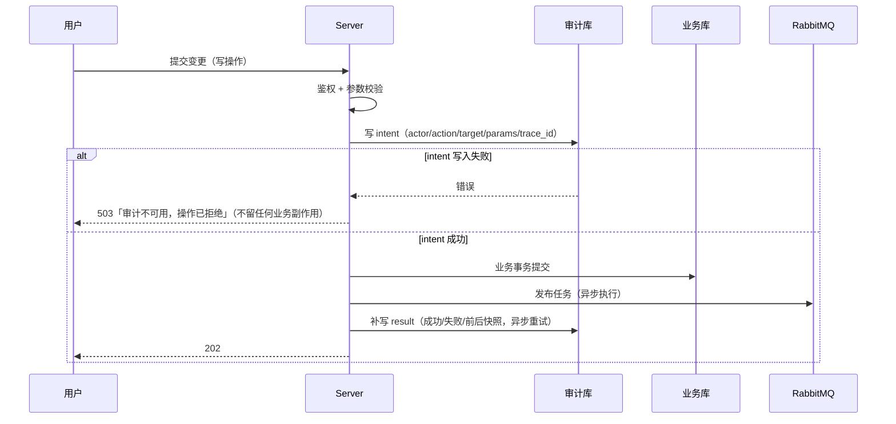

# ADR-29 · 审计落点：独立库 + 两段式写入（intent 必达 / result 补偿）

| 项目 | 内容 |
| --- | --- |
| 状态 | **Accepted（已确认）** |
| 决策日期 | 2026-11-15 |
| 决策人 | 项目负责人 |
| 影响范围 | 架构设计 §5.8 / §8 / §11、安全与审计设计 §5、API 审计导出、部署方案（新增审计库）、TC-35 |
| 关联 | [ADR-06 DB 只存元数据](架构设计-Ceph管理平台.md) · [ADR-25 任务状态机](ADR-25-任务状态机.md) · [安全与审计设计](../../07-新兴与稀缺线/19-安全工程师/安全与审计设计.md) |

---

## 1. 背景

文档一直写着「审计写入失败则任务拒绝执行（fail-closed）」和「审计独立存储」，但这两句在跨库时不能同时严格成立：

**跨库没有共同事务**。要么退成异步（会丢），要么承认「审计库是写路径的强依赖」。不说清这一点的 fail-closed 只是口号。

## 2. 决策

| 项 | 决策 |
| --- | --- |
| 存储 | **独立审计库**（同实例独立 database，或独立 PG 实例，配置项） |
| 写入模型 | **两段式**：`intent`（意图）同步必达 → `result`（结果）提交后补写 |
| intent 失败 | **拒绝执行**写操作（这才是真正的 fail-closed） |
| result 失败 | 进 outbox 重试 + 告警；不阻塞业务，但**必须对账**（每日扫描「有 intent 无 result」） |
| 防篡改 | **链式哈希**：每条记录含前一条的 hash；每日把尾 hash 记账到外部（导出/邮件/交付物） |
| 保留 | 在线 ≥180 天，按月分区；过期归档或删除，**归档动作本身记审计** |

### 2.1 一次写操作的审计时序

## 3. 为什么接受「审计库仍是强依赖」

用户要的是「隔离故障」，但需要说清隔离的是什么：

| 隔离掉了 | 没有隔离 |
| --- | --- |
| 审计表膨胀影响业务库性能 | 审计库不可用时**写操作仍被拒绝** |
| 业务库 DBA 顺手改审计记录 | 跨库写入的额外延迟（每次写操作多一跳） |
| 审计库被拖库 = 业务数据一并泄露 | 跨库网络故障导致的 intent 失败 |

**如果要求「审计库挂了业务照跑」，那就必须放弃 fail-closed**——这是二选一，不能两头都要。本项目选 fail-closed，因为「做了事没痕迹」比「暂时不能改」更难向审计交代。

## 4. 强制约束

| 约束 | 原因 |
| --- | --- |
| 业务账号**只有 INSERT**，无 UPDATE/DELETE/TRUNCATE | 应用自己都不能改历史 |
| 审计库与业务库**不同 database、不同凭据** | 业务库凭据泄露不应连带审计 |
| 每条记录带 `prev_hash` + `hash`（链式） | 单点篡改可被发现；配合每日尾 hash 外锚 |
| result 补写必须**幂等**（按 trace_id upsert） | 重试不能产生重复记录 |
| 「有 intent 无 result」每日对账并告警 | 这是跨库模型唯一的兜底 |
| 导出必须流式，且**导出动作本身记审计**（元审计） | 导出即数据外流，必须可追溯 |
| 审计写入**禁止绕过**（无「静默模式」开关） | 一旦有开关，生产就会有人关掉 |

## 5. 数据模型

| 表（审计库） | 关键字段 |
| --- | --- |
| `audit_intents` | id, trace_id(uk), actor, src_ip, action, target_type, target_id, params_redacted, created_at, prev_hash, hash |
| `audit_results` | id, trace_id, result, error_code, before_snapshot, after_snapshot, duration_ms, created_at, prev_hash, hash |

业务库不再保留 `audit_logs` 表（迁移到审计库），但保留 `trace_id` 关联，便于联查。

## 6. 代价

| 代价 | 说明 |
| --- | --- |
| 每次写操作 +1 次跨库往返 | 内部平台可接受；批量操作需批量写 intent，否则延迟累加 |
| 审计库成为写路径单点 | 必须做备份与恢复演练，优先级等同业务库（不是「可降级组件」） |
| 两段式带来「结果缺失」窗口 | 每日对账 + 告警兜住；缺失记录标记为 `unknown` 而不是假装成功 |
| 链式哈希增加实现复杂度 | 并发写入需串行化锚点（按分区加锁或单写队列）；否则链会分叉 |

## 7. 风险

| 风险 | 缓解 |
| --- | --- |
| 链式哈希在高并发下成为瓶颈 | 按天/按分区独立成链，链头 hash 单独锚定 |
| 审计库故障导致平台「只能看不能改」 | 这是设计选择，需在运维手册里写明并做演练；不允许临时关闭审计 |
| 归档后无法检索历史 | 归档保留索引（trace_id/时间范围），支持按需恢复单月 |
| 参数里的敏感值被记入审计 | `params_redacted` 统一脱敏（复用凭据脱敏规则），审计里永不出现明文口令 |

## 8. 验收（TC-35）

| 场景 | 通过标准 |
| --- | --- |
| 审计库断开 | 写操作返回 503 且**无任何业务副作用**；读操作不受影响 |
| result 补写失败 | 恢复后自动补齐；重复补写不产生重复记录 |
| 对账任务 | 人为制造「有 intent 无 result」，次日告警出现 |
| 篡改检测 | 直接改一条记录，链式校验能定位到该条 |
| 导出 | 导出内容与库一致；导出动作产生元审计记录 |
| 不可绕过 | 全代码库搜索无「关闭审计」的开关或环境变量 |

## 9. 什么情况下推翻

- 合规要求「审计必须与业务同事务、不可分离」→ 回到同库同事务（ADR 需重写）。
- 引入专用审计产品（SIEM）→ 平台只做 intent 转发，本 ADR 的「intent 必达」原则保留。

推翻流程同前：新开 ADR → 本 ADR 标 `Superseded` → 同步架构设计 §5.8/§8/§11、安全设计 §5、部署方案、TC-35。
