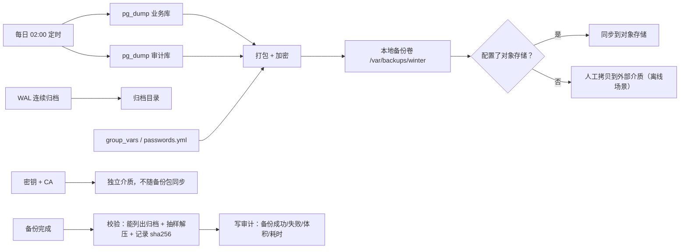

# ADR-31 · 备份与恢复：数据 + 密钥 + CA + 配置，镜像与日志不备

| 项目 | 内容 |
| --- | --- |
| 状态 | **Accepted（已确认）** |
| 决策日期 | 2026-11-15 |
| 决策人 | 项目负责人 |
| 影响范围 | 架构设计 §5.10 / §10 / §12、部署方案（备份卷）、安装手册 §6、TC-37、AGENTS.md |
| 关联 | [ADR-16 镜像仓库](ADR-16-镜像仓库.md) · [ADR-28 证书体系](ADR-28-Agent证书体系.md) · [ADR-29 审计落点](ADR-29-审计落点.md) |

---

## 1. 决策

| 备份对象 | 备不备 | 说明 |
| --- | --- | --- |
| 业务库 PostgreSQL | **备** | 每日全量 + WAL 连续归档 |
| 审计库（独立） | **备** | 同上；审计不可重建，必须备 |
| 凭据加密密钥 | **备（独立介质）** | 没有它，库里的 `cipher_text` 全是废数据 |
| CA（root + intermediate） | **备（独立介质）** | 丢了要给所有节点重签，等于重装 |
| 配置（`group_vars`、`passwords.yml`） | **备** | 体积小，价值极高 |
| Harbor 镜像存储 | **不备** | 可从离线包重推；纳秒级成本换来数十 GB 体积，不值 |
| 指标（VictoriaMetrics） | **不备** | 可重新采集 |
| 日志（VictoriaLogs） | **不备** | 可丢；审计另有独立出口 |

**目标**：RPO ≤ 15 分钟（WAL 归档频率），RTO ≤ 2 小时（含镜像重推）。

## 2. 最容易被忽略的一条

**密钥不能和数据库备份放同一个地方。**

凭据在库里是密文，解密要密钥；如果备份包里有库也有密钥，那么拿到备份包 = 拿到全部 Ceph 凭据。所以：

- 备份包**加密**（age / GPG 对称，口令离线保管）；
- **密钥单独介质**（另一块盘 / 保险柜 / 密码管理器），与数据库备份物理分离；
- 恢复时必须两边都到齐——这也是恢复演练要验的内容。

## 3. 备份流程

**备份本身也要被审计**：成功、失败、体积、耗时都要记录——「备份一直在失败但没人发现」是最常见的灾难剧本。

## 4. 恢复顺序

| 步 | 动作 | 注意 |
| --- | --- | --- |
| 1 | 按安装手册部署管理面（`deploy.sh`） | 先有能跑的骨架 |
| 2 | 停业务写入（只起 PG 与 Server 只读模式） | 避免恢复期间接受变更 |
| 3 | 恢复业务库（全量 + WAL 到目标时间点） | PITR |
| 4 | 恢复审计库 | 与业务库时间点尽量一致 |
| 5 | 恢复密钥与 CA 到各自位置 | 缺任何一个，后续步骤会明确失败 |
| 6 | 校验：能解出凭据、能签出证书、会话全部失效 | 会话失效是**预期**行为（ADR-26） |
| 7 | 起剩余组件，触发一次全量对账 | 恢复后漂移是正常的，靠对账追平 |
| 8 | 重推管理面镜像（Harbor 未备） | 从离线包 push |
| 9 | 记录恢复演练结果并写审计 | 形成可审计的记录 |

**Agent 不需要重装**：证书还在节点上且未被吊销，恢复后自动重连（ADR-28）。

## 5. 强制约束

| 约束 | 原因 |
| --- | --- |
| 备份文件必须加密 | 里面有全部集群凭据的密文与全部审计 |
| 密钥与数据库备份**物理分离** | 同包 = 拿到即全解 |
| 备份卷与数据卷分离 | 同盘时「盘坏了备份也没了」 |
| 每季度至少一次**恢复演练**，且演练记录入审计 | 没演练过的备份不算备份 |
| 备份失败必须告警，且连续失败升级 | 静默失败的备份最危险 |
| 恢复后强制全量对账 | 恢复点与真实状态必然有差 |
| 保留：日备 30 天、月备 12 个月 | 兼顾误删恢复与合规 |

## 6. 代价

| 代价 | 说明 |
| --- | --- |
| 恢复需要重推镜像 | 多几十分钟；换来备份体积小一个数量级 |
| 备份卷另需容量 | 建议独立卷 ≥100G（不计入部署方案的 350G 数据盘） |
| 密钥分离增加操作复杂度 | 现场必须有人知道密钥在哪；写进交付清单 |
| 季度演练有成本 | 但这是唯一能证明「备份可用」的方式 |

## 7. 风险

| 风险 | 缓解 |
| --- | --- |
| 密钥丢失 → 库恢复出来但凭据不可用 | 密钥双份异地保存；恢复演练必须验证「能解密」 |
| 备份成功但不可恢复 | 演练只验真实恢复，不验「文件存在」 |
| 备份占满磁盘导致业务写失败 | 备份卷独立 + 容量水位告警 |
| 恢复后旧会话仍有效 | 恢复流程强制清空 `sessions` |
| 离线环境无对象存储 | 人工拷贝 + 双人确认；介质编号登记 |

## 8. 验收（TC-37）

| 场景 | 通过标准 |
| --- | --- |
| 全量恢复演练 | 在一台新机器上按顺序恢复到可用状态，RTO 达标 |
| PITR | 恢复到指定时间点，数据与预期一致 |
| 密钥缺失 | 只恢复库不恢复密钥时，流程**明确失败**并指出缺什么，不静默 |
| 备份加密 | 备份包无法直接读出明文；口令错误时解包失败 |
| 会话清理 | 恢复后所有旧会话失效 |
| 备份告警 | 故意让备份失败，告警在约定时间内到达 |

## 9. 什么情况下推翻

- 引入专用备份系统（如 Velero 式卷快照 + 应用一致性钩子）→ 介质与流程替换，范围原则不变。
- 要求 RPO < 1 分钟 → 需要同步复制或跨节点热备，属 HA 范畴（ADR-10 已把 HA 推到 V1）。

推翻流程同前：新开 ADR → 本 ADR 标 `Superseded` → 同步架构设计 §5.10/§10/§12、部署方案、安装手册、TC-37。
