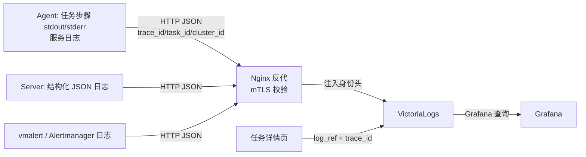
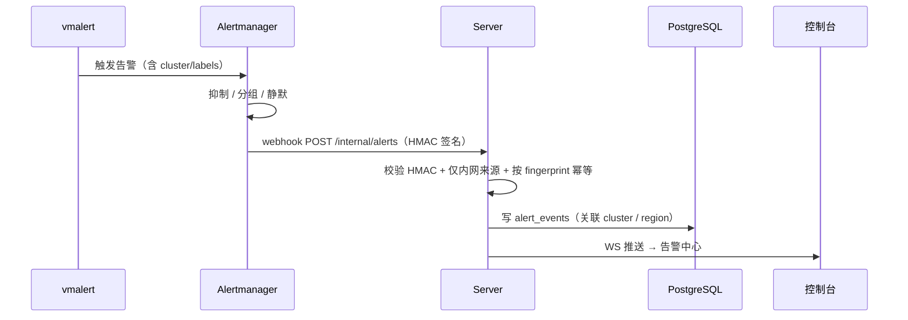

# ADR-33 · 日志与告警链路：Agent 直推 VL，告警走 webhook 回流

| 项目 | 内容 |
| --- | --- |
| 状态 | **Accepted（已确认）** |
| 决策日期 | 2026-11-15 |
| 决策人 | 项目负责人 |
| 影响范围 | 架构设计 §5.4 / §12、安全与审计设计 §6、Agent 设计、TC-39 |
| 关联 | [ADR-18 可观测性栈](ADR-18-可观测性栈.md) · [ADR-28 证书体系](ADR-28-Agent证书体系.md) · [ADR-03 Agent 拉模式](架构设计-Ceph管理平台.md) |

---

## 1. 决策

| 数据 | 路径 | Server 的角色 |
| --- | --- | --- |
| 指标 | Ceph mgr prometheus / node-exporter → VM（remote_write 或 scrape）→ vmalert → Alertmanager | 只查，不转发 |
| **日志** | Agent（含任务步骤 stdout/stderr）→ **HTTP 直推 VictoriaLogs** | **不碰日志字节** |
| **告警** | vmalert → Alertmanager → **webhook → Server** `/internal/alerts` → `alert_events` → 告警中心 | 入库、关联集群、去重 |
| 面板 | Grafana → 经 Nginx 反代（注入身份头）→ 查询 VM | 不代理 |

**Server 不代理日志**：日志量与 API 流量不是一个量级，让 Server 转发等于给主路径加一个必然的瓶颈。

## 2. 日志链路

| 约束 | 说明 |
| --- | --- |
| 鉴权用 **mTLS 客户端证书**，复用 Agent 证书（ADR-28） | 不新造一套日志令牌；Nginx 校验后注入身份头，VL 不做业务鉴权 |
| **日志不可用不阻塞任务** | 任务的成功与否由 DB 状态决定；VL 挂了只影响「看日志」，不影响「做操作」 |
| Agent 本地**环形缓冲**（内存 + 可选落盘） | 断连时先缓存，恢复后补推；超出容量丢最旧 |
| 任务步骤日志**同时落本地文件并上报 `log_ref`** | VL 是检索层，本地文件是「现场证据」，两者互补 |
| 必须有**限流与采样** | 单节点日志刷屏（死循环重试）不能打满 VL |
| 禁止把凭据写进日志 | 与 I5 一致；脱敏在产生侧做，不靠事后清洗 |

## 3. 告警回流

| 约束 | 说明 |
| --- | --- |
| webhook 必须 **HMAC 签名 + 仅内网** | 否则任何能访问该端口的人都能伪造「集群故障」 |
| 按 `fingerprint` **幂等**写入 | Alertmanager 会重复投递，重复入库会刷屏 |
| 抑制与分组交给 Alertmanager，平台不重复实现 | 两处都做规则，行为会打架 |
| 告警与审计分开 | 告警可丢（会重发），审计不可丢（ADR-29） |

## 4. 代价

| 代价 | 说明 |
| --- | --- |
| 节点需要直达 VL（新增出站路径） | 部署方案端口表要加一条；现场防火墙要放行 |
| Agent 内置推送客户端 | 增加少量代码与缓冲逻辑，但换来 Server 不被拖累 |
| 日志与任务状态可能不一致 | 极端情况下任务成功但日志缺失；以 DB 为准，UI 需提示「日志不完整」 |
| mTLS 到 Nginx 的额外握手 | 长连接复用，实际开销可忽略 |

## 5. 风险

| 风险 | 缓解 |
| --- | --- |
| 单节点日志风暴打满 VL | 单节点限流（条数/字节）+ 采样 + 水位告警 |
| 日志把磁盘写满（VL 最先满） | 保留期（ADR-32）+ 水位告警 + 只读保护 |
| 伪造告警 webhook | HMAC + 内网白名单 + 时间戳防重放 |
| 断连期间日志丢失导致排障缺证据 | 本地环形缓冲 + 步骤日志落盘；关键步骤的权威记录在 DB |
| trace_id 断链 | 由 Server 生成并注入任务，Agent 原样携带；缺 trace_id 的日志单独标记 |

## 6. 验收（TC-39）

| 场景 | 通过标准 |
| --- | --- |
| VL 停机 | 任务照常成功；日志补推；UI 提示日志不完整而非报任务失败 |
| Agent 断连 | 本地缓冲生效，恢复后补推，不丢最近 N 分钟 |
| 伪造 webhook | 无签名/错签名/过期时间戳的请求被拒并告警 |
| 重复投递 | 同一 fingerprint 多次投递只产生一条事件 |
| 链路追踪 | 从任务详情能跳到对应日志（trace_id 贯穿） |
| 日志风暴 | 单节点刷屏被限流，其他节点日志不受影响 |

## 7. 什么情况下推翻

- 需要日志「零丢失」（合规）→ 改为本地落盘 + 采集器确认机制，代价是节点多一个进程。
- 引入统一日志网关（如 Vector 集群）→ 采集端替换，Server 仍不代理。

推翻流程同前：新开 ADR → 本 ADR 标 `Superseded` → 同步架构设计 §5.4/§12、安全设计 §6、TC-39。
