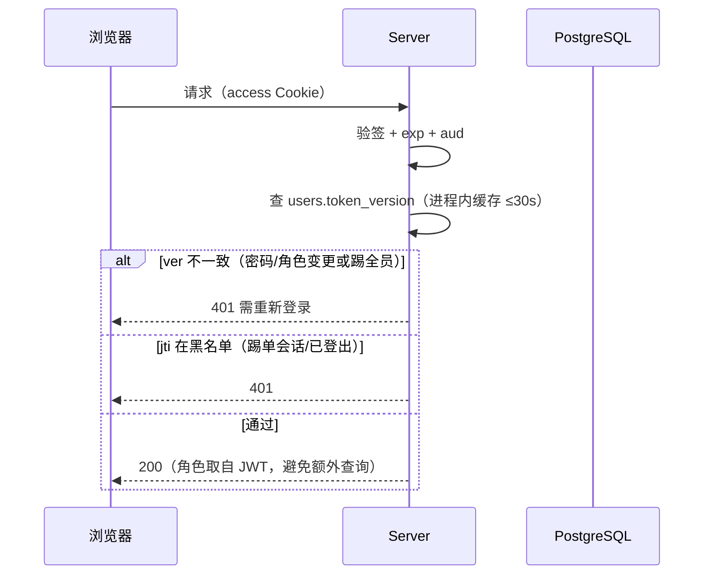

# ADR-34 · 会话方案：JWT + 版本号/黑名单（取代 ADR-26）

| 项目 | 内容 |
| --- | --- |
| 状态 | **Accepted（已确认）** |
| 决策日期 | 2026-11-15 |
| 决策人 | 项目负责人 |
| 取代 | [ADR-26](ADR-26-会话存储.md)（原定 PG 会话表 + 不透明 Session ID） |
| 影响范围 | 架构设计 §5.5 / §8 / §10、安全与审计设计 §3、API `/auth/*`、TC-32、`group_vars` |
| 关联 | [ADR-22 LDAP](ADR-22-LDAP接入.md) · [ADR-21 认证源](ADR-21-认证源.md) |

---

## 1. 变更点

| 项 | ADR-26 | 本 ADR |
| --- | --- | --- |
| 令牌 | 不透明 Session ID | **JWT（access）+ 不透明 refresh** |
| 身份来源 | 每请求查 `sessions` 表 | **JWT 自包含**，靠签名 + 版本号校验 |
| 撤销 | 置 `revoked_at`，下一请求即 401 | **版本号 `token_version`（全员）+ jti 黑名单（单会话）** |
| 踢人延迟 | 0（每次查库） | **≤30s**（缓存窗口），可配 0 换取即时 |

继续执行的部分：Argon2id、HttpOnly + Secure + SameSite Cookie、登录后轮换、改角色/改密码使旧令牌失效、审计不记令牌明文。

## 2. 为什么改

1. **Server 可真正无状态**：access 校验不依赖 DB（签名 + 缓存比对），水平扩展不必共享会话存储。
2. **省掉一张高频写入的表**：`sessions` 表每请求要更新 `last_seen_at`，JWT 方案下没有这个写放大。
3. **前端多端登录更自然**：access 短、refresh 长，符合常规体验。

## 3. 必须承认的代价

**「纯 JWT」不能即时踢人。** 要做到「点一下立刻下线」，只有两条路：

- **版本号**（`users.token_version`）：改密码、改角色、踢全员时 `+1`；JWT 里带 `ver`，校验时比对。
- **jti 黑名单**：踢单个会话时把该 `jti` 写入黑名单，TTL 到 access 过期为止。

两者都是**读库**操作。为了不让每个请求都查库，只能加缓存——而缓存就意味着窗口期：

| 缓存 TTL | 踢人延迟 | 每请求开销 |
| --- | --- | --- |
| 0（关闭） | 立即 | 一次主键查询（等同 ADR-26 的成本） |
| 30s（默认） | ≤30s | 命中缓存时 0 查询 |
| 5min | ≤5min | 最省，但「踢人」名存实亡 |

**默认 30s**，并可配置为 0：需要零延迟的客户自己承担查询成本。这不是妥协，是把取舍显式化。

## 4. 令牌设计

| 项 | 设计 |
| --- | --- |
| access | JWT，HS256/ES256（密钥来自平台密钥库），有效期 **15 分钟** |
| access claims | `sub`（user_id）、`idp`、`role`、`ver`（token_version）、`jti`、`exp`、`iat` |
| refresh | 不透明随机串（256bit），**哈希存 PG** `refresh_tokens`，有效期 **7 天**，一次一换（rotation） |
| 存放 | 两者均 HttpOnly + Secure + SameSite=Lax，`__Host-` 前缀；**禁止 localStorage** |
| 角色 | **放进 JWT**（减少每请求查询）；角色变更靠 `ver++` 强制失效 |
| CSRF | 双提交 token（header），写操作必带 |

## 5. 校验流程

## 6. 撤销语义

| 场景 | 手段 | 生效 |
| --- | --- | --- |
| 登出当前会话 | access `jti` 入黑名单 + 删 refresh | 立即（不缓存黑名单时）/ ≤30s |
| 踢某个会话 | 同上 | 同上 |
| 踢该用户全部会话 | `users.token_version + 1` + 删其 refresh | ≤30s（默认） |
| 改密码 / 改角色 | `token_version + 1` | ≤30s |
| 账号禁用 | `token_version + 1` + `status=disabled` | ≤30s |

## 7. 数据模型

| 对象 | 变更 |
| --- | --- |
| `users` | 增 `token_version`（int，默认 1） |
| `refresh_tokens` | id, user_id, token_hash(uk), issued_at, expires_at, revoked_at, client_fp —— 替代原 `sessions` 表 |
| `token_blacklist` | jti(uk), expires_at, reason —— 只增，按 `expires_at` 清理（与 access 同寿命，表很小） |
| ~~`sessions`~~ | 删除 |

## 8. 代价

| 代价 | 说明 |
| --- | --- |
| 踢人有 ≤30s 窗口 | 要零延迟就关缓存，代价是每请求一次查询 |
| 改角色强制重登 | 用户会觉得「怎么又要登录」，需在 UI 提示原因 |
| 三件套复杂度 | ver + jti 黑名单 + refresh rotation，比「查会话表」多写不少代码 |
| refresh 仍需存储 | 「纯无状态」只在 access 层面成立，refresh 一定是服务端状态 |
| 密钥轮换 | JWT 签名密钥轮换需要过渡期（新旧密钥并行验签） |

## 9. 风险

| 风险 | 缓解 |
| --- | --- |
| 缓存导致踢人延迟，被当成「已下线」 | UI 明确提示「最多 30 秒生效」；安全事件场景可临时把 TTL 调 0 |
| JWT 泄露后 15 分钟内可用 | 短有效期 + 绑定 `client_fp` 做异常检测（不强制拒绝，避免误杀） |
| 黑名单无限增长 | TTL 与 access 同寿命，过期即删；表规模可控 |
| 角色变更后旧 token 仍带旧角色 | 依赖 `ver` 比对强制失效——**这是唯一防线**，测试必须覆盖 |
| 签名密钥泄露 | 密钥存平台密钥库；轮换预案写进运维手册 |

## 10. 验收（TC-32）

| 场景 | 通过标准 |
| --- | --- |
| 登出 | 当前 access 立即被拒（jti 黑名单生效） |
| 踢单会话 | 目标会话失效，同用户其他会话不受影响 |
| 踢全部 | `ver++` 后在缓存窗口内失效；TTL=0 时立即失效 |
| 改角色 | 旧 access 被拒（ver 不一致），重新登录后拿到新角色 |
| refresh 轮换 | 旧 refresh 用一次即失效；重放被拒 |
| 缓存窗口 | 配置 TTL=30s 时延迟可见；配置 0 时立即生效 |
| 多副本 | A 副本登录、B 副本请求正常；踢人后各副本在窗口内一致 |
| 令牌存放 | 浏览器 localStorage 中无任何令牌 |

## 11. 什么情况下推翻

- 「零延迟踢人」成为硬合规要求 → 关缓存或回到 PG 会话表（ADR-26 的思路）。
- 需要跨产品单点登录 → 引入 OIDC，令牌由 IdP 签发，本 ADR 退化为资源服务器校验。

推翻流程同前：新开 ADR → 本 ADR 标 `Superseded` → 同步架构设计 §5.5/§8/§10、安全设计、API、TC-32。
