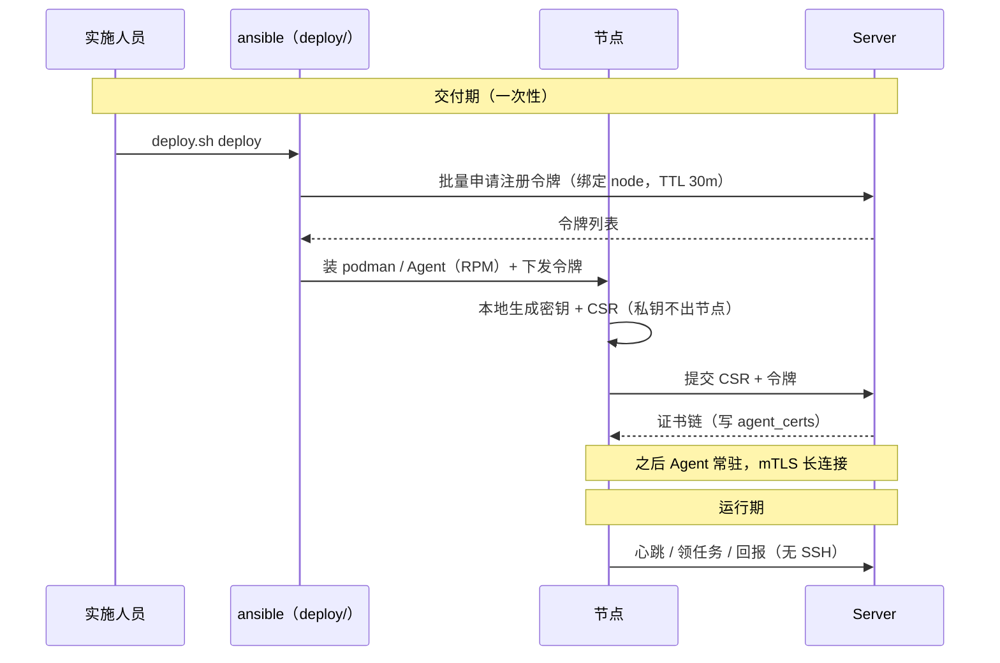

# ADR-35 · Agent 预装、运行期零 SSH、纳管单位为集群

| 项目 | 内容 |
| --- | --- |
| 状态 | **Accepted（已确认）** |
| 决策日期 | 2026-11-15 |
| 决策人 | 项目负责人 |
| 取代 | [ADR-23](ADR-23-建集群预检执行者.md)（Runner/SSH 窗口）、[ADR-27](ADR-27-纳管双通道.md)（limited 走 mgr API） |
| 修订 | [ADR-24](ADR-24-SSH凭据管理.md)（范围缩小：平台完全不持 SSH 凭据） |
| 影响范围 | 架构设计 §3 / §5.1 / §5.6 / §7 / §8 / §11、安全设计 §1、全景与图册、TC-29/TC-33、AGENTS I3 |
| 关联 | [ADR-03 Agent 拉模式](架构设计-Ceph管理平台.md) · [ADR-28 证书体系](ADR-28-Agent证书体系.md) · [ADR-17 部署框架](ADR-17-部署框架.md) |

---

## 1. 决策

| 项 | 决策 |
| --- | --- |
| **Agent 安装时机** | **交付期预装**：由 `deploy/` 的 ansible 阶段装到所有被管节点，同时完成注册与证书签发 |
| **运行期 SSH** | **零**。平台不持有任何 SSH 凭据，不建立任何 SSH 通道 |
| **Server 与 Ceph** | **无任何直接关系**：不连 mgr REST、不调 cephadm、不执行 ceph CLI |
| **唯一执行通道** | Agent（mTLS），所有节点命令与集群读写都经它 |
| **纳管单位** | **cluster**。节点预装后处于「未分配池」，纳管时划入某个 cluster，再部署 Ceph |
| **能力档** | `managed`（读写）/ `limited`（**只读 Agent**：只给只读 cephx key 与采集能力），同一通道、两种权限 |

## 2. 分层模型

```
Region（地域）
  └── AZ（可用区）
        └── Cluster（纳管单位：一个 Ceph 集群）
              └── Host（节点，已预装 Agent）
```

- `regions` / `azs` / `clusters` / `hosts` 四张表沿用；
- `hosts.cluster_id` **可为空** —— 空值表示「已预装、未纳管」，进未分配池；
- 纳管 = 把池里的节点绑定到 cluster，然后部署 Ceph；解除纳管 = 解绑，节点回池（不卸载 Agent）。

## 3. 为什么这样更好

1. **信任边界彻底简单**：全系统只有 Agent 能触达 Ceph。Server 完全待在管理面内，不需要 cephx 凭据，也不需要「管理面 → 集群」的反向防火墙。
2. **平台零 SSH 凭据**：原来 ADR-24 要把 SSH 凭据管到「内存态、用后擦除」，现在**根本不需要**——ANSIBLE 用的是实施人员的凭据，平台不持有。
3. **审计单一路径**：所有对 Ceph 的动作都经 Agent → Server → 审计，没有「中心直连」这个例外。
4. **取消客户侧前置条件**：不再要求启用 mgr dashboard、不再要求集群网络可达管理面。

## 4. 代价（必须接受）

| 代价 | 说明 |
| --- | --- |
| 交付多一步 | 必须先铺 Agent 才能纳管；「临时进来一台机器、不想装东西」的场景不支持 |
| **放弃「完全不装 Agent」的客户** | 这是明确的能力边界，要写进售前清单（原来 limited 就是为了这类客户） |
| 预检逻辑要重写 | 节点上不再有 ansible，预检改由 Agent 用 Go 实现；与 `deploy/roles/prechecks` 变成**两套实现**，靠同一份检查项清单 + 契约测试防漂移 |
| Agent 故障 = 该节点不可管 | 预检、部署、采集全依赖 Agent 心跳；Agent 挂了只能通过交付期工具（ansible）介入 |
| 节点重装/退役要走交付期流程 | 运行期没有 SSH，无法远程重装 Agent |
| 少了一条排障通道 | 平台侧不能自己查 `ceph -s`，只能看 Agent 上报；好处是凭据不扩散 |

## 5. 注册与证书（时机前移）



**预检也随之改由 Agent 执行**：`precheck` 变成一种任务类型，由 Agent 本地跑（读 os-release / chronyc / lsblk / ss / 探源），结果回 Server。检查项清单与 `deploy/roles/prechecks` 保持一致，用契约测试（同一份用例喂两边）防漂移。

## 6. 影响清单

| 项 | 变化 |
| --- | --- |
| 执行者模型（原 `tasks.executor`） | **只剩 `agent`**；`runner` 值保留但不再使用（向后兼容） |
| Runner 组件 | **取消**（从组件职责表、拓扑、图中移除） |
| `clusters.collector` | 删除（只有 agent 一种） |
| `hosts.cluster_id` | 允许 NULL（未分配池） |
| `capability` | 保留，含义改为「Agent 的权限档」，不再是「装不装」 |
| SSH 凭据管理（ADR-24） | 范围缩小：平台不持有；交付期由实施人员掌握 |
| TC-29 | 改写为「平台全生命周期无 SSH 凭据」 |
| TC-33 | 改写为「未分配池 → 纳管 → 部署」与「limited 只读档」 |

## 7. 什么情况下推翻

- 需要「零接触纳管」（客户连 Agent 都不让装，只能给 API）→ 必须恢复一条只读 API 通道，届时另立 ADR。
- 需要平台侧远程重装 Agent → 必须引入某种带外管理通道（IPMI/云 API），不属于 SSH 范畴。

推翻流程同前：新开 ADR → 本 ADR 标 `Superseded` → 同步架构设计 §3/§5.1/§5.6/§7/§8/§11、安全设计 §1、全景与图册、TC-29/TC-33、AGENTS I3。
