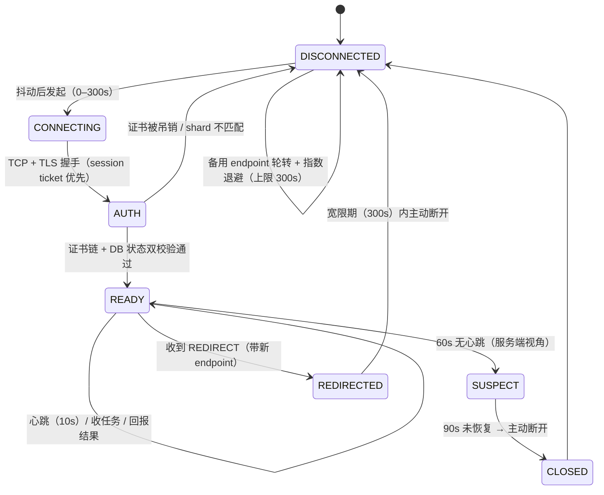

# ADR-38 · Agent ↔ Server 通信：10 万连接的分片方案

| 项目 | 内容 |
| --- | --- |
| 状态 | **Accepted（已确认）** |
| 决策日期 | 2026-11-15 |
| 决策人 | 项目负责人 |
| 范围 | **只定 Agent 与 Server 之间的通信**（连接归属、协议、路由、迁移、故障）；部署底座与数据面分片不在本 ADR |
| 扩展 | [ADR-37](ADR-37-容量模型与规模上限.md)（原上限 10k；>10k 走本方案） |
| 关联 | [ADR-03 Agent 拉模式](架构设计-Ceph管理平台.md) · [ADR-36 任务队列去 MQ](ADR-36-任务队列去MQ.md) · [ADR-28 证书体系](ADR-28-Agent证书体系.md) |

---

## 1. 问题

100,000 条长连接，任务表在 PG 里。核心问题不是「连接能不能扛」（10 GB 内存，能扛），而是：

> **任务怎么找到持有那条连接的那个进程？**

不分片时：40 个 Server 副本、10 万条连接散落各处，任一副本领到任务都可能「推不到目标 Agent」，只能靠路由表或跨副本转发——副本越多越糟。

## 2. 决策

| 项 | 决策 |
| --- | --- |
| 分片数 | **20 片**（每片 ≤5,000 连接） |
| 分片维度 | **按机房 / 可用区**绑定（Agent 连本地片，跨机房延迟最小） |
| Agent 归属 | **静态预配置**：交付期写入 `shard_id` + 1 个主 endpoint + 2 个备用 endpoint |
| 副本 | **每片 2 个对等副本**（双活，不做主备） |
| 任务路由 | `tasks.shard_id`；副本只领「本片 + 本地有连接」的任务；跨副本靠租约兜底 |
| 连接形态 | 一条 mTLS 连接承载 **3 个逻辑流**：控制（心跳）/ 任务 / 结果 |
| 迁移 | `REDIRECT` 指令 + 300s 宽限期 + 全局限速 50 次/s per shard |
| 日志 | **不走这条连接**（Agent 直推 VictoriaLogs，ADR-33），这是能把连接压到 100 KB 的关键 |

### 2.1 拓扑

```
                     ┌──────────────── Shard 07（机房 A）────────────────┐
Agent ×2,500 ──────▶ │ Server 副本 A ──┐                               │
（主 endpoint）       │                 ├── 本片 PG（tasks WHERE shard_id=7）
Agent ×2,500 ──────▶ │ Server 副本 B ──┘                               │
（同一 VIP）          └─────────────────────────────────────────────────┘
        │
        └─ 备用 endpoint ×2（本片副本挂了 → 按顺序退避重试）
```

**为什么对等双活而不是主备**：主备切主要重连 5,000 条；对等副本只重连 2,500 条，且不存在「切换」这个动作——Agent 重连到 VIP 上活着的那个即可。

## 3. 连接生命周期



**关键点**：`REDIRECT` 不是「断开重连」，而是「优雅迁移」——Agent 先完成手头任务、回报结果，再断开去新 endpoint，**迁移期间任务不丢**。

## 4. 消息类型与优先级

| 类型 | 方向 | 优先级 | 可丢弃 | 说明 |
| --- | --- | --- | --- | --- |
| `HEARTBEAT` | Agent→Server | 低 | **可合并/可丢** | 10s 一次；拥塞时合并为「批量心跳」 |
| `TASK_ASSIGN` | Server→Agent | 高 | 不可丢 | 带 `task_id` + 幂等键 |
| `TASK_RESULT` | Agent→Server | 高 | 不可丢 | 落库成功才 ack |
| `REDIRECT` | Server→Agent | **紧急** | 不可丢 | 携带新 endpoint + 宽限期 |
| `CERT_ROTATE_HINT` | Server→Agent | 中 | 可丢 | 提示轮换（Agent 自己也会按时轮换） |
| `LOG_*` | — | — | — | **不在此连接**（直推 VL） |

**背压规则**：每连接任务流窗口 = 4 个未完成任务；窗口满则 Server 不再派发（任务留在表里）。心跳流窗口 = 1，拥塞时直接丢旧值。

## 5. 容量与参数（100k）

| 指标 | 值 | 推导 |
| --- | --- | --- |
| 分片数 | 20 | 100k ÷ 5k |
| Server 进程数 | 40 | 20 片 × 2 副本 |
| 每副本连接 | 2,500 | 10 万 ÷ 40 |
| 每副本内存 | ≈250 MB | 2,500 × 100 KB |
| 每副本心跳 | 250 msg/s | 2,500 ÷ 10s |
| 全局心跳 | 10,000 msg/s | 100k ÷ 10s |
| accept 限速 | 200/s per 副本 | 全量重连 100k ÷ (200×40) ≈ 13s 铺开，叠抖动后更平 |
| 迁移限速 | 50/s per shard | 单片 5k 迁移 ≈ 100s |
| 每副本 PG 连接 | ≤20 | 40 × 20 = 800 → **PG 必须按下片区**，否则连接池先满 |

> 最后一行是硬前提：通信分片而数据不分片，第一个瓶颈会是 PG 连接池，不是 Server。

## 6. 故障处理

| 故障 | 影响 | 处理 |
| --- | --- | --- |
| 单个 Agent 卡死 | 无 | 服务端 60s 标 SUSPECT、90s 断开；任务靠租约回收 |
| 单副本重启 | 该片 2,500 条连接 | 重连到同片另一副本（VIP 自动）；任务由对端接手 |
| 整片故障 | 5,000 节点不可管 | Agent 按备用 endpoint 重试；**备用列表不允许指向同片**，否则一起挂 |
| 机房断网 | 该片全部离线 | 数据面不受影响；恢复后 Agent 抖动重连 |
| 控制面全挂 | 全部不可管 | Agent 本地缓存结果，恢复后补报（不丢任务） |
| 证书被吊销 | 单节点 | 握手拒绝；重新注册需交付期工具（ADR-35） |

**注意「整片故障 + 备用指向同片」这个坑**：备用 endpoint 必须指向**其他片**，否则片级故障时全部回连到同一处，形成二次风暴。

## 7. 代价

| 代价 | 说明 |
| --- | --- |
| 40 个 Server 实例 | 运维面显著上升（这也是为什么部署底座迟早要 K8s，但不在本 ADR 范围） |
| 静态分片不自动均衡 | shard 容量靠交付期规划；某机房超 5k 需提前拆片 |
| REDIRECT 是新机制 | 要处理「迁移中任务未完成」「宽限期到期仍未断开」两类边界 |
| 双活副本各自持有部分连接 | 任务可能「找错副本」，靠本地优先 + 租约兜底（多等一个租约周期） |
| 分片与数据必须对齐 | 通信分片而 PG 不分片 = 连接池先炸 |

## 8. 与既有 ADR 的关系

| ADR | 关系 |
| --- | --- |
| ADR-03（拉模式） | **不变**：仍是 Agent 主动连 Server，只是连到「自己那一片」 |
| ADR-36（PG 任务表） | **补字段**：`tasks.shard_id`，查询与派发都按片收敛 |
| ADR-37（容量模型） | **扩展上限**：10k 为「单控制面」上限；100k 走本 ADR 的 20 片 |
| ADR-35（零 SSH） | 不变；分片归属在交付期写入，不需要运行期改配置 |

## 9. 验收（TC-42）

| 场景 | 通过标准 |
| --- | --- |
| 10 万连接 | 20 片 × 2 副本全部建立；每副本 RSS ≤400MB；无 fd 报错 |
| 归属正确 | 每 Agent 连到自己 `shard_id` 的 VIP；跨片连接被拒绝 |
| 任务路由 | 任务只被本片副本领取；无重复派发；跨片任务不存在 |
| 单副本宕机 | 仅 2,500 条连接重连；30s 内恢复；任务不丢 |
| 整片故障 | 该片 Agent 按备用 endpoint 重试到其他片；**不形成同点风暴** |
| REDIRECT 迁移 | 迁移期间未完成任务完成回报后才断开；限速 50/s 生效 |
| 全量重连 | 仅重启一个副本时，重连不影响其他片 |
| 背压 | 单 Agent 任务窗口满时不再派发；心跳拥塞可丢，任务不丢 |

## 10. 什么情况下推翻

- 需要跨片自动均衡（机房规模动态变化）→ 静态分片改动态分配，需要目录服务。
- 需要「任意片管任意节点」→ 回到路由表方案，代价是跨副本 RPC。
- 连接数再上一个量级（>50 万）→ 单进程 5k 上限不变，片数增加，但 40 → 200 个实例的运维方式必须换成 K8s。

推翻流程同前：新开 ADR → 本 ADR 标 `Superseded` → 同步架构设计 §5.2/§10、图册、TC-42。
