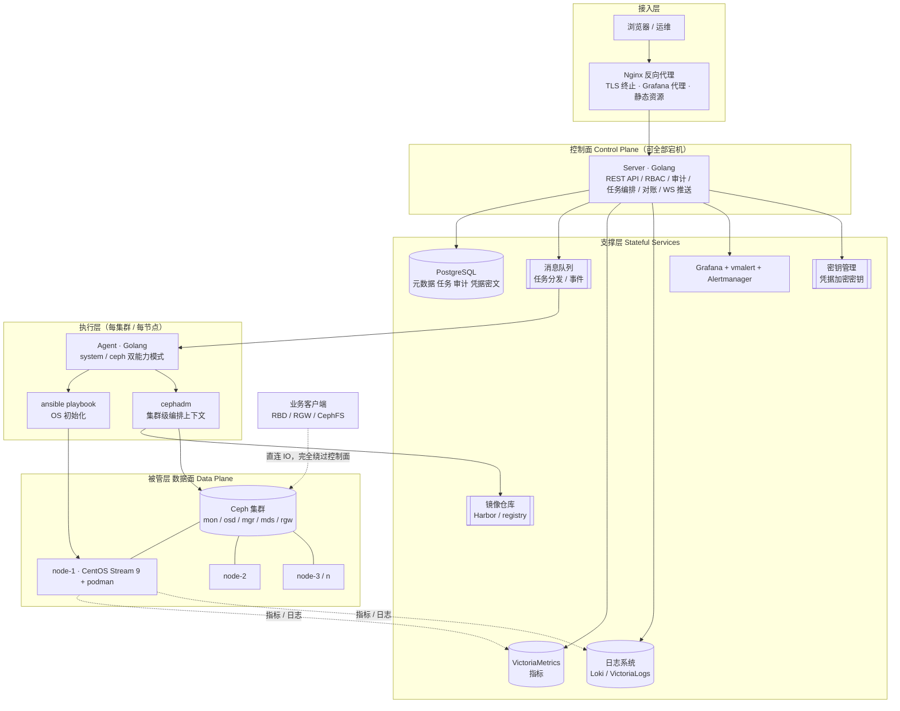
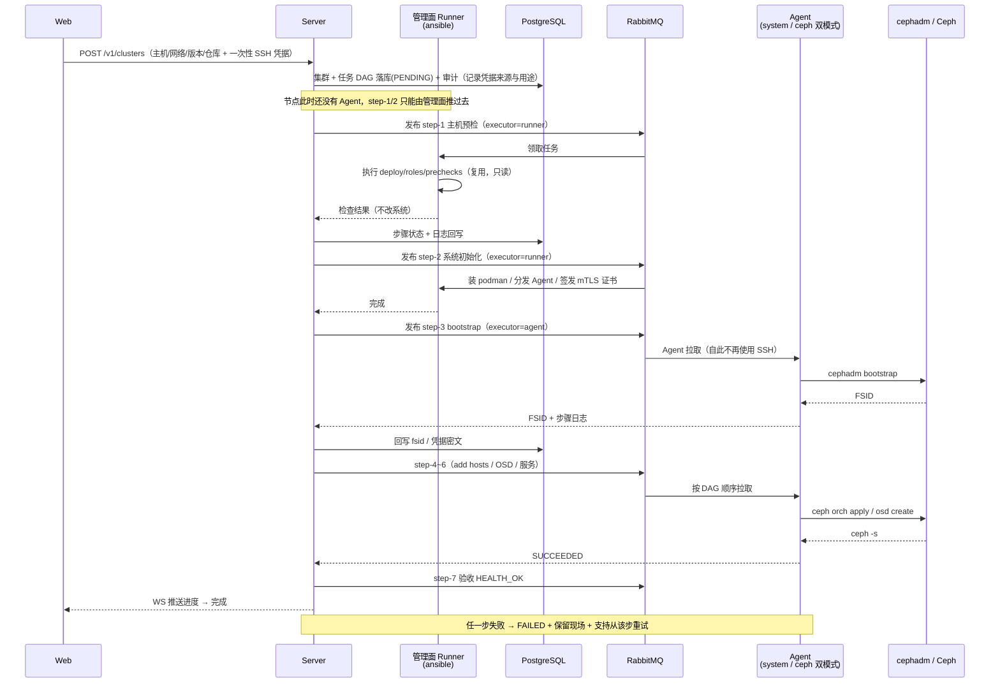
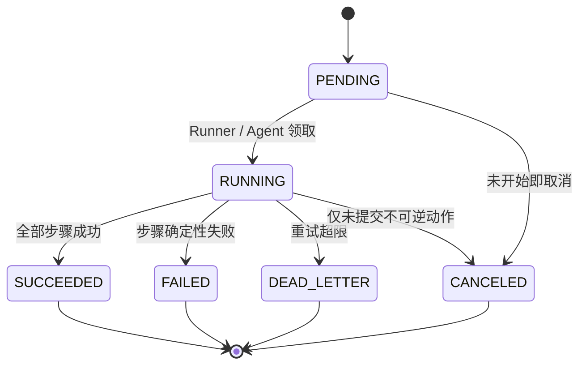
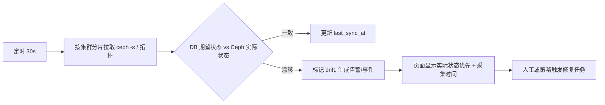
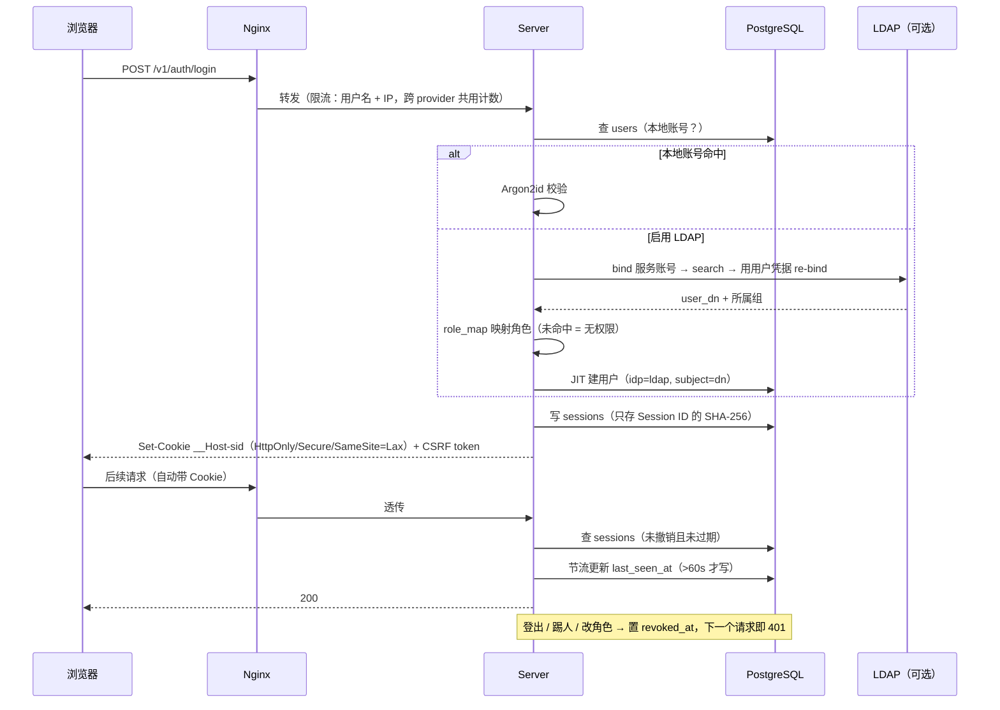
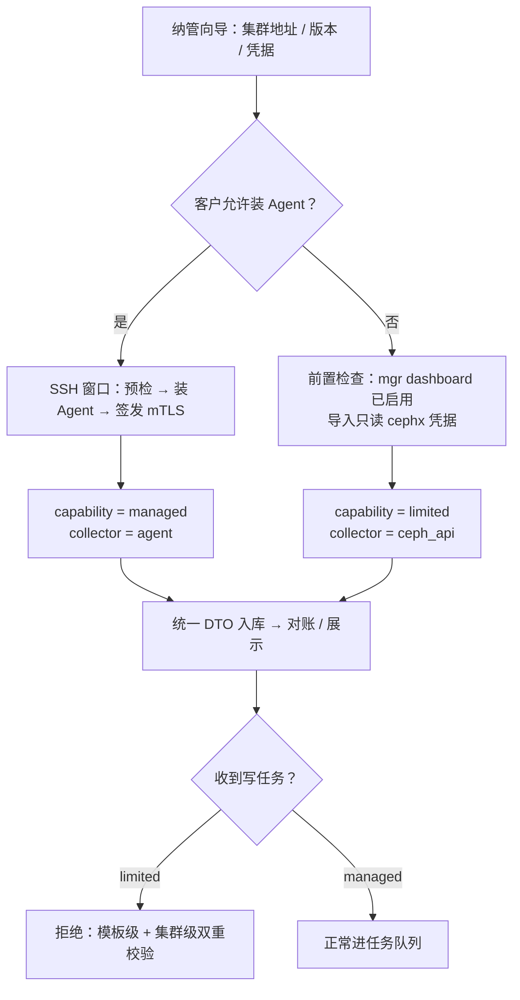
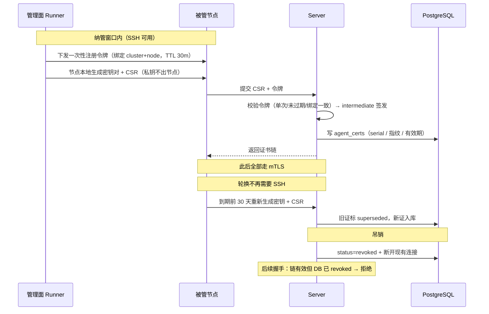
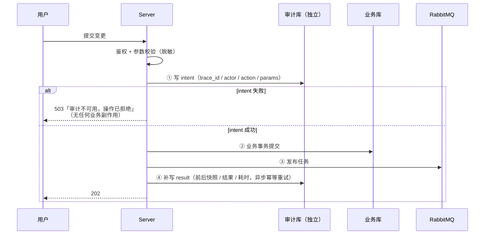

# Ceph 管理平台 · 架构设计（v0.1 草案）

| 项目 | 内容 |
| --- | --- |
| 文档归属 | 架构师（Architect） |
| 状态 | 草案 · 待技术评审 |
| 版本 / 日期 | v0.1 / 2026-11-07 |
| 输入 | 初版设想图、[PRD](../../01-产品线/01-产品经理/PRD-Ceph管理平台.md) |
| 配套 | [架构决策与权衡分析](架构决策与权衡分析.md)（**必读**：设计理由、优点、缺点、弊端） |
| 文档规范依据 | [《软件行业岗位全景图》](https://lnsyyj.github.io/posts/software-industry-job-roles/) 第 ④ 岗：架构师的产出为「架构设计 + trade-off 记录」 |

> 本文回答「系统怎么搭」；「为什么这么搭、代价是什么」全部放在权衡分析文档，避免自卖自夸。

---

## 1. 设计目标与约束

### 1.1 目标（按优先级）

| 优先级 | 目标 | 架构含义 |
| --- | --- | --- |
| G1 | **数据面零影响** | 控制面与数据面彻底解耦，平台全挂不影响 Ceph 读写 |
| G2 | **长操作可恢复、可追溯** | 一切变更走异步任务 + 状态机 + 审计，不做同步 HTTP 长调用 |
| G3 | **多集群、可扩展** | 控制面无状态，元数据模型支持 Region/AZ/Cluster 三级 |
| G4 | **离线可搬运**（原「内网 / 离线可交付」） | 有网环境制包 → 搬运 → 现场远程安装；目标环境零外网依赖、不编译（[ADR-14](ADR-14-离线交付模型.md)） |
| G5 | **最小权限与防误操作** | 参数化白名单任务，不提供自由 shell |
| G6 | **交付可控**（原「部署单元尽量少」） | 一次交付、可重复、失败可回滚；组件数量不设上限，但每个有状态组件必须齐备离线安装 / 升级 / 备份 / 自监控（[ADR-13](ADR-13-放宽部署单元约束.md)） |

> G1/G2 与「交付成本」之间存在张力，但已不再是设计层面的自相矛盾：2026-11-15 G6 由「组件尽量少」改为「交付可控」（[ADR-13](ADR-13-放宽部署单元约束.md)），张力转为可管理的成本，见权衡分析「弊端 B1」。

### 1.2 约束

- 操作系统基线：CentOS Stream 9；容器运行时：podman；Ceph 编排：cephadm；**平台部署编排：Ansible（结构对齐 kolla-ansible，[ADR-17](ADR-17-部署框架.md)）**。
- 已有组件倾向：React（Web）、Golang（Server / Agent）、PostgreSQL、VictoriaMetrics、Grafana。
- 已定项：技术栈 7 项见 [ADR-11](ADR-11-技术栈基线.md)，消息队列见 [ADR-12](ADR-12-消息队列选型.md)，镜像仓库见 [ADR-16](ADR-16-镜像仓库.md)。
- 未定项：**无**。组件与目标层均已收敛（ADR-11~ADR-21）；剩余为实现层细节 D2 / D6 / D10。
- 假设规模：20 集群 / 500 节点（PRD §2.1）。

---

## 2. 架构总览

### 2.1 分层视图



**最重要的一条线**是右下角那条虚线：业务客户端的 IO **永远不经过控制面**。控制面只做「看、管、记」。

### 2.2 相对设想图的调整（Change Log）

| # | 设想图 | 本设计 | 理由 |
| --- | --- | --- | --- |
| C1 | `server → cephadm` 直连调用 | 改为 `server → 任务队列 → Agent → cephadm` | 建集群/扩容是分钟级长事务，同步调用会超时、丢进度、无法重试；异步任务才能做状态机、审计与断点续跑 |
| C2 | `cephadm` 画在中心，连镜像仓库与所有 node | 改为**集群级执行上下文**，由目标节点上的 Agent 驱动 | cephadm 是「一套集群一套状态」，不是全局中心服务；中心化会造成跨集群状态串扰与单点 |
| C3 | `server-system-agent-1` / `server-ceph-agent-1` 两个独立组件 | **保留能力边界，合并为一个二进制的两种运行模式**（`--capability=system\|ceph`） | 两者都运行在被管节点、都需要高权限，拆两个进程并不真正缩小权限面，却让部署、鉴权、升级翻倍；能力白名单才是真正的隔离手段 |
| C4 | 消息队列标注 `queue? rabbitmq? redis? Kafka?` | 明确为**必需组件**，选定 RabbitMQ（ADR-12） | 任务可靠性是本平台的生命线；不能靠 `goroutine + 内存队列` 糊过去 |
| C5 | 日志系统仅有方框 | 纳入统一检索，与任务日志、审计日志分层 | 排障需要「一次任务 → 步骤日志 → 节点日志」的可追踪链路 |
| C6 | VictoriaMetrics / Grafana 直接前台集成 | Grafana 经反向代理统一鉴权；告警引入 vmalert + Alertmanager | 防止绕过平台 RBAC 直接看别的集群面板；补齐 Prometheus 规则生态 |
| C7 | 无凭据与安全层 | 新增密钥管理 + Agent↔Server mTLS + 命令白名单 | Agent 具备 root 级执行能力，是最高价值攻击面 |
| C8 | 无状态对账 | 新增 Reconciler（对账器） | 平台 DB 状态与 Ceph 真实状态必然漂移，必须主动对账而非假设一致 |
| C9 | PostgreSQL 连到所有组件 | 明确**只存元数据 / 任务 / 审计**，指标与日志不入库 | 避免把时序数据塞进关系库导致膨胀 |

---

## 3. 组件职责

| 组件 | 技术 | 职责 | 不负责 |
| --- | --- | --- | --- |
| Web | React + TS | 控制台、向导、任务进度、Grafana 面板承载 | 不直连 Ceph、不直连 DB |
| Server | Golang | REST/WS、RBAC、审计、任务编排 DAG、状态对账（driver：agent / ceph_api，ADR-27）、凭据加解密、告警关联 | 不执行任何节点命令 |
| 任务队列 | RabbitMQ（ADR-12） | 任务派发、重试、持久化、死信 | 不承载业务状态 |
| PostgreSQL | PG 16+ | 集群/主机/用户/角色/任务/审计/凭据密文 | 不存指标、不存大段日志 |
| Agent | Golang 单二进制双模式 | 心跳注册、拉取任务、执行白名单参数化命令、回报步骤日志与状态、**本地生成密钥与轮换证书**（私钥不出节点，ADR-28） | 不接受任意命令、不主动连 DB、**不负责节点纳管前的自检**（那时它还不存在） |
| 管理面 Runner | ansible（复用 `deploy/`） | **仅**在节点尚未纳管时执行预检与初始化（SSH，`executor=runner`） | 不参与运行期调度；不得执行日常运维任务（ADR-23） |
| cephadm | Ceph 官方 | 集群 bootstrap、服务编排、OSD 部署、升级 | 不作为常驻中心服务 |
| 镜像仓库 | Harbor / registry | Ceph 镜像、Agent 镜像、离线制品 | 不承担业务制品 |
| VictoriaMetrics | VM + vmalert | 指标存储、PromQL 查询、告警规则求值 | 不做业务数据存储 |
| 日志 | VictoriaLogs | 任务日志、Agent 日志、访问日志 | 不替代审计日志 |
| Grafana | 官方镜像 | 面板展示（经反代鉴权） | 不作为权限判定点 |
| Nginx | 反代 | TLS 终止、静态资源、Grafana 代理、限流 | 不含业务逻辑 |

---

## 4. 技术选型

### 4.1 选型现状

> ✅ **已确认** = 2026-11-15 项目负责人确认，见 [ADR-11](ADR-11-技术栈基线.md)；其余为建议值，待对应决策项拍板，**不得写成结论**。

| 领域 | 选择 | 状态 | 理由 | 备选 | 主要风险 |
| --- | --- | --- | --- | --- | --- |
| 前端 | React + TypeScript | ✅ 已确认 | 团队既定；生态成熟；Grafana 面板嵌入方便 | Vue | 嵌入 iframe 的鉴权与样式割裂 |
| 控制面 | Golang | ✅ 已确认 | 单二进制、并发模型适合大量长连接/任务、静态部署简单 | Java / Python | 生态内 Ceph SDK 弱，多数靠 CLI |
| 关系库 | PostgreSQL | ✅ 已确认（主版本待 DBA） | 图中既定；JSONB 适合存任务参数与 Ceph 原始状态；advisory lock 可做集群级互斥 | MySQL | 需自己做分区与审计表冷热分离 |
| 消息队列 | **RabbitMQ** | ✅ 已确认（ADR-12） | 团队已有运维经验、语义完备（confirm/ack/DLX/TTL）、管理 UI 与 exporter 成熟 | NATS JetStream（更轻但团队不熟）、Kafka（过重，不选）、Redis Stream（持久化/确认语义不足，不选） | Erlang 运行时与 flow control 排障；内存基线比 JetStream 高 |
| 镜像仓库 | **Harbor（自建在管理面）** | ✅ 已确认（ADR-16） | 镜像 GC、漏洞扫描、robot 只读凭据、配额；作为镜像唯一来源，供应链可追溯 | registry:2（无 GC/扫描）、对接客户现有仓库 | 单点；磁盘随版本增长需 GC；Trivy 漏洞库需离线更新 |
| 指标 | VictoriaMetrics + vmalert | ✅ 已确认（ADR-18） | 资源省、兼容 Prometheus remote_write / PromQL 主体；与日志同栈 | Prometheus + Thanos | 与 Prometheus 规则生态存在边界差异 |
| 告警 | vmalert + Alertmanager | ✅ 已确认（ADR-18） | 唯一告警规则链路，复用 Prometheus 生态规则与通知渠道 | Grafana Alerting（会双发，不选） | 两套告警规则源需统一 |
| 日志 | **VictoriaLogs** | ✅ 已确认（ADR-18） | 与 VM 同栈、一套查询习惯、资源轻 | Loki（生态更广）、ELK（重） | 社区案例少，查询语法需自建 runbook |
| 可视化 | Grafana（反代鉴权） | ✅ 已确认（ADR-18） | 面板生态成熟；只做面板，不开 Alerting | 自研图表 | 越权与多租户隔离 |
| 编排 | cephadm + podman | ✅ 已确认 | 官方路径、容器化、无 K8s 依赖 | Rook（引入 K8s，超出范围） | 版本绑定、抽象泄漏 |
| 初始化 | ansible | ✅ 已确认 | 图中既定，幂等、易审计 | SaltStack | playbook 版本管理 |
| OS | CentOS Stream 9 | ✅ 已确认（锁定 minor） | 图中既定 | Rocky / Alma | Stream 滚动更新带来兼容风险 |
| 部署框架 | Ansible，结构对齐 kolla-ansible | ✅ 已确认（ADR-17） | inventory 表达拓扑、单一 group_vars、分阶段 playbook、role 粒度=组件；prechecks 只读 | 零散手写 playbook、Terraform、K8s Operator | 自建框架易退化成脚本；须守住「幂等 + 配置单一入口」 |
| 认证源 | 本地账号（Argon2id）+ **可选 LDAP（配置项）** | ✅ 已确认（ADR-22） | 默认只开本地，客户填配置即可接目录服务；本地管理员始终保留作 break-glass | OIDC（V1 后评估）、多 LDAP 并存 | 组映射配错会导致「能登录但无权限」；目录服务故障只影响 LDAP 用户 |

> 已确认项的版本策略、放弃项与推翻条件全部记录在 [ADR-11](ADR-11-技术栈基线.md)，本节只保留摘要，避免两处各自演化。

### 4.2 明确不选

- **Kafka**：为 20 集群规模引入 ZooKeeper/KRaft 级别的运维成本，收益为负。
- **Redis 当可靠队列**：AOF/持久化语义与任务「不丢」要求不匹配；可作缓存，不作任务底座。
- **Rook / Kubernetes**：会引入一整套 K8s 运维体系，与「一次交付、一条命令」冲突；作为 V2+ 的另一个产品形态评估。
- **Server 直连 SSH 执行命令**：鉴权、审计、密钥轮换、连接风暴都难控，改用 Agent 拉模式。

---

## 5. 关键链路

### 5.1 新建集群（任务 DAG）



**执行者有两种，互斥**（ADR-23）：

| executor | 谁执行 | 适用 |
| --- | --- | --- |
| `runner` | 管理面 Runner（ansible，SSH） | 节点尚未纳管：预检、初始化、装 Agent |
| `agent` | 目标节点 Agent（拉模式） | Agent 上线后的全部步骤与日常运维 |

同一集群同一时刻只允许一种执行者，由集群级 advisory lock 保证。**Agent 上线后 SSH 通道即可关闭，平台不再依赖它**（验收见 TC-29）。

### 5.2 任务下发与执行语义

- **通信**：Agent 主动向 Server 发起 mTLS 长连接（或按配置轮询拉取），Server 不反向连节点 → 天然适配 NAT / 内网 / 防火墙单向放行。
- **心跳**：Agent 10s 心跳，上报在线状态、版本、能力集；离线 30s 标记 `offline`，任务留在队列不派发。
- **幂等**：每个步骤带 `idempotency_key = cluster_fsid + task_type + normalized_params`，Agent 本地记录最近执行结果，重复投递直接返回上次结果。
- **互斥**：同一集群同一资源类别的变更任务用 PostgreSQL advisory lock 加集群级互斥，避免并发改 OSD。
- **超时 / 取消**：每步有超时；取消只作用于 `PENDING/RUNNING` 中尚未提交不可逆动作的步骤，已提交步骤不回滚。
- **失败处理**：瞬时错误按退避自动重试（1s→5s→30s→2min→10min，最多 5 次），超限进死信并告警；**人工重跑开新任务**（`parent_task_id` 串链），原任务状态不变（[ADR-25](ADR-25-任务状态机.md)）。

**任务状态机**（详见 [ADR-25](ADR-25-任务状态机.md)）：



**状态机约束**：单向流转，仅允许 `RETRYING → RUNNING` 回流；每次迁移写事件（操作者/时间/原因）；**不加** `PAUSED` / `BLOCKED` / `WAITING_APPROVAL`——「卡住」用 `last_progress_at` + 超时告警表示，不新增状态。

### 5.3 状态对账（Reconciler）



**原则**：`ceph -s` 的真实状态**永远优先于** DB 中的期望状态展示；DB 只用于流程与审计，不作为真相来源。

### 5.4 监控与告警链路

```
Ceph mgr prometheus 模块 / node-exporter / ceph-exporter
   → VM agent(remote_write 或 scrape) → VictoriaMetrics
   → vmalert（Prometheus 兼容规则）→ Alertmanager → Webhook/邮件
   → Server 订阅告警事件 → 关联 cluster/region → 控制台告警中心
Grafana → 经 Nginx 反代（注入统一鉴权头）→ 查询 VM
```

---

### 5.5 认证与会话（含可选 LDAP）



**要点**：Session ID 是不透明随机串，**不用 JWT 装身份**——JWT 无法即时撤销；DB 只存哈希，拖库也不能冒用（[ADR-26](ADR-26-会话存储.md)）。LDAP 不可用不影响本地管理员登录（break-glass，ADR-22）。

### 5.6 纳管已有集群（双通道）



| 通道 | 前置条件 | 能力 | 采集 |
| --- | --- | --- | --- |
| `managed` | 可 SSH + 允许装 Agent | 全写（白名单任务） | Agent 拉模式 |
| `limited` | 启用 mgr dashboard + 只读 cephx key + 网络可达 mgr | **只读** | Server 直连 mgr REST API |

**硬约束**（[ADR-27](ADR-27-纳管双通道.md)）：limited 只能用只读 key（禁 `client.admin`）；写任务在 API 层双重拒绝；**拿不到 mgr API 就不支持纳管，不允许偷偷退回 SSH**——否则 I3 的边界会被悄悄突破。两种 driver 必须产出同一套 DTO，靠契约测试对拍。

### 5.7 Agent 证书生命周期



**关键**：私钥**在节点本地生成**，平台只签发证书；吊销靠「证书链 + DB 状态」双校验，**不依赖 CRL 分发**——空气隔离环境里 CRL 分发经常不成立（[ADR-28](ADR-28-Agent证书体系.md)）。CA 为两层：root 离线、intermediate 在线签发。

### 5.8 审计写入（独立库，两段式）



**要点**（[ADR-29](ADR-29-审计落点.md)）：跨库**没有共同事务**，所以「fail-closed」落在 ① 上——intent 写不进去就不执行；② 之后的结果用幂等补写 + 每日「有 intent 无 result」对账兜底。审计库是**写路径强依赖**，不是可降级组件。防篡改用链式哈希 + 每日尾 hash 外锚。

---

## 6. 部署拓扑

### 6.1 MVP（单机管理面，最小可交付）

```
管理节点 ×1（或 3 台小规格 VM）
  ├─ Nginx + Web 静态资源
  ├─ Server ×1（无状态，可起 2 副本）
  ├─ PostgreSQL ×1（+ 每日 pg_dump）
  ├─ RabbitMQ ×1（单节点，durable queue + 持久化卷）
  ├─ VictoriaMetrics 单节点 + vmalert + Alertmanager
  ├─ VictoriaLogs 单节点（日志）
  ├─ Grafana
  ├─ Harbor（镜像仓库 + Trivy；MVP 单节点，全部镜像经此拉取）
被管节点 ×N（CentOS Stream 9 + podman）
  └─ Agent 单二进制（system + ceph 能力，按标签启用）
```

所有管理面组件以 podman pod / compose 方式交付，离线镜像包一次导入（对应 PRD D6）。

> **交付期角色**：制包机（有网，与目标 OS 同 minor）与安装机（跳板，跑 ansible）都是**临时角色，不进入常驻拓扑**。制包机产出离线包，安装机在现场把制品推到管理节点与被管节点（[ADR-14](ADR-14-离线交付模型.md)）。安装期用 SSH/ansible，运行期仍走 Agent 拉模式。
>
> **安装通道**：安装机（或管理节点）用 Nginx 提供只读内网源（RPM + repodata 双重签名、镜像 tar），节点用 dnf 从 HTTP 拉取，ansible 只负责配 repo 与触发安装（[ADR-15](ADR-15-安装通道.md)）。

### 6.2 V1（管理面 HA）

Server 多副本 + PG 主从 + RabbitMQ 3 节点集群（quorum queue）+ VM 双副本 + Harbor 多副本（外部 PG/Redis）；**控制面仍是「一个逻辑控制面」**，不做跨地域拆分。

### 6.3 V2（多 Region 联邦，若确有必要）

每 Region 部署一套自治控制面，全局视图通过只读聚合层汇总。避免把所有地域的 Agent 长连接拉到中心（跨地域链路不稳定会导致大面积误判离线）。

### 6.4 故障域隔离

| 故障 | 数据面 | 控制面 |
| --- | --- | --- |
| Server / DB / MQ 全停 | **不受影响** | 不可管理，Agent 本地缓存待上报状态 |
| Agent 离线 | **不受影响** | 该节点任务暂停，其他节点可用 |
| 镜像仓库不可达 | 不受影响 | 新建/升级受阻，日常运维可用 |
| 监控栈全停 | 不受影响 | 无指标与告警，任务仍可执行（降级） |

---

## 7. 接口约定

| 通道 | 协议 | 用途 |
| --- | --- | --- |
| Web ↔ Server | HTTPS REST + WebSocket | 页面数据、任务进度推送 |
| Server ↔ Agent | mTLS + gRPC 双向流 / HTTPS 长轮询 | 注册、心跳、任务派发、日志与状态回报 |
| Server ↔ Ceph（只读） | ceph-mgr RESTful / Agent 转发 `ceph -s` | 状态采集（优先经 Agent，避免中心直连） |
| 监控采集 | Prometheus remote_write / scrape | 指标 |
| 告警 | Alertmanager Webhook → Server | 告警入库与关联 |

REST 资源分组（详见 [API 与数据模型设计](../03-开发工程师/API与数据模型设计.md)）：
`/v1/regions` `/v1/azs` `/v1/clusters` `/v1/clusters/{id}/hosts` `/v1/tasks` `/v1/users` `/v1/roles` `/v1/audits` `/v1/alerts` `/v1/credentials` `/v1/system/components`

**约定**：所有变更类接口返回 `202 Accepted + task_id`，不返回同步执行结果。

---

## 8. 数据模型（核心表）

| 表 | 关键字段 | 说明 |
| --- | --- | --- |
| `regions` / `azs` | id, name, parent_id | 自定义三级模型前两级 |
| `clusters` | id, fsid(uk), az_id, name, deploy_mode, capability(managed/limited), collector(agent/ceph_api), ceph_version, health, last_sync_at | 集群主表；非 cephadm 只能 limited（ADR-27） |
| `hosts` | id, cluster_id, hostname, mgmt_ip, labels, agent_status, os_version, **ssh_host_key_fp** | 节点；指纹是公钥信息，允许持久化（ADR-24） |
| `credentials` | id, cluster_id, type(ceph/ceph_key/dashboard), cipher_text, key_id, rotated_at | 只存密文；**只存 Ceph 凭据，不含 SSH 登录凭据**（ADR-24）；limited 用 `ceph_key` 只读（ADR-27） |
| `tasks` | id, cluster_id, type, params_jsonb, status, executor(agent/runner), parent_task_id, cancel_requested_at, last_progress_at, idempotency_key(uk), created_by, started_at, finished_at | 任务主表；`parent_task_id` 只用于人工重跑（ADR-25） |
| `task_steps` | id, task_id, seq, name, status, attempt_count, last_error_code, next_retry_at, compensable, log_ref, output_jsonb | DAG 步骤；`compensable=false` 禁止自动补偿 |
| `agent_certs` | id, node_id, serial(uk), fingerprint, not_before, not_after, status(active/superseded/revoked), issued_by, revoked_at, revoke_reason | 握手时双校验：链 + DB 状态（ADR-28） |
| `ca_state` | id, kind(root/intermediate), cert_pem, key_cipher, not_after, rotated_at | 私钥只存密文；root 离线保存 |
| `audit_intents` / `audit_results`（**审计库**） | intent: id, trace_id(uk), actor, src_ip, action, target_type, target_id, params_redacted, prev_hash, hash · result: id, trace_id, result, error_code, before/after_snapshot, duration_ms, prev_hash, hash | 只追加、按月分区、保留 ≥180 天；链式哈希防篡改（ADR-29） |
| `users` | id, username, password_hash(Argon2id), idp, subject, external_id, status, last_login_at | 本地账号 + LDAP 用户共存；`(idp, subject)` 唯一（ADR-22） |
| `sessions` | id, session_hash(uk), user_id, idp, created_at, last_seen_at, expires_at, revoked_at, revoke_reason, client_fp | 只存哈希；撤销即时生效（ADR-26） |
| `roles` / `grants` | 标准 RBAC + scope(region/az/cluster) | 三级授权 |
| `alert_rules` / `alert_events` | 规则模板、关联集群、抑制策略 | 告警 |

> **审计不在业务库**：`audit_intents` / `audit_results` 存独立审计库（[ADR-29](ADR-29-审计落点.md)），业务库只保留 `trace_id` 关联。业务库与应用账号对审计库只有 INSERT 权限。

**不入库**：指标时序数据、原始日志正文（只存 `log_ref`）、Ceph 完整 `ceph -s` 历史快照（只存关键字段 + 对象存储引用）。

---

## 9. 一致性、幂等与并发

| 场景 | 策略 |
| --- | --- |
| 任务重复投递 | `idempotency_key` 唯一索引 + Agent 本地结果缓存 |
| 同一集群并发变更 | PG advisory lock（`hashtext(cluster_fsid)`）；同时保证同一集群只有一个 executor（runner 或 agent）在跑（ADR-23） |
| 长事务失败 | **补偿式 Saga**，不做分布式事务；不可逆步骤标记 `compensable=false`，只允许人工清理后重跑 |
| DB 与 Ceph 漂移 | Reconciler 定时对账，UI 以 Ceph 实际状态为准 |
| Agent 上报丢包 | 步骤状态带单调递增 `seq`，Server 按序合并，乱序丢弃 |
| 队列积压 | 按集群分片 + 并发上限 + 死信告警 |

---

## 10. 高可用与容错小结

- Server 无状态 → 水平扩展；**会话存 PG**（[ADR-26](ADR-26-会话存储.md)），多副本天然一致，不依赖本地内存与 Redis。
- PG 主从 + 定期备份 + 恢复演练（DBA 职责）。
- RabbitMQ durable queue + publisher confirm + manual ack，重启不丢任务；单节点故障期间无法接收新任务（不承诺零丢失，见 ADR-12 §6）。
- Agent 断线重连、本地缓存结果、任务不丢。
- 监控/日志/仓库属于**可降级组件**：全挂时控制台仍应能展示最近一次同步状态并允许执行预定义任务。
- 管理面整体不可用时，保留 Ceph Dashboard 与 SSH 作为最终兜底（PRD §2.2 第 2 条）。

---

## 11. 安全架构

详见 [安全与审计设计](../../07-新兴与稀缺线/19-安全工程师/安全与审计设计.md)，此处列架构级约束：

1. **信任边界**：Server 是唯一可信调度方；Agent 只信任带签名与 nonce 的任务；被管节点不信任 Server 下发的自由文本。
2. **传输**：全链路 TLS，Agent ↔ Server 双向 mTLS，证书按节点签发、支持轮换与吊销。
3. **凭据**：静态加密（密钥外置，MVP 可用文件密钥 + 权限收紧，V1 接 KMS/Vault）；明文不出现在 API 响应、日志、审计、前端。
4. **执行**：任务模板白名单 + 参数强类型校验 + 枚举/正则/范围约束 + 参数化执行（不拼 shell 字符串）；禁止 `bash -c` 拼接。
5. **审计**：写**独立审计库**，两段式（intent 同步必达 → result 异步补写）；intent 失败则操作拒绝（fail-closed），result 失败靠幂等重试 + 每日对账兜底；只追加、链式哈希、保留 ≥180 天（ADR-29）。
6. **最小权限**：Agent **一律不以 root 运行**——专用账号常驻，特权动作经 sudo 精确白名单（绝对路径 + 参数形态），禁止 `ALL` 与解释器（ADR-19）。
7. **Grafana 隔离**：禁止直连，经 Nginx 反代注入身份，按 cluster 过滤数据源查询。
8. **认证**：本地账号（Argon2id + HttpOnly 会话 + 登录限流）+ **可选 LDAP**（配置文件开启，强制 TLS、`default_role: none`、本地管理员保留为 break-glass）；**认证与 RBAC 分离**（ADR-22）。
9. **临时凭据**：SSH 登录凭据只存活于任务会话内存，终态即擦除；不走队列、不入日志、页面不回显；多副本用一次性 token 领取（ADR-24）。
10. **节点身份**：Agent 私钥本地生成、永不外传；证书 90 天自动轮换；吊销靠「证书链 + DB 状态」双校验，不依赖 CRL（ADR-28）。

---

## 12. 可观测性（平台自身）

| 信号 | 内容 |
| --- | --- |
| 指标 | API QPS/延迟/错误率、任务成功率与耗时分布、Agent 在线率、对账漂移次数、队列积压 |
| 日志 | 结构化 JSON，带 `trace_id / task_id / cluster_id` 贯穿全链路 |
| 健康 | `/healthz`（进程）、`/readyz`（依赖检查，区分核心/可降级依赖） |
| 告警 | Agent 大面积离线、任务失败率突增、对账漂移持续、凭据即将过期 |

---

## 13. 演进路线与推翻条件

| 阶段 | 变化 |
| --- | --- |
| MVP | 单机管理面、单 Region、RabbitMQ 单节点、只读纳管 + 新建 |
| V1 | 管理面 HA、告警闭环、离线制品、Grafana 统一鉴权 |
| V2 | 多 Region 联邦、LDAP/OIDC、配额、升级与配置回滚 |

**何时需要重新设计**（见权衡分析 §6）：集群规模 > 100 / 需要跨地域自治 / 引入 K8s 作为统一底座 / 平台自身 SLA 要求高于 99.9% / 需要接管数据面。

---

## 14. 架构决策记录（ADR 索引）

状态含义：`Accepted` = 已确认，可作为约束执行，推翻需新 ADR；`Proposed` = 建议，待拍板，**不得当结论引用**；`Rejected` = 评估后未采纳；`Superseded` = 被后续 ADR 取代。

| ADR | 决策 | 状态 | 详见 |
| --- | --- | --- | --- |
| ADR-01 | 控制面与数据面分离，平台不代理 IO | Accepted | 权衡分析 §2 R1 |
| ADR-02 | 所有变更走异步任务队列，禁止同步长调用 | Accepted | §2 R2 |
| ADR-03 | Agent 拉模式 + mTLS，中心不直连 SSH | Accepted | §2 R3 |
| ADR-04 | 双能力合并为单二进制双模式 | Accepted | §2 R4 |
| ADR-05 | cephadm 定位为集群级执行器而非中心服务 | Accepted | §2 R5 |
| ADR-06 | DB 只存元数据，指标/日志分离；Ceph 实际状态为真相 | Accepted | §2 R6 / §4 B3 |
| ADR-07 | 消息队列选 NATS JetStream（备选 RabbitMQ） | **Rejected**（改选 RabbitMQ，见 ADR-12） | §2 R7 |
| ADR-08 | 引入 Reconciler 主动对账 | Accepted | §2 R8 |
| ADR-09 | Grafana 经反代统一鉴权，禁止直连 | Accepted | §2 R9 |
| ADR-10 | MVP 单机管理面，HA 延后到 V1 | Accepted | §2 R10 |
| [ADR-11](ADR-11-技术栈基线.md) | 技术栈基线：React+TS / Golang / PostgreSQL / cephadm+podman / ansible / CentOS Stream 9 | Accepted（2026-11-15） | ADR-11 §2 |
| [ADR-12](ADR-12-消息队列选型.md) | 消息队列选 RabbitMQ（非 JetStream） | Accepted（2026-11-15） | ADR-12 §3 |
| [ADR-16](ADR-16-镜像仓库.md) | 镜像仓库：自建 Harbor，节点统一经仓库拉取 | Accepted（2026-11-15） | ADR-16 §2 |
| [ADR-17](ADR-17-部署框架.md) | 部署编排：Ansible 框架，结构对齐 kolla-ansible（不 fork） | Accepted（2026-11-15） | ADR-17 §2 |
| [ADR-18](ADR-18-可观测性栈.md) | 可观测性：VictoriaLogs + 自带 VM/vmalert/Alertmanager/Grafana | Accepted（2026-11-15） | ADR-18 §1 |
| [ADR-19](ADR-19-Agent权限模型.md) | Agent 非 root：专用账号 + sudo 精确白名单 | Accepted（2026-11-15） | ADR-19 §1 |
| [ADR-20](ADR-20-适用下限.md) | 适用下限：≥3 集群或 ≥20 节点（推荐，非门禁） | Accepted（2026-11-15） | ADR-20 §1 |
| [ADR-21](ADR-21-认证源.md) | 认证源：MVP 本地账号，V1 预留 LDAP/OIDC | **Superseded**（→ ADR-22） | ADR-21 §1 |
| [ADR-22](ADR-22-LDAP接入.md) | 认证源：本地账号 + LDAP 可配置（客户自行对接） | Accepted（2026-11-15） | ADR-22 §2 |
| [ADR-23](ADR-23-建集群预检执行者.md) | 建集群预检由管理面 Runner 复用 deploy prechecks 执行 | Accepted（2026-11-15） | ADR-23 §2 |
| [ADR-24](ADR-24-SSH凭据管理.md) | SSH 凭据仅内存态：不落库、不走队列、终态擦除 | Accepted（2026-11-15） | ADR-24 §1 |
| [ADR-25](ADR-25-任务状态机.md) | 自动重试不动任务号，人工重跑开新单 | Accepted（2026-11-15） | ADR-25 §2 |
| [ADR-26](ADR-26-会话存储.md) | 会话存 PG 表，不透明 Session ID（非 JWT） | Accepted（2026-11-15） | ADR-26 §2 |
| [ADR-27](ADR-27-纳管双通道.md) | 纳管双通道：Agent 托管（managed）/ 只读 mgr API（limited） | Accepted（2026-11-15） | ADR-27 §2 |
| [ADR-28](ADR-28-Agent证书体系.md) | Agent 证书：内置两层 CA，私钥不出节点，DB 状态双校验吊销 | Accepted（2026-11-15） | ADR-28 §2 |
| [ADR-29](ADR-29-审计落点.md) | 审计独立库：intent 同步必达、result 幂等补写 | Accepted（2026-11-15） | ADR-29 §2 |

> ADR-17 改变了部署的**执行方式**（从手敲命令变成分阶段 playbook），不改任何运行期架构。它同时也是 G6「可重复」与 B1「交付成本可控」的落地手段。

> ADR-07 曾被记为「已决策」而 D1 仍写「待决策」，是一处真实矛盾。2026-11-15 D1 以 **RabbitMQ** 关闭（ADR-12）、D3 以 **自建 Harbor** 关闭（ADR-16），ADR-07 标记为 `Rejected` 保留理由不删。**组件层选型已全部关闭**（最后一项 D7 由 ADR-21 关闭），剩余仅 D2 / D6 / D10 的实现层细节。
