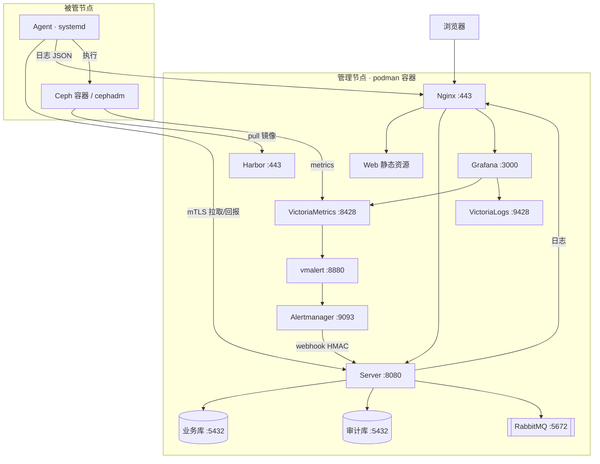

# 系统架构与数据流全景（Review 稿）

| 项目 | 内容 |
| --- | --- |
| 状态 | **待评审** |
| 日期 | 2026-11-15 |
| 用途 | 一页读完全局：有哪些进程、进程之间怎么连、数据怎么流、哪一环挂了会怎样 |
| 关系 | 是 [架构设计](架构设计-Ceph管理平台.md) 的**汇总视图**，细节以 §5 各链路与 ADR 为准；本文件不引入新决策 |

---

## 0. 怎么读这份文档

建议按这个顺序看，**发现不对就停在那一节**：

1. §1 一句话架构 —— 30 秒建立印象；
2. §2 进程全景 —— 确认「有哪些进程、谁连谁」；
3. §3 数据所有权 —— 确认「哪张表归谁写」，这里最容易出隐藏耦合；
4. §4 数据流 —— 13 条，每条只看「路径 / 约束 / 失败」三行；
5. §5 调用矩阵 + §6 降级矩阵 —— 用来交叉检查有没有漏掉的依赖；
6. §7 十条边界 —— 这份文档的**验收清单**，任何一条被破坏就是设计事故。

看不懂或觉得别扭的地方，多半是真问题，直接标出来。

---

## 1. 一句话架构

> **一个无状态的调度中心（Server）+ 一个唯一的执行面（Agent）+ 一套独立的数据面（PG / 审计库 / MQ）+ 一套可降级的观测面（VM / VL / Grafana）**；所有变更都走「任务 → 队列 → 执行 → 回报」这条链，Ceph 数据面永远不依赖平台存活。

三条硬性质：

- **数据面不依赖控制面**：平台全停，Ceph 集群照常读写；
- **变更必留痕**：审计 intent 写不进去，操作直接被拒；
- **执行面唯一**：所有命令经 Agent（mTLS）；平台运行期零 SSH、零 SSH 凭据。

---

## 2. 进程全景

### 2.1 进程清单

| 进程 | 形态 | 监听 | 谁连它 | 它连谁 | 认证 | 可降级 |
| --- | --- | --- | --- | --- | --- | --- |
| Nginx | 容器 | 443/80 | 用户、Agent（日志）、内部 | Server、Grafana、VL、静态资源 | TLS；Agent 日志走 **mTLS 客户端证书** | 否（唯一入口） |
| Server | 容器（无状态，可多副本） | 8080（仅内网） | Nginx、内部 webhook | PG、审计库、MQ、VM（查询） | 用户 JWT；内部调用 mTLS | 否 |
| Agent | 二进制 + systemd | **无入站** | — | Server（mTLS）、Nginx（日志）；**不连 Harbor**（由它触发的 cephadm 去拉） | mTLS 客户端证书 | 是（离线时本地缓存） |
| 业务库 PG | 容器 | 5432 | Server | — | 密码（内网） | 否 |
| 审计库 PG | 容器 | 5432 | Server | — | 密码（内网，只有 INSERT） | 否（写路径强依赖） |
| RabbitMQ | 容器 | 5672 | Server | — | 密码 | 是（期间不收新任务） |
| Harbor | 容器 | 443 | 节点、cephadm、制包机（push） | — | TLS + robot 凭据 | 是 |
| VictoriaMetrics | 容器 | 8428 | 采集端、Grafana、vmalert | — | 内网 | 是 |
| vmalert | 容器 | 8880 | — | VM、Alertmanager | 内网 | 是 |
| Alertmanager | 容器 | 9093 | vmalert | Server（webhook） | HMAC 签名 | 是 |
| VictoriaLogs | 容器 | 9428 | Nginx 转发、Grafana | — | 内网（前置 mTLS） | 是 |
| Grafana | 容器 | 3000 | **仅 Nginx** | VM、VL | 反代注入身份 | 是 |

> **注意两处不对称**：Agent **没有入站端口**（拉模式）；Grafana **不能直连**（必须经反代，否则绕过 RBAC）。

---

## 3. 数据存储与所有权

「谁写」比「谁读」重要——写者只有一个，耦合就少一半。

| 存储 | 内容 | **唯一写者** | 读者 | 保留 |
| --- | --- | --- | --- | --- |
| 业务库 PG | clusters / hosts / tasks / users / creds 等 | **Server** | Server | 任务 90 天 |
| 审计库 PG | audit_intents / audit_results | **Server**（只 INSERT） | Server（检索）、导出 | 在线 ≥180 天 |
| RabbitMQ | 待执行任务、死信 | **Server** | Agent（经 Server 拉取） | 消费即删 |
| VictoriaMetrics | 指标时序 | 采集端（remote_write） | Server、Grafana、vmalert | 30 天 |
| VictoriaLogs | 日志 | Agent / Server / 中间件 | Grafana、Server（按 log_ref） | 30 天 |
| Harbor | 镜像 | 制包机 / CI | 节点、cephadm | 按 GC 策略 |
| 节点本地 | Agent 证书与私钥、日志环形缓冲 | **Agent** | — | 证书 90 天 |
| 备份卷 | 备份包（加密） | 备份任务 | 恢复流程 | 日备 30 / 月备 12 |

**关键**：审计库与业务库**不同 database、不同凭据**；Agent **不写入任何中心存储**（只经 Server 转达）。

---

## 4. 数据流（13 条）

### A. 用户交互

**① 登录与会话**
`浏览器 → Nginx → Server → 业务库（校验 local 或 LDAP）→ 签发 access JWT + refresh`
约束：LDAP 必须 TLS；失败提示统一防枚举；角色装在 JWT 里，改角色靠 `token_version` 强制失效。
失败：LDAP 不可用 → 本地管理员仍可登录（break-glass）。

**② 页面请求与实时推送**
`浏览器 → Nginx → Server → PG`；任务进度走 WebSocket。
约束：所有变更接口返回 `202 + task_id`，不同步执行；列表分页统一结构。
失败：Server 全挂 → 页面不可用，但数据面不受影响。

### B. 任务执行

**③ 新建集群**（见 §5.1）
`Server 建 DAG → 队列 → Agent 拉取 → 预检 → 绑定 cluster_id → bootstrap → OSD/服务`
约束：Agent 在交付期已预装并注册，全程只有一种执行者；运行期零 SSH（ADR-35）。
失败：任一步失败 → 任务 FAILED、保留现场、可从该步重跑（新开单）。

**④ 纳管已有集群**（见 §5.6）
`向导 → 从未分配池选节点 + 选 cluster → 授予 managed（读写）或 limited（只读）权限档`
约束：两条路都走 Agent；limited 只配只读 cephx key，写任务在模板级 + 集群级双重拒绝。
边界：**不支持「完全不装 Agent」的客户**（ADR-35）。

**⑤ 任务状态与重试**（见 §5.2）
`PENDING → RUNNING → SUCCEEDED / FAILED / DEAD_LETTER / CANCELED`，步骤级 `RETRYING`
约束：自动重试不动任务号；人工重跑开新单（`parent_task_id`）；「卡住」靠 `last_progress_at` + 分级告警。
失败：重试超限 → DEAD_LETTER + 告警 + 死信入口。

**⑥ 镜像供给**（见 §5.9）
`Agent 下发 CA + registry 配置 → cephadm 自己 pull（digest 固定）`
约束：管理面组件镜像走 `pull` 阶段，Ceph 镜像由 cephadm 拉，两者分开。
失败：拉取失败 → 错误码 `image_pull_failed`，不是笼统的 bootstrap 失败。

### C. 采集与观测

**⑦ 指标**：`ceph mgr / node-exporter → VM → vmalert → Alertmanager`。
**⑧ 日志**：`Agent / Server / 中间件 → Nginx（mTLS）→ VictoriaLogs`。
约束：**Server 不代理日志字节**；VL 挂了不影响任务，UI 提示「日志不完整」。
**⑨ 告警回流**：`Alertmanager → webhook（HMAC）→ Server → alert_events → 告警中心`。
约束：按 `fingerprint` 幂等；抑制与分组只在 Alertmanager 做。
**⑩ 状态对账**：`Reconciler 定时 30s → 拉 actual → 与期望比 → drift_state / last_sync_at`。
约束：UI 以 Ceph 实际状态为准；漂移触发告警而非自动修复。

### D. 系统自身

**⑪ 审计**（见 §5.8）
`写操作 → 审计库 intent（同步，失败即拒）→ 业务提交 → 结果幂等补写`
约束：独立库、只追加、链式哈希、每日尾 hash 外锚。
**⑫ 证书**（见 §5.7）
`交付期 ansible 批量发起注册 → 节点本地生成 CSR → Server 签发 → 运行期轮换（90 天）→ 吊销（DB 状态）`
约束：私钥不出节点；吊销不依赖 CRL。
**⑬ 备份与清理**（见 §5.10 / ADR-32）
`每日全备（库 + 配置）→ 加密 → 独立备份卷；密钥与 CA 另存独立介质`
约束：密钥与备份包**物理分离**；清理按分区 DROP，且清理本身写审计。

### 尚缺一条

| 流 | 状态 |
| --- | --- |
| **Ceph 凭据使用流**（录入 → 加密入库 → 用时解密 → 经 mTLS 下发 Agent / 注入 cephadm） | 安全设计 §3 有表格，**无流程图**；编码前需补 |

---

## 5. 进程间调用矩阵

| 从 → 到 | 协议 | 认证 | 说明 |
| --- | --- | --- | --- |
| 浏览器 → Nginx | HTTPS | TLS | 唯一入口 |
| Nginx → Server | HTTP（内网） | 内网 | — |
| Server → Agent | mTLS + gRPC 流/长轮询 | **双向证书** | Agent 主动发起（拉模式） |
| Agent → Server | 同上 | 同上 | 心跳、领任务、回报 |
| Server → MQ | AMQP | 密码 | 发布任务 |
| Server → 业务库/审计库 | SQL | 密码（不同账号） | 审计只有 INSERT |
| Agent → Nginx（日志） | HTTPS | mTLS 客户端证书 | 反代后注入身份头 |
| Server → Ceph mgr | HTTPS REST | 只读 cephx key 换取的凭据 | 仅 limited 集群 |
| Alertmanager → Server | HTTPS | **HMAC 签名** | 仅内网 |
| Grafana → VM/VL | HTTP | 内网 | 用户经反代鉴权 |

---

## 6. 失败与降级矩阵

| 挂掉的组件 | 读操作 | 写操作 | 任务执行 | 告警 | 备注 |
| --- | --- | --- | --- | --- | --- |
| Server | ✗ | ✗ | ✗ | ✗ | 数据面不受影响 |
| 业务库 | ✗ | ✗ | ✗ | — | 核心依赖 |
| 审计库 | ✓ | **✗（intent 写不进）** | ✗ | — | 刻意选择，不是缺陷 |
| RabbitMQ | ✓ | ✓（落库） | ✗（排队） | — | 恢复后继续 |
| Agent（单节点） | ✓ | ✓（其他节点） | 该节点暂停 | — | 本地缓存结果 |
| Harbor | ✓ | ✓ | 新建/升级受阻 | — | 运行中容器不受影响 |
| VictoriaMetrics | ✓（降级展示） | ✓ | ✓ | 规则不评估 | 可降级 |
| VictoriaLogs | ✓ | ✓ | ✓（日志缺失） | — | UI 提示日志不完整 |
| Alertmanager | ✓ | ✓ | ✓ | ✗ | 告警不发 |
| Grafana | ✓ | ✓ | ✓ | — | 面板不可用 |
| 整个管理面 | ✗ | ✗ | ✗ | ✗ | Ceph Dashboard / SSH 兜底 |

---

## 7. 十条边界（Review 检查清单）

任何一条被破坏，都算设计事故：

1. **Agent 不直连数据库、不接任意命令、私钥不出节点**；节点上无 DB 凭据。
2. **运行期零 SSH**：平台不持 SSH 凭据、不建 SSH 通道；SSH 只存在于交付期 ansible（由实施人员执行）。
3. **Server 是唯一调度方**；审计 intent 写不进去 → 操作直接拒绝。
4. **镜像唯一来源是 Harbor**；禁 `insecure-registry` 与 `--tls-verify=false`。
5. **所有变更走任务队列与状态机**；不存在「同步改一把」的接口。
6. **审计独立库、只追加、无关闭开关**；告警可丢（会重发），审计不可丢。
7. **凭据分层**：Ceph 凭据加密入库、只下发给 Agent；平台不持 SSH 凭据；用户口令不落库不缓存。
8. **会话撤销靠 `token_version` / jti 黑名单**，默认 ≤30s 窗口，可配 0。
9. **指标、日志、审计三者不混**：指标不落 PG，日志不替代审计，审计不进日志系统。
10. **配置单点**（`group_vars`）、`prechecks` 只读、`deploy` 幂等。

---

## 8. 未定项（本文件不覆盖）

| 项 | 影响 | 何时需要 |
| --- | --- | --- |
| Go 工程结构与框架选型（路由/DB/迁移/日志） | 第一个 PR 就要用 | **编码前必须定** |
| 前端架构（目录、路由权限、状态管理、组件库） | 第一个页面前 | **编码前必须定** |
| 错误码字典 / OpenAPI 契约 | 前后端联调 | 编码第一周 |
| Ceph 凭据使用流图 | 凭据链路评审 | 编码前 |
| V1 的 HA 形态、V2 多 Region 联邦 | 部署与规模 | V1 / V2 |

---

## 9. 与决策记录的映射

| 主题 | ADR |
| --- | --- |
| 技术栈 / MQ / 镜像仓库 | 11 / 12 / 16 |
| 交付与部署（离线、通道、框架） | 13 / 14 / 15 / 17 |
| 可观测性 / 日志告警 / 保留期 | 18 / 33 / 32 |
| 身份与凭据（Agent 权限、LDAP、会话、证书、预装与零 SSH） | 19 / 22 / 34 / 28 / 35 |
| 任务与纳管（状态机、预检执行者、纳管双通道） | 25 / 23 / 27 |
| 数据（审计、镜像拉取、备份） | 29 / 30 / 31 |
| 边界条件（适用下限、交付可控） | 20 / 13 |

> 已被取代的：ADR-21（→ 22）、ADR-26（→ 34）。完整索引见 [docs/README](../../README.md)。
