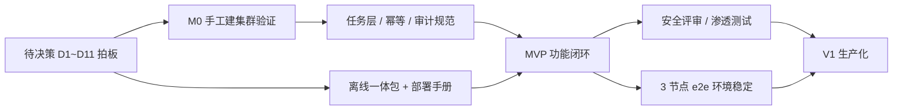

# Ceph 管理平台 · 项目计划与路线图（v0.1 草案）

| 项目 | 内容 |
| --- | --- |
| 文档归属 | 项目经理（Project Manager） |
| 状态 | 草案 · 待需求与技术评审后基线化 |
| 依据 | [PRD §10 里程碑](../../01-产品与设计/01-产品经理/PRD-Ceph管理平台.md) · [权衡分析 §9](../../02-研发/06-架构师/架构决策与权衡分析.md) |

> 用「阶段 / 迭代」表达相对顺序，不写死日历工期：本项目最大的不确定性在 M0 的选型与离线验证，排期应在 M0 出口后再基线化。

---

## 1. 阶段划分

| 阶段 | 目标 | 主要工作 | 出口条件（Definition of Done） |
| --- | --- | --- | --- |
| **M0 选型验证** | 把「不确定」变成「确定」 | 拍板 D1~D11；**纯命令手工跑通 3 节点离线建集群**；验证 cephadm + podman + CentOS Stream 9；确定最小部署单元形态 | 4 项选型 ADR + 一次完整手工建集群成功 + 离线镜像清单；手工跑不通则不进入 MVP |
| **MVP** | 功能闭环、可用 | FR-01~07、FR-11；单 Region；单机管理面；本地账号；只读纳管 + 新建集群 | 满足 PRD §9 六条发布门槛；[P0 用例](../../03-测试与质量/01-测试工程师/测试策略与验收用例.md) 100% 通过 |
| **V1 生产化** | 可交付、可值守 | FR-08~10；告警闭环；离线制品；管理面 HA；Grafana 统一鉴权；LDAP/OIDC 预留 | 生产试运行 ≥ 一个完整运维周期；恢复演练通过；安全评审闭环 |
| **V2 规模化** | 多地域、企业级 | FR-12；多 Region 联邦；配额；升级与配置回滚；能力矩阵扩展 | 规模压测通过；多地域自治验证 |

---

## 2. 关键依赖链

**两条硬依赖**：
1. M0 手工跑通是 MVP 的前置——不能自动化一个还没验证可靠的过程；
2. 任务层规范（幂等、白名单、审计 fail-closed）必须先于业务功能——事后补的代价是重写任务层。

---

## 3. 角色与交付对应

| 岗位 | 本阶段主要产出 | 目录 |
| --- | --- | --- |
| 产品经理 | PRD、需求确认清单 | `01-产品与设计/01-产品经理/` |
| UI/UX | 信息架构、原型、设计规范 | `01-产品与设计/02-UI-UX设计师/` |
| 架构师 | 架构设计、权衡分析、ADR | `02-研发/06-架构师/` |
| 后端 / 前端 | API 与数据模型、页面 | `02-研发/01~02/` |
| 安全工程师 | 安全设计、渗透测试报告 | `02-研发/08-安全工程师/` |
| 测试 / SDET | 用例、报告、自动化环境 | `03-测试与质量/` |
| SRE / DevOps / DBA | 部署方案、CI/CD、备份恢复 | `04-运维与基础设施/` |
| 项目经理 | 本计划、进度报告、复盘 | `05-项目与流程/` |
| 交付 / 售前 / 支持 | 部署手册、方案、FAQ | `06-交付与实施/`、`07-市场与支持/` |

---

## 4. 风险登记册（项目视角）

| ID | 风险 | 影响 | 责任岗位 | 应对 | 状态 |
| --- | --- | --- | --- | --- | --- |
| RK-1 | 部署复杂度抵消产品价值（B1） | 高 | 产品 + SRE | M0 锁定最小部署单元；明确适用下限 D11 | 开放 |
| RK-2 | 高权限 Agent 安全事故（B2） | 灾难 | 安全 + 架构 | MVP 前安全评审；全局熔断开关 | 开放 |
| RK-3 | 纳管承诺超出实际能力（B7） | 高 | 产品 + 架构 | 能力矩阵 + `limited` 只读分级 | 开放 |
| RK-4 | 幂等设计遗漏导致集群损坏（B6） | 高 | 后端 + 测试 | 规范先行；TC-09/10 用例把关 | 开放 |
| RK-5 | 选型久拖不决 | 中 | 架构 + 项目 | M0 设决策截止时间，超时按建议默认值执行 | 开放 |
| RK-6 | 离线环境验证资源不足 | 中 | 项目 + 交付 | 提前准备独立离线环境 | 开放 |
| RK-7 | Ceph/OS 版本升级打破兼容（B4/B14） | 中 | 架构 + SRE | 兼容矩阵 + 升级回归 | 开放 |
| RK-8 | 白名单限制导致平台被架空（B12） | 中 | 产品 | 模板可配置化 + 旁路操作统计反哺 | 观察 |

---

## 5. 待确认问题（阻塞基线化）

来自 [PRD §11.3](../../01-产品与设计/01-产品经理/PRD-Ceph管理平台.md)：

1. 内部自用还是对外私有化交付？
2. 目标规模上限（暂定 20 集群 / 500 节点）？
3. 是否必须完全离线？
4. 存量集群的部署方式分布？
5. Agent 是否允许 root？
6. 是否已有存量监控栈可复用？

> 问题 1 与 2 直接决定要不要做 V1/V2，也决定 M0 的投入强度。若回答是「1~2 套集群内部自用」，应重新评估是否采用更轻的备选方案（权衡分析 §6 的方案 B/C）。

---

## 6. 协作机制

- **评审节点**：M0 出口、PRD 基线、架构评审、MVP 发布门禁、每次版本升级前；
- **同步节奏**：迭代内短同步 + 阶段评审会；风险登记册每次同步更新；
- **复盘**：每次线上故障/发布事故后产出复盘记录与改进项，回流到 PRD 与架构文档；
- **变更控制**：已确认文档变更需在架构师目录留 ADR，禁止口头改范围。
