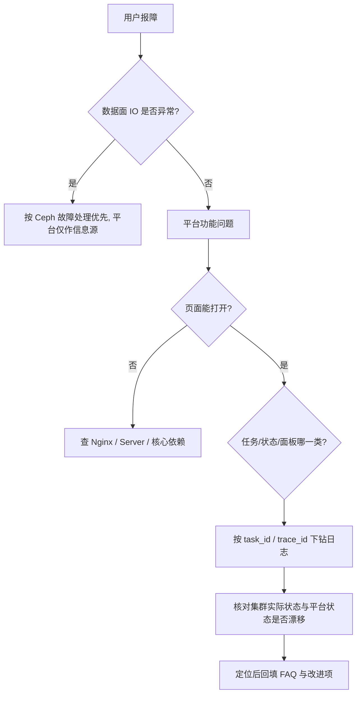

# Ceph 管理平台 · FAQ 与故障排查手册（骨架 v0.1）

| 项目 | 内容 |
| --- | --- |
| 文档归属 | 技术支持（SUPPORT） |
| 状态 | 骨架 · 随 MVP 上线补充实测问题 |
| 依据 | [权衡分析弊端清单](../../02-研发/06-架构师/架构决策与权衡分析.md) · [SRE Runbook](../../04-运维与基础设施/01-运维-SRE/部署与监控告警方案.md) §6 |

> 工单处理原则：**先确认数据面是否受影响，再查控制面**。平台页面显示异常 ≠ Ceph 集群异常，第一步永远是用 `ceph -s` 或 Ceph Dashboard 交叉验证。

---

## 1. 通用排查路径

工单必带信息：平台版本、Ceph 版本与部署方式、OS 版本、集群 ID、`task_id` / `trace_id`、发生时间、是否平台外做过变更。

---

## 2. FAQ

### Q1 平台显示集群「不可达」，是不是 Ceph 挂了？
不一定。先在被管节点执行 `ceph -s`（或开 Ceph Dashboard）。若 Ceph 正常，则问题在凭据、Agent、网络或 Server。按 Q3 / Q4 排查。

### Q2 页面显示 `HEALTH_OK`，但 Ceph Dashboard 显示 `HEALTH_WARN`，信谁？
**信 Ceph 实际状态**。平台存在同步窗口与状态漂移（权衡分析 B3）。请记录采集时间并反馈，我们会检查 Reconciler 是否正常工作；在修复前，以 `ceph -s` 为准做运维决策。

### Q3 纳管时提示连通性校验失败？
按顺序查：接入地址与端口 → 凭据是否有效/是否过期 → FSID 是否已被纳管（不允许重复）→ 证书/时间同步 → 防火墙。失败时平台**不会保存明文凭据**，需重新录入。

### Q4 Agent 显示离线？
查：节点上 Agent 进程 → mTLS 客户端证书是否过期 → 到管理面 443 的出站连通性 → Server 是否健康。若大面积同时离线，优先怀疑证书批量过期或 Server 不可达，**先启用全局熔断再排查**，避免恢复瞬间批量任务重投。

### Q5 为什么这个集群的「新建 Pool / 加 OSD」按钮是灰的？
该集群被标记为 `limited`（非 cephadm 部署或版本不在能力矩阵内），只提供只读能力（权衡分析 B7）。这是刻意设计，不是 bug；需要变更能力请提交需求并附部署方式与版本。

### Q6 建集群到一半失败了，能重来吗？
可以从**失败步骤重试**，但已完成的不可逆步骤（bootstrap、OSD 创建）不会自动回滚（B5）。请在任务详情查看失败步骤与日志，按提示清理残留后重试；不要直接删掉任务重新建集群，可能产生第二套集群或重复 OSD。

### Q7 同一个操作为什么点两次没有执行两次？
任务有幂等键，重复提交会命中上一次结果（B6 的对策）。这是保护机制。如果确实需要再执行一次，请确认参数有变化或联系管理员处理。

### Q8 为什么提交任务后页面没有立刻变化？
变更是异步的（返回 `task_id`），页面通过任务状态与 WebSocket 更新；Ceph 实际状态还有同步周期。请到任务中心看进度，并留意页面上的「最近同步时间」。

### Q9 监控面板空白 / 告警突然不报了？
按 exporter → VM → vmalert → Alertmanager 逐段验证，重点确认 Ceph 升级后指标名是否变化（B8）。**告警静默不等于集群正常**，验证前请直接看 `ceph -s`。

### Q10 为什么 viewer 打不开 Grafana 的某些页面？
Grafana 必须经平台反代访问，且按集群授权（B9）。直连地址、探索页、编辑面板会被拦截。需要更多面板请由管理员配置。

### Q11 审计里查不到某次操作？
审计只覆盖**平台内**操作。通过 SSH 或 Ceph Dashboard 做的变更不在覆盖范围（B11）。如需完整追溯，请配合堡垒机 / 节点 auditd 日志交叉核对。

### Q12 平台标了「跨 3 个 AZ」，是不是数据就跨 AZ 冗余了？
**不是**。Region/AZ 是管理分组，数据冗余由 CRUSH 故障域决定（B10）。请检查 CRUSH map 与副本规则；平台不会自动替你配置故障域。

### Q13 管理面全部宕机，业务会不会中断？
按设计不会：客户端 IO 直连 Ceph，不经过平台。控制面恢复后会自动追平状态。但期间无法执行管理与变更，告警也可能中断。

### Q14 平台能做任意 ceph 命令吗？
不能，也不应该。只提供白名单内的参数化任务（安全设计）。缺少的动作可以提交「新增任务模板」需求；模板可配置化发布，不需要等平台大版本。

### Q15 升级 Ceph / OS 前要注意什么？
先查兼容矩阵，在 e2e 环境做升级回归（cephadm 输出解析、指标名、模板参数）。CentOS Stream 9 滚动更新可能带来内核/podman 行为变化（B14），建议锁定已验证版本快照。

---

## 3. 工单分级与升级路径

| 级别 | 判据 | 升级到 |
| --- | --- | --- |
| P0 | 数据面受损 / 疑似安全事件 / 批量任务误执行 | 立即通知 SRE + 安全，启用全局熔断 |
| P1 | 核心流程不可用、状态错误、权限异常 | 后端 / 架构 |
| P2 | 面板、体验、文档、单功能咨询 | 技术支持闭环 |

---

## 4. 高频问题回流

每季度统计工单 Top 问题，回流给：
- **产品**：白名单模板缺口（对应 B12「平台被架空」风险）、`limited` 集群能力诉求；
- **架构 / SRE**：漂移、告警静默、同步风暴类问题；
- **交付**：部署手册中步骤不清晰导致的实施工单。

> 本文件随每次发布更新；每条新问题请先给出「现象 → 交叉验证方法 → 处置 → 根因分类」四段式记录。
