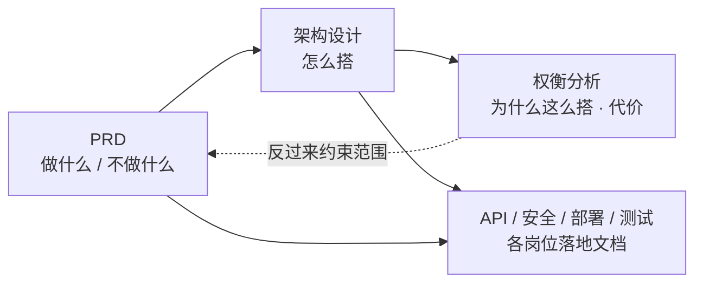

# docs · 文档总览

本目录按 [《软件行业的岗位》](https://lnsyyj.github.io/posts/software-industry-roles/) 一文的**七大岗位族 / 22 个岗位**组织：每个岗位一个目录，目录内 `README.md` 说明该岗位职责与常见产出文档，实际文档按产出岗位归档。

当前文档围绕一个具体项目：**Ceph 集群管理平台**（初版设想图 → PRD → 架构 → 交付）。

---

## 1. 目录结构

```
docs/
├── README.md                          ← 本文件（总览与索引）
├── 01-产品与设计/                      决定做什么、给谁用、长什么样
│   ├── 01-产品经理/                   PRD、原型、路线图
│   └── 02-UI-UX设计师/                设计稿、设计规范、信息架构
├── 02-研发/                          怎么做出来
│   ├── 01-前端工程师/                  网页、接口联调记录
│   ├── 02-后端工程师/                  API 文档、数据库结构
│   ├── 03-客户端工程师/                可安装应用
│   ├── 04-算法工程师/                  模型、实验报告
│   ├── 05-数据工程师/                  数据管道、数仓、报表
│   ├── 06-架构师/                     架构设计、技术规范、ADR
│   ├── 07-技术负责人/                  任务拆解、代码评审
│   └── 08-安全工程师/                  安全报告、规范、应急方案
├── 03-测试与质量/                     做得对不对
│   ├── 01-测试工程师/                  用例、bug 单、测试报告
│   └── 02-测试开发工程师/              自动化框架、测试平台
├── 04-运维与基础设施/                 能不能一直稳定跑
│   ├── 01-运维-SRE/                    部署、监控、告警体系
│   ├── 02-DevOps工程师/                CI/CD、发布系统
│   └── 03-DBA/                         备份、索引、性能报告
├── 05-项目与流程/                     大家步调是否一致
│   ├── 01-项目经理/                    项目计划、进度报告
│   └── 02-敏捷教练/                    会议引导、改进项
├── 06-交付与实施/                     落地到客户现场、通过验收
│   ├── 01-交付实施工程师/              部署方案、操作手册、验收报告
│   └── 02-售前工程师/                  解决方案、演示、报价
└── 07-市场与支持/                     有人用、好不好卖
    ├── 01-市场运营/                    活动、内容、增长报表
    ├── 02-数据分析师/                  报表、数据报告
    └── 03-技术支持/                    工单、FAQ、知识库
```

> 每个岗位目录都有 `README.md`。暂无独立文档的岗位保留目录，作为后续产出的落位，避免文档随手乱放。

---

## 2. 文档索引（Ceph 管理平台）

| # | 文档 | 归档岗位 | 状态 | 说明 |
| --- | --- | --- | --- | --- |
| 1 | [PRD-Ceph管理平台.md](./01-产品与设计/01-产品经理/PRD-Ceph管理平台.md) | 产品经理 | 草案 · 待评审 | 背景/目标/非目标、12 项功能需求、非功能需求、验收门槛、11 项待决策 |
| 2 | [信息架构与页面清单.md](./01-产品与设计/02-UI-UX设计师/信息架构与页面清单.md) | UI/UX 设计师 | 草案 | 导航结构、页面清单、关键交互约定 |
| 3 | [架构设计-Ceph管理平台.md](./02-研发/06-架构师/架构设计-Ceph管理平台.md) | 架构师 | 草案 · 待评审 | 分层架构、组件职责、选型、链路、部署、数据模型、安全、ADR 索引 |
| 4 | [架构决策与权衡分析.md](./02-研发/06-架构师/架构决策与权衡分析.md) | 架构师 | 草案 · **决策必读** | 10 条设计理由、10 条优点、10 条缺点、**14 条结构性弊端**、6 种备选架构对比 |
| 5 | [API与数据模型设计.md](./02-研发/02-后端工程师/API与数据模型设计.md) | 后端工程师 | 草案 | REST 分组、任务状态机、核心表结构、幂等约定 |
| 6 | [安全与审计设计.md](./02-研发/08-安全工程师/安全与审计设计.md) | 安全工程师 | 草案 | 信任边界、凭据、命令白名单、审计链路、应急响应 |
| 7 | [测试策略与验收用例.md](./03-测试与质量/01-测试工程师/测试策略与验收用例.md) | 测试工程师 | 草案 | 分层测试策略、MVP 验收用例、发布门槛 |
| 8 | [部署与监控告警方案.md](./04-运维与基础设施/01-运维-SRE/部署与监控告警方案.md) | 运维 / SRE | 草案 | 管理面部署、指标/告警/日志链路、故障处置 |
| 9 | [项目计划与路线图.md](./05-项目与流程/01-项目经理/项目计划与路线图.md) | 项目经理 | 草案 | M0/MVP/V1/V2 里程碑、依赖、风险清单 |
| 10 | [安装部署手册.md](./06-交付与实施/01-交付实施工程师/安装部署手册.md) | 交付 / 实施工程师 | 骨架 · 待补命令 | 离线部署步骤、验收清单、回滚 |
| 11 | [FAQ与故障排查手册.md](./07-市场与支持/03-技术支持/FAQ与故障排查手册.md) | 技术支持 | 骨架 | 高频问题与排查路径 |

**推荐阅读顺序**：想理解全貌 → `1 → 3 → 4`；准备拍板 → `4 §8 待决策清单` + `1 §11 待确认问题`；准备动手 → `1 → 3 → 5 → 7 → 8`。

---

## 3. 三份核心文档的关系



> 权衡分析不是附属说明，而是**决策输入**：其中 §5 的 14 条弊端里，B1（部署复杂度与目标矛盾）、B2（高权限 Agent）、B10（Region/AZ 与 CRUSH 故障域混淆）会直接影响 PRD 的范围与承诺，应在评审时一并处理。

---

## 4. 约定

1. **归档规则**：文档放在「产出它的岗位」目录下；跨岗位引用一律用相对路径；每个岗位 `README.md` 的「本目录文档」清单要与本索引同步。
2. **状态标记**：`草案`（可大改）→ `评审中` → `已确认`（变更需走评审）→ `已废弃`（保留但标注原因）。
3. **命名**：中文主名 + 限定后缀，如 `PRD-Ceph管理平台.md`、`架构决策与权衡分析.md`；不使用空格。
4. **决策留痕**：技术选型与架构变更写进架构师目录下的 ADR 条目，不要只留在聊天记录里。
5. **文档规范依据**：文章速查表中各岗位的「主要产出物」——PRD、设计稿、接口文档、测试用例、架构设计、安全报告、部署方案、项目计划、操作手册、FAQ 等。

---

## 5. 当前未决事项（需要人拍板）

来自 [PRD §11](./01-产品与设计/01-产品经理/PRD-Ceph管理平台.md) 与 [权衡分析 §8](./02-研发/06-架构师/架构决策与权衡分析.md)：

- 消息队列 / 数据库 / 镜像仓库 / 日志系统 / 监控栈的选型（草图 TODO 第 1 条）；
- 「复制粘贴就能部署上」的具体形态（草图 TODO 第 2 条）；
- 首个交付是内部自用还是私有化产品；目标规模上限；是否完全离线；允许 Agent 以什么权限运行。

在这些答案确定前，所有文档均保持 `草案` 状态。
