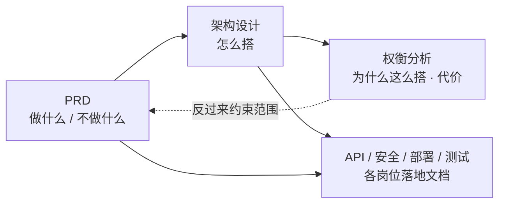

# docs · 文档总览

本目录按 [《软件行业岗位全景图》](https://lnsyyj.github.io/posts/software-industry-job-roles/) 的**七条线 / 24 个岗位**组织：每个岗位一个目录，目录内 `README.md` 说明该岗位职责、常见产出，以及它在本项目中的具体落位。

当前文档围绕一个具体项目：**Ceph 集群管理平台**（初版设想图 → PRD → 架构 → 交付）。

> 2026-11-15 按新版文章重排：旧结构为 7 族 / 22 岗，岗位合并、撤销、新增的完整对照见 [岗位映射与变更记录](./岗位映射与变更记录.md)。

---

## 1. 目录结构

岗位目录编号 = **原文的岗位编号**，因此父目录下的序号不连续（`02-研发线/` 下是 03、04、05），这是为了让「文章第 N 个岗位」与「磁盘路径」永久对齐。

```
docs/
├── README.md                                  ← 本文件（总览与索引）
├── 岗位映射与变更记录.md                        ← 22 岗 → 24 岗的对照与文档迁移表
├── 01-产品线/                                  决定做什么、给谁用
│   ├── 01-产品经理/                            PRD、原型、路线图
│   └── 02-产品运营/                            使用率报表、活动与反馈
├── 02-研发线/                                  把想法变成能跑的代码
│   ├── 03-开发工程师/                          前后端代码、API 文档、数据模型
│   ├── 04-架构师/                              架构设计、ADR、权衡分析
│   └── 05-技术总监-CTO/                        技术战略、预算、人才梯队
├── 03-测试线/                                  专门找茬的人
│   ├── 06-测试工程师/                          用例、缺陷、测试报告
│   └── 07-测试开发/                            自动化脚本、测试平台、CI
├── 04-运维线/                                  让系统别宕机
│   ├── 08-运维工程师/                          部署脚本、监控配置、巡检
│   ├── 09-SRE-DevOps/                          SLO、告警体系、流水线
│   └── 10-DBA/                                 备份演练、表结构、性能
├── 05-业务线/                                  把软件卖出去、让客户满意
│   ├── 11-销售-客户经理/                       合同、报价、回款
│   ├── 12-售前工程师/                          解决方案、投标书、Demo
│   └── 13-客户成功/                            工单、回访、续约记录
├── 06-支撑线/                                  让产品更好用、更可控
│   ├── 14-UI-UX设计师/                         信息架构、交互稿、设计规范
│   ├── 15-数据分析师/                          指标口径、报表、分析报告
│   └── 16-项目经理-ScrumMaster/                项目计划、风险清单、复盘
└── 07-新兴与稀缺线/                            市场上还缺、正在冒头的职业
    ├── 17-算法-AI工程师/                        模型、推理服务、评估报告
    ├── 18-数据工程师/                           数据管道、数仓、指标层
    ├── 19-安全工程师/                           安全规范、漏洞报告、审计
    ├── 20-技术文档工程师/                       安装手册、FAQ、API 文档
    ├── 21-开发者关系/                           博客、演讲、社区内容
    ├── 22-用户研究员/                           访谈记录、可用性报告
    ├── 23-业务分析师/                           需求清单、业务流程图
    └── 24-合规-隐私专家/                        合规报告、数据保留策略
```

> 每个岗位目录都有 `README.md`。暂无独立文档的岗位保留目录，作为后续产出的落位，避免文档随手乱放。

---

## 2. 文档索引（Ceph 管理平台）

| # | 文档 | 归档岗位（原文编号） | 状态 | 说明 |
| --- | --- | --- | --- | --- |
| 1 | [PRD-Ceph管理平台.md](./01-产品线/01-产品经理/PRD-Ceph管理平台.md) | 产品经理 ① | 草案 · 待评审 | 背景/目标/非目标、12 项功能需求、非功能需求、验收门槛、11 项待决策 |
| 2 | [信息架构与页面清单.md](./06-支撑线/14-UI-UX设计师/信息架构与页面清单.md) | UI/UX 设计师 ⑭ | 草案 | 导航结构、页面清单、关键交互约定 |
| 3 | [架构设计-Ceph管理平台.md](./02-研发线/04-架构师/架构设计-Ceph管理平台.md) | 架构师 ④ | 草案 · 待评审（技术栈 7 项已确认） | 分层架构、组件职责、选型状态、链路、部署、数据模型、安全、ADR 索引 |
| 4 | [架构决策与权衡分析.md](./02-研发线/04-架构师/架构决策与权衡分析.md) | 架构师 ④ | 草案 · **决策必读** | 10 条设计理由、10 条优点、10 条缺点、**14 条结构性弊端**、6 种备选架构对比 |
| 5 | [API与数据模型设计.md](./02-研发线/03-开发工程师/API与数据模型设计.md) | 开发工程师 ③ | 草案 | REST 分组、任务状态机、核心表结构、幂等约定 |
| 6 | [安全与审计设计.md](./07-新兴与稀缺线/19-安全工程师/安全与审计设计.md) | 安全工程师 ⑲ | 草案 | 信任边界、凭据、命令白名单、审计链路、应急响应 |
| 7 | [测试策略与验收用例.md](./03-测试线/06-测试工程师/测试策略与验收用例.md) | 测试工程师 ⑥ | 草案 | 分层测试策略、MVP 验收用例、发布门槛 |
| 8 | [部署与监控告警方案.md](./04-运维线/09-SRE-DevOps/部署与监控告警方案.md) | SRE / DevOps ⑨ | 草案 | 管理面部署、指标/告警/日志链路、故障处置 |
| 9 | [项目计划与路线图.md](./06-支撑线/16-项目经理-ScrumMaster/项目计划与路线图.md) | 项目经理 ⑯ | 草案 | M0/MVP/V1/V2 里程碑、依赖、风险清单 |
| 10 | [安装部署手册.md](./07-新兴与稀缺线/20-技术文档工程师/安装部署手册.md) | 技术文档工程师 ⑳ | 骨架 · 待补命令 | 离线部署步骤、验收清单、回滚 |
| 11 | [FAQ与故障排查手册.md](./07-新兴与稀缺线/20-技术文档工程师/FAQ与故障排查手册.md) | 技术文档工程师 ⑳ | 骨架 | 高频问题与排查路径 |
| 12 | [ADR-11-技术栈基线.md](./02-研发线/04-架构师/ADR-11-技术栈基线.md) | 架构师 ④ | **已确认** · 2026-11-15 | 7 项技术栈的决策、放弃项、推翻条件；D2 / D6 / D10 部分收敛 |
| 13 | [ADR-12-消息队列选型.md](./02-研发线/04-架构师/ADR-12-消息队列选型.md) | 架构师 ④ | **已确认** · 2026-11-15 | 消息队列选 RabbitMQ：放弃 JetStream 的理由、8 条实现硬约束、HA 形态；D1 关闭 |
| 14 | [ADR-13-放宽部署单元约束.md](./02-研发线/04-架构师/ADR-13-放宽部署单元约束.md) | 架构师 ④ | **已确认** · 2026-11-15 | G6 改为「交付可控」：为什么「组件尽量少」不可验收、B1 如何降级、新增的四件套门槛 |

**推荐阅读顺序**：想理解全貌 → `1 → 3 → 4`；准备拍板 → `4 §8 待决策清单` + `1 §11 待确认问题`；准备动手 → `1 → 3 → 5 → 7 → 8`。

---

## 3. 三份核心文档的关系



> 权衡分析不是附属说明，而是**决策输入**：其中 §5 的 14 条弊端里，B1（部署复杂度与目标矛盾）、B2（高权限 Agent）、B10（Region/AZ 与 CRUSH 故障域混淆）会直接影响 PRD 的范围与承诺，应在评审时一并处理。

---

## 4. 约定

1. **归档规则**：文档放在「产出它的岗位」目录下；跨岗位引用一律用相对路径；每个岗位 `README.md` 的「本目录文档」清单要与本索引同步。
2. **目录编号**：`两位序号-岗位线/两位序号-岗位名`，岗位序号**沿用原文编号**；新增岗位时不得重排既有编号（会破坏所有历史链接与引用）。
3. **状态标记**：`草案`（可大改）→ `评审中` → `已确认`（变更需走评审）→ `已废弃`（保留但标注原因）。
4. **命名**：中文主名 + 限定后缀，如 `PRD-Ceph管理平台.md`、`架构决策与权衡分析.md`；不使用空格。
5. **决策留痕**：技术选型与架构变更写进架构师目录下的 ADR 条目，不要只留在聊天记录里。
6. **体系变更留痕**：岗位体系或目录结构发生变化时，必须更新 [岗位映射与变更记录](./岗位映射与变更记录.md)，写清旧路径与新路径的对应关系。
7. **文档规范依据**：文章速查表中各岗位的「主要产出」——PRD、设计稿、接口文档、测试用例、架构设计、安全报告、部署方案、项目计划、操作手册、FAQ 等。

---

## 5. 当前未决事项（需要人拍板）

来自 [PRD §11](./01-产品线/01-产品经理/PRD-Ceph管理平台.md) 与 [权衡分析 §8](./02-研发线/04-架构师/架构决策与权衡分析.md)：

- 镜像仓库（D3）/ 日志系统（D4）/ 监控栈（D5）的选型 —— 基础组件层已无待定项：技术栈 7 项见 [ADR-11](./02-研发线/04-架构师/ADR-11-技术栈基线.md)，消息队列见 [ADR-12](./02-研发线/04-架构师/ADR-12-消息队列选型.md)；
- 「一次交付」的具体形态（D6）与**离线包体积 / 启动时间上限**——ADR-13 要求必须设限，但阈值需 M0 实测后确定；
- 首个交付是内部自用还是私有化产品；目标规模上限；是否完全离线；允许 Agent 以什么权限运行。

在这些答案确定前，所有文档均保持 `草案` 状态。
